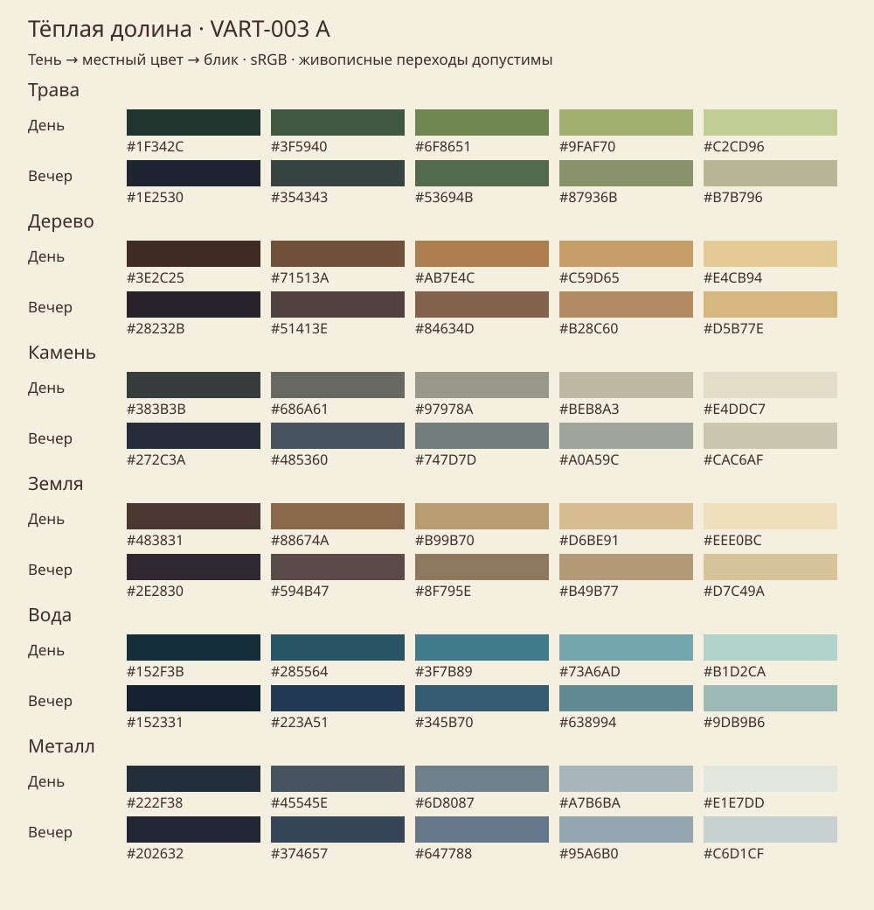
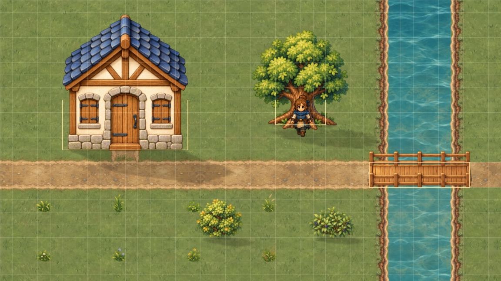
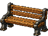
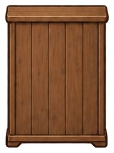
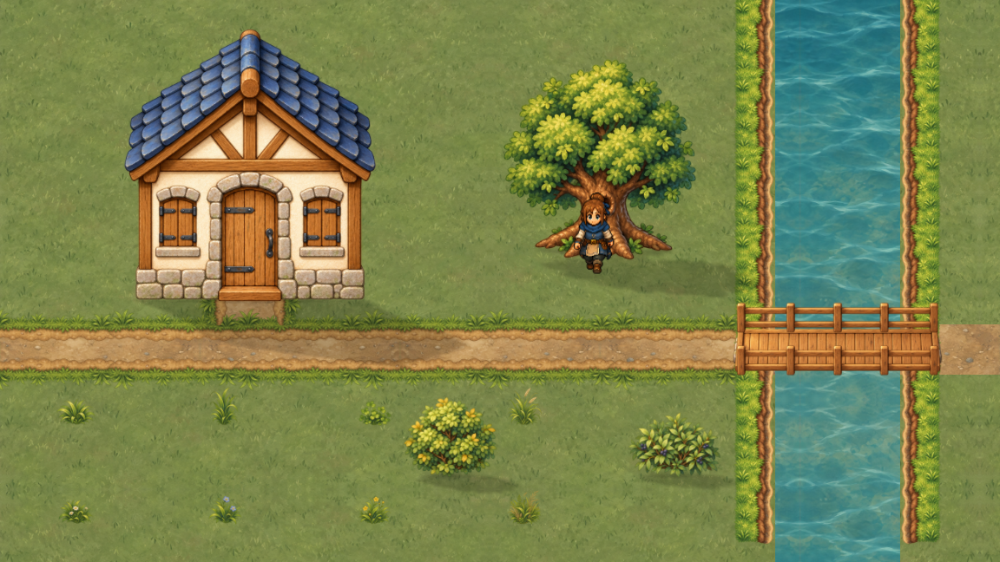
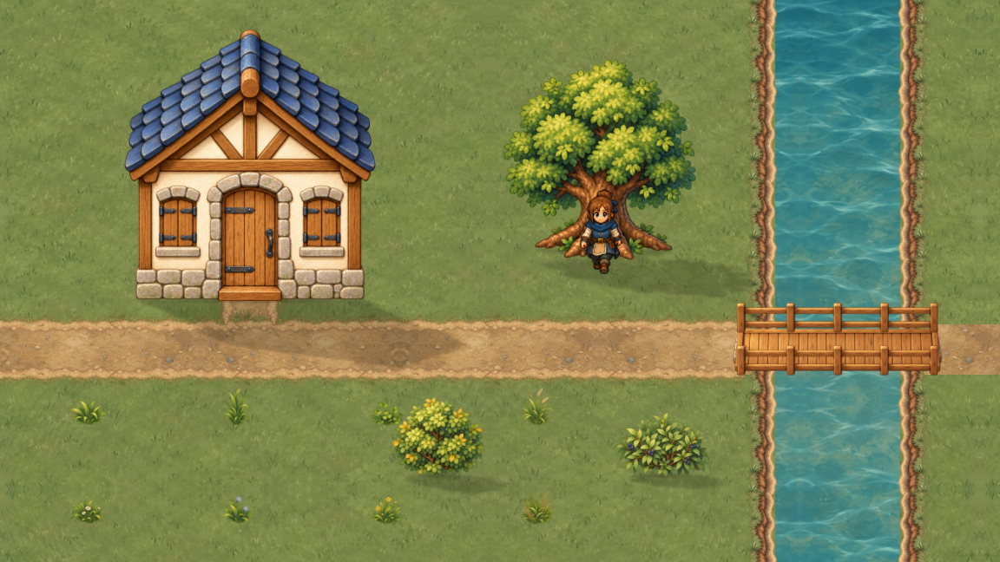
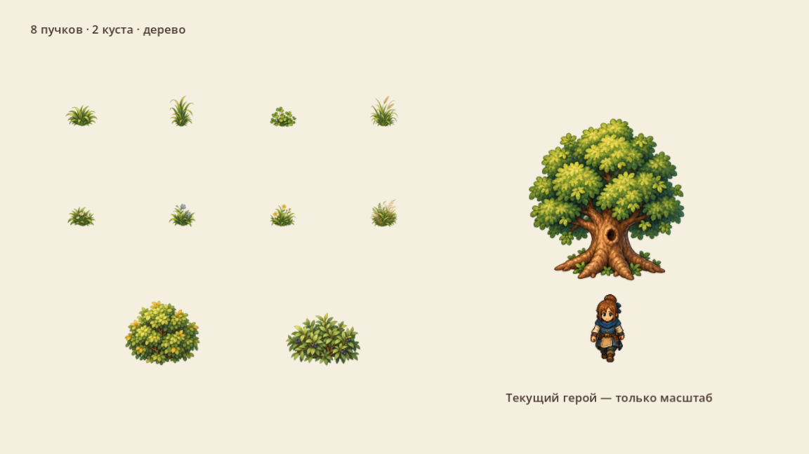
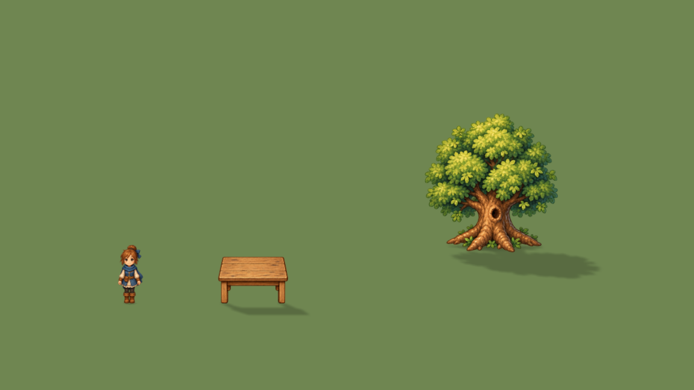
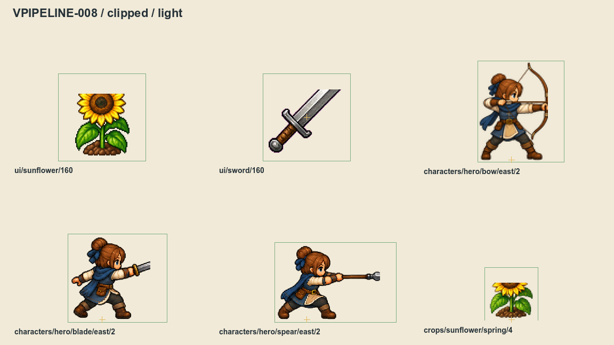
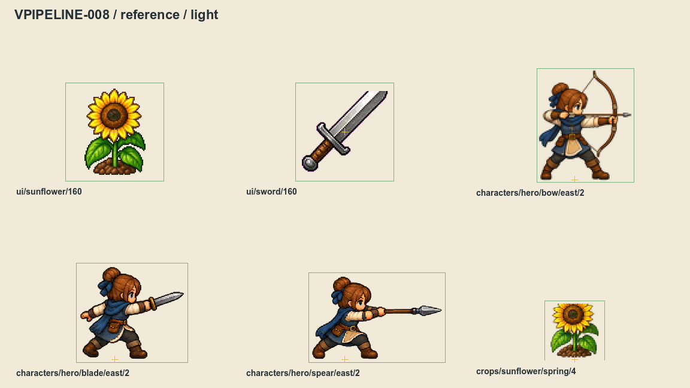

# Пакет художника · первая локация

Собираем первую `overworld` целиком в мягкой живописной 2D-графике. Начинаем с участка 40×24 клетки, затем расширяем его до всей карты. Курс, очередь и условия приёмки — в [маршруте первой локации](visual-pilot.md). Новые механики, интерьеры и другие карты ждут VMAP-003.

Это ориентир композиции, материалов и мягкости. Не заказываем одно большое изображение всей карты: нужны отдельные совместимые модули.

## Уже принято

| Решение | Как рисовать |
|---|---|
| VART-001 A · мягкая живопись | Крупная читаемая форма, мягкие мазки, без пиксельной лестницы |
| VART-003 A · «Тёплая долина» | Шалфейная трава, медовый дуб, тёплая земля, спокойная бирюзовая вода |
| VART-005 A · естественный край | Сглаживание в цвет материала; без общей обводки, белого ореола и размытия всего предмета |
| VART-006 B · ремесленная фактура | Волокна, борозды, листья; конструкция и рабочая сторона важнее мелкого шума |
| VART-007 A · свет сверху-слева | Локальная форма в рисунке; контакт и солнечная тень вправо-вниз отдельно |
| VART-008 · оба дома | Синяя сланцевая и тёплая черепичная крыши сохранены; для первого пилота используем синюю |
| VART-010 B · предметные иконки | Выразительные мазки и выборочные блики, читаемые в 64 и 160 px; весь каталог сейчас не перерисовываем |

## Палитра, которую можно взять в работу

Слева направо: глубокая тень → полутень → местный цвет → свет → блик. Это опорные тона sRGB, между ними допустимы живописные переходы. Не сводить картинку к пяти плоским цветам. Вечерная шкала сохраняет материал, охлаждая тени; отдельную вечернюю копию каждого PNG сейчас не заказываем.

Форма должна различаться и без цвета: у дерева волокна, у камня тяжёлые грани, у воды горизонтальная рябь. [Скачать палитру и правила показа в JSON](../../docs/reports/visual-overhaul/vart-003/palette.json).

## Масштаб и сетка

| Величина | Значение и смысл |
|---|---|
| Базовый игровой кадр | 1152×648 экранных px |
| Мир в этом кадре | 960×540 мировых единиц при приближении 120% |
| Клетка размещения | 24×24 мира → 28,8×28,8 экранных px |
| Кадр нынешнего героя | 96×96 мира → 115,2×115,2 px, включая прозрачные поля |
| Видимый рост контрольной позы | Около 97 экранных px; это ориентир рядом с предметом, не требование обрезать каждый силуэт до 97 |
| HUD и окна | 100%; мировая камера не увеличивает интерфейс |
| Проход двери / ширина моста | Не уже 48 / 96 мировых единиц |
| Фасад / дерево / куст / настил VART-008 | Основания 240×96 / 96×48 / 72×48 / 192×48 мира; разметка макета, не новые коллизии |

Мировой размер, исходные пиксели и твёрдое основание — три разных величины. Например, дерево VART-008 вырезано из области 545×570 исходных px и показано с коэффициентом 0,360225; его рисунок около 196,32×205,33 мира, а основание 96×48. Нельзя растягивать крону до размера коллизии или менять масштаб каждой стороны независимо.

Левая и нижняя границы основания лежат на сетке 24. Нижний центр при нечётном числе клеток может попасть на полуклетку 12 — не округлять его второй раз. У каждой позы сохранять физическую опору стоп/корня. Пиксели мастера выбираются по максимальному экранному показу; увеличенный старый PNG не становится детальнее. Не задаём всем объектам общий квадрат 256×256: точные размеры каждого из 28 образцов есть в [таблице модулей CSV](../../docs/reports/visual-overhaul/vrelease-005/modules.csv).

Проверять 100% как контроль и 120% как игровой масштаб первой карты, затем 1920×1080 и Retina 2304×1296. Не менять камеру между вариантами ради красивого сравнения. [Принятая камера и парные видео](visual-reference-zoom.md).

## Только три стороны предметов

Для лавки, колодца, телеги, мебели и станков: **влево, вправо, вниз к игроку** (`west`, `east`, `south`). Рисовать самостоятельные виды, а не поворачивать весь PNG. Рабочая грань должна читаться по сиденью, дверце, тискам или ручке. Верх столешницы может быть виден в общей камере; это не разрешение на диагональный разворот основания.

Персонажи имеют собственный контракт направлений; правило трёх сторон не удаляет у героя вид вверх. Здание, дерево и покрытие с нейтральным видом не обязаны получать три выдуманные стороны. Старый индекс предмета 2 — алиас переднего вида, не заказ на заднюю стенку.

## Покрытия, берег и слои

Река и маршруты ортогональные. Рисованная кромка может быть неровной: выемки, короткие пучки и земляные пятна скрывают геометрическую границу. Нельзя делать вдоль воды отдельную ярко-зелёную полосу или ровный цветовой разрыв.

Эти два сохранённых статичных макета используют один стенд VART-008, поле 960×540, проекцию 1,2 и кадр 1152×648. Это сравнение художественной правки, а не новой работающей карты. В исходном наборе 28 частей: 8 пучков, 2 куста, дерево, 3 материала, по 4 края тропы и берега, 4 части моста и 2 фасада. Четыре края не заменяют полный набор переходов. Совпадение повторов, Т/крест/тупики, углы, низкий каменный берег и контакт моста принимает VGROUND/VSHORE.

Разделять настил, задние перила и передние перила. Порядок на мосту: вода → настил → задние перила → герой → передние перила. Крона перекрывает героя по положению опоры, а не по верху PNG. Контакт под ножками и корнями хранится отдельно от мягкой солнечной тени; не запекать второй солнечный след на полу.

Ветер, рябь, блики и контактные деформации делает код по отдельным маскам. Художник готовит форму и необходимые слои. Шейдер не исправляет отсутствующий угол берега, диагональный предмет или неправильную походку. Не нарезать сотни кадров воды вместо спокойного эффекта.

## Как сдавать файлы

1. Сохранить редактируемый мастер и сведения об авторе/источнике отдельно от импорта игры. Макеты и мастера — в `docs/design` или папке отчёта под `.gdignore`; рабочий PNG подключает разработчик после приёмки.
2. Экспортировать цвет в PNG RGB/RGBA, 8 бит на канал, sRGB; прозрачность прямая, без premultiply и цветной подложки. Для вырезаемых предметов — RGBA. Размеры целые; не терять ни лист, ни ручку, ни кончик оружия.
3. Отдать таблицу областей `[x,y,w,h]` в исходных px и точку опоры относительно каждой области. Нерегулярный лист не делить на равные ячейки на глаз. Сохранять общий коэффициент масштаба семейства и пропорции.
4. Цветовой standalone: семейство `painted_world`, linear, repeat disabled; lossless, `fix_alpha_border=true`, `premult_alpha=false`. Действующий профиль `color_srgb` по умолчанию без автоматических mipmaps. Особые mip-цепочки стенда VART-008 не переносить в импорт молча.
5. Маски глубины/гибкости сдавать отдельно как `data_rgba8`: линейные числа без sRGB, premultiply, исправления края, уменьшения и mipmaps. У shader sampler цвету нужен `source_color`, данным он запрещён. Числовой канал проверяет разработчик, не только просмотрщик PNG.
6. Не собирать обычный тесный linear-атлас. Запас выбирается по выборке и самому малому показу. Для действующих UI-миниатюр уже принят отдельный пакет 64/32/16/8 с экструзией полного RGBA по 2 px на каждом уровне и без общих аппаратных mipmaps. Это частный UI-контракт, не универсальные «2 px для всего».
7. При заказе иконки дать один мастер, миниатюру 64 и отдельное превью 160. В превью минимум 8 прозрачных px; проверить целый подсолнух и мелкие выступы. Большие превью держатся в ограниченном кеше 16. Всю предметную партию пока не включать в работу первой локации.

Белый ореол проверять на тёмном, светлом и травяном фоне; плотный контур — при реальном показе, не только увеличении. Дополнительно отклонять: растяжение в квадрат, кусок соседа из атласа, дрейф стоп, двойную тень, стоящий на воде предмет, шумную траву, скрывающую лут, и рисунок без происхождения. [Как устроена безопасная выборка](padded-atlases.md) · [Проверка областей и обрезки](sprite-slices.md).

## Паспорт сдачи

Скопировать [пустой шаблон JSON](../../docs/reports/visual-overhaul/vrelease-005/handoff-template.json) и заполнить все поля. [Заполненный пример дерева VART-008](../../docs/reports/visual-overhaul/vrelease-005/handoff-example.json) показывает настоящие область, масштаб, корень и основание. Это паспорт художественной передачи; он не импортируется автоматически в runtime-каталог.

| Поля | Что указать |
|---|---|
| ID, задача, владелец | Существующая карточка и устойчивое имя; прежние игровые ID не переименовывать |
| Источник | Мастер, SHA256, автор/инструмент, условия использования; неизвестные права явно оставить открытыми |
| Решения | Стиль A, палитра A, край A, фактура B, свет A; собственное исключение объяснить |
| Геометрия каждого вида | Исходный PNG/область/опора в px, коэффициент, размер мира, отдельный footprint; без подгонки сторон |
| Слои и назначение | Цвет, контакт, тень, маска; RGB/альфа и единицы каналов данных |
| Экспорт | Фильтр, повтор, mip/padding, варианты качества; отсутствующие качества не выдумывать |
| Потребители | Game/F12/Wiki: путь и состояние «не подключено»/«проверено», а не галочка на будущее |
| Приёмка | Commit, кадр/видео и его SHA256, камера/seed/время/погода/разрешение; дефекты и способ отката |

Проверить комплект до сдачи: все виды на трёх фонах; сетку и опору рядом с героем; стыки и перекрытия с соседями; минимальный и максимальный показ; целые кадры анимации, если она заказана. Для подключения разработчик преобразует паспорт в [действующий каталог ресурсов](visual-resources.md), проверяет импорт, память и ссылки всех потребителей.

## Что принимается отдельно

VRELEASE-005 фиксирует эту инструкцию и воспроизводимый комплект ссылок, а не выпуск новой графики. [Манифест исходных материалов и SHA256](../../docs/reports/visual-overhaul/vrelease-005/references.json) закрепляет Git-основание и точные байты; файлы старых доказательств не переподписаны.

Старый слот остаётся у VCOMPAT-002, обычное включение нового участка — у VRELEASE-003, откат визуальной версии — у VCOMPAT-010. Статика принимается в VRELEASE-002, живой маршрут — в VRELEASE-003, стоимость — в VRELEASE-004; вся первая карта — в VMAP-003. Эти условия остаются открытыми. Текущие живые замеры VCAMERA-006 не укладываются в абсолютный бюджет 60 FPS; разрешение большого мастера нельзя выбирать без последующего бюджета текстур и проверок VPERF.

Для новой партии сравнивать один camera point, позу, время и seed; отдельно записывать загрузку, память и живые замеры без захвата GPU в интервале. Статичный readback или ролик с фиксированными часами не измеряет FPS. Историческая пара source/pack VPIPELINE-010 относится к старой камере 100%, а не к новой живописи при 120%. Проверка старых доказательств не заменяет приёмку новой партии.
