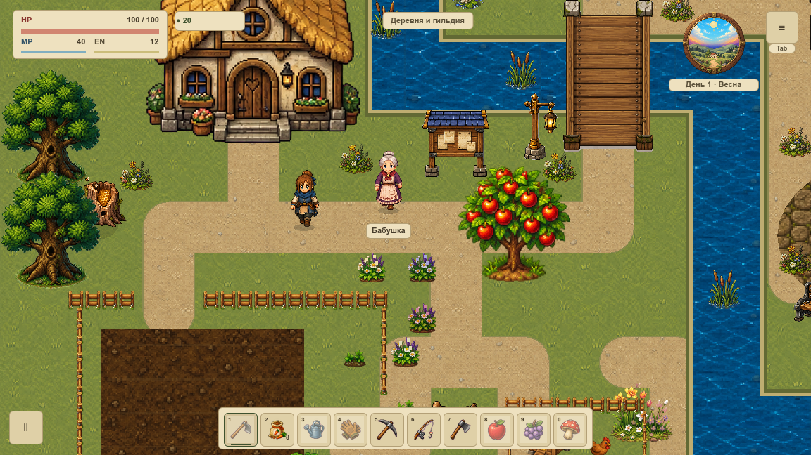

# Происхождение ресурсов, память и проверенный экспорт

VPIPELINE-010 завершает технический аудит подготовки графики. Учтены **2839 production-файлов**, включая 1183 PNG, семь встроенных изображений, звук, шрифт, импорты, уведомления, дескрипторы и корневые изображения приложения. Снимок связан с commit `6ade4a2c` и реальными импортами Godot 4.7.1.

## Полные данные

Теперь таблицы можно скачать прямо из Wiki:

- [Все файлы: CSV](../../docs/reports/visual-overhaul/vpipeline-010/inventory.csv) — путь, SHA, размер, ширина, высота, номинальная память и статус источника.
- [Полный реестр: JSON](../../docs/reports/visual-overhaul/vpipeline-010/inventory.json) — альфа, параметры импорта, доказательства, исходники производных и адресный список неизвестного происхождения.
- [Состав настоящего экспорта: JSON](../../docs/reports/visual-overhaul/vpipeline-010/pack.json) — 3874 записи, 1595 production-ресурсов и их реальные remap/payload.

Это отдельные файлы отчёта. Большая таблица не загружается в игровой процесс и не создаёт тысячи строк интерфейса Wiki при открытии статьи.

## Что означают размеры

| Показатель | Значение |
|---|---:|
| Файлы на диске, включая метаданные и звук | 250,89 MiB |
| Номинальная сумма RGBA8 всех 1190 изображений по путям | 810,74 MiB |
| Та же сумма с однократным учётом одинакового SHA файла | 802,24 MiB |
| Проверенный ZIP Godot | 205,25 MiB |

**810,74 MiB не означает, что игра сейчас занимает столько видеопамяти.** Это стоимость всех перечисленных изображений в условном RGBA8, включая объявленные mip-уровни. Живые загрузки, дополнительные очищенные текстуры, CPU-копии, glyph-атласы, драйвер и framebuffer требуют отдельного измерения. Одинаковые файлы по разным путям также не обязаны делить GPU-объект. Кадры AtlasTexture считаются ссылками на общий backing; семь бинарных ImageTexture учтены отдельно. Для WAV сохранён размер PCM; память шрифта зависит от языка и размеров текста.

Крупнейшие отдельные изображения: старый фон первой локации — 10,99 MiB, деревенский atlas — 8 MiB, защищённая страница миниатюр — 7,06 MiB, исходная страница миниатюр — 6,25 MiB. Размер не доказывает активную загрузку и не разрешает удаление. Резидентность и длительные сессии остаются у OPT-03, OPT-11 и VPERF.

## Что известно о происхождении

Есть документы для 362 файлов с генерацией и 34 звуков с процедурным синтезом. Для 16 картинок обнаружены точные совпадения с локальными исходными наборами; сохранены пути, SHA и уведомления. Девять мостов связаны с их внешним набором и генератором. У шрифта Alice сохранён полный OFL, у Lazy River — уведомление CC0.

**400 прямых изображений пока имеют неустановленное происхождение.** Они перечислены по адресам и SHA в полном реестре. Это адресный долг, который нельзя распространить на новые файлы: новый или изменённый неопознанный рисунок останавливает проверку. Утверждения о документированных источниках тоже привязаны к SHA конкретной картинки — одной замены под прежним именем недостаточно. Готовые превью и атласы наследуют сведения об исходниках; 31 превью с вычисляемым источником имеет fingerprint/provider без выдуманного файлового пути.

Ссылка на сайт условий отличается от сохранённого полного текста лицензии. Запись о генерации также не означает автоматической юридической проверки всех референсов. Инструмент не принимает решение о выпуске: `release_clearance=false` описывает границу аудита, а не запрет каждого файла. Для релиза остаются проверка конкретных внешних пакетов, версии условий и режим экспорта пользовательских ресурсов F12. [Craftpix](https://craftpix.net/file-licenses/), [Lazy River](https://foozlecc.itch.io/critters-lazy-river) и исходный [Alice в Google Fonts](https://github.com/google/fonts/tree/main/ofl/alice) сверены с первичными страницами.

## Экспорт проверен в самой игре

Новый preset собирает ресурсный desktop-пакет. В него входят импортированные игровые ресурсы, JSON-каталоги, опубликованные уровни и TXT-уведомления. Макеты, авторские исходники, архивы, Wiki, инструменты и тесты исключены. Это пакет данных, а не установщик и не решение о публичном релизе.

Проверены все 1190 импортированных изображений: размеры, формат и RGBA до/после совпадают. Дополнительно сняты восемь настоящих GPU-кадров 1152×648: стол на двух фонах и реальные деревня/дом до и после упаковки. Камера, игровые состояния и целые изображения совпали: **0 отличающихся пикселей**.

Это нынешняя графика, сохранённая экспортом. Новый мягкий живописный стиль, тёплая палитра и три стороны предметов продолжают внедряться отдельными партиями.

Пакет запускался из пустой физической папки. Это существенно: рядом с checkout Godot может незаметно подобрать недостающий файл. В намеренно испорченной временной копии удалён payload стола и добавлен ZIP из папки макетов. Проверка состава обнаружила оба нарушения, настоящий загрузчик отклонил недостающую текстуру. Рабочие файлы не портились.

17 сценариев стоимости/источников/ZIP и восемь сценариев порчи нативных доказательств проверяют отказ, даже если повреждённому отчёту пересчитать SHA. Измерений FPS и улучшения долгой сессии этот результат не обещает.

Связанные статьи: [границы исходников](visual-pipeline.md), [паспорта ресурсов](visual-resources.md), [миграция и откат](asset-migration.md), [проверка кадров](sprite-slices.md). Дальнейшее внедрение начинается с ограниченного игрового пилота; родительские OPT-03 и VRELEASE этим аудитом не закрываются.
