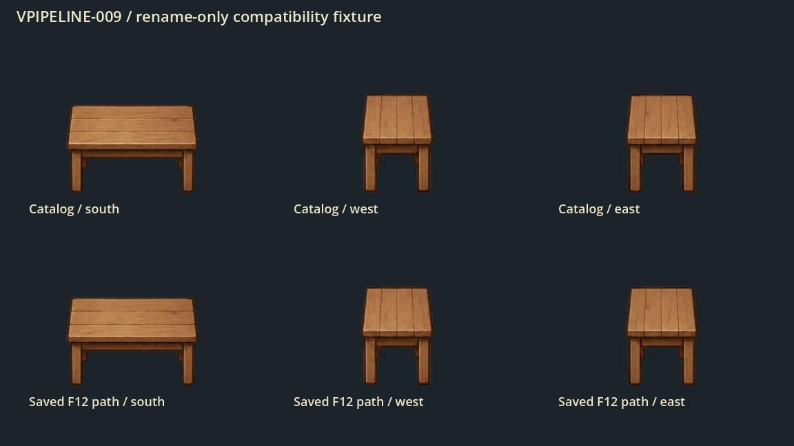
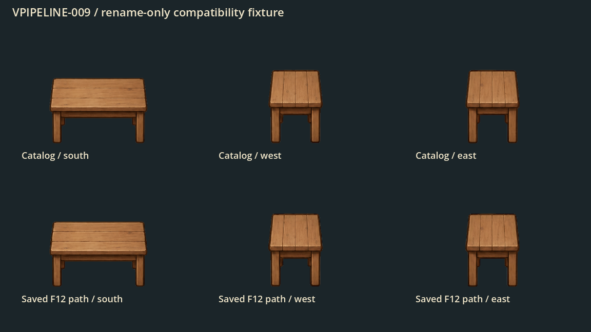
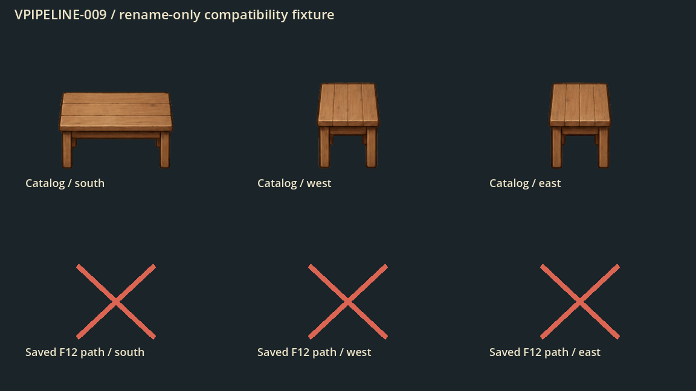
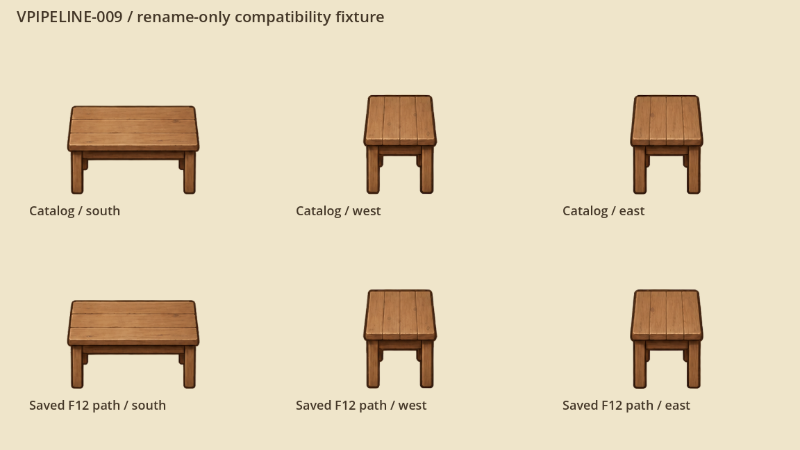

# Безопасный перенос графики: пути, ID и старые уровни

VPIPELINE-009 подготовила порядок миграции и проверила его в отдельной копии проекта. В рабочей игре файлы пока остаются на прежних местах. Новые изображения будут подключаться небольшими партиями под владельцами соответствующих эпиков.

## Почему нельзя просто переименовать PNG

Смысловой ID и путь файла — разные вещи. У дубового стола есть `prop.rustic_table`, у предметов и жителей — свои content ID. Но старый черновик F12 формата v6 сохраняет `asset_path`, область кадра и пользовательскую геометрию. Избранное и некоторые каталоги также используют пути.

Подготовленные иконки сверяют provider, путь, tint и подпись исходника. Переименование без пересборки индекса способно вернуть тяжёлый запасной маршрут вместо готовой миниатюры. Рядом существуют UID Godot, импорты, параметры фильтрации и исторические доказательства. Отсутствие прямой строки в скрипте не означает, что файл можно удалить.

## Проверенный порядок

1. Зафиксировать конкретную партию, её ID, читателей, размеры, UID, области, опоры, коллизии и кадры.
2. Добавить новый runtime-файл рядом со старым; авторский мастер оставить среди исходников. Новый PNG получает собственный UID.
3. Переключить паспорт и всех потребителей, сохранив смысловые ID и три стороны предмета.
4. Пересобрать подготовленные пиксели, миниатюры 64/32/16/8 и крупные превью 160. Сверить новые пути и подписи в индексах.
5. Проверить совместимость старых документов, опубликованных уровней, избранного и undo/redo. Разрешать старый адрес до загрузки текстуры. Для иной геометрии нужен отдельный преобразователь версии с резервной копией.
6. Пересобрать Wiki: игровые статьи, связи, кадры и направления сохраняются.
7. Выполнить проверки, сравнение при одной камере и пробный откат. Память и стоимость кадра измеряются отдельной приёмкой.
8. Удалять прежние файлы отдельным этапом после проверки всех читателей, внешних документов, экспортированного пакета и отката.

В плане есть **29 мировых семейств / 238 деклараций / 236 различных файлов**. У каждого общего файла один ведущий эпик. WATER сохраняет общую геометрию воды; VEDITOR отвечает за редакторские документы, VCOMPAT — старые слоты и откат, OPT-03 — загрузку и память. Один успех стенда не закрывает эти направления.

## Что показал настоящий стенд

Стенд использовал три существующих ракурса дубового стола и настоящие каталог, метаданные и сериализатор F12 из 107 зависимостей. Герой и симуляция не запускались. Верхний ряд ниже — каталог, нижний — специально созданный старый черновик с заметками и коллизиями.

С прототипом адаптера перенос и откат дали **0 отличающихся пикселей** на светлом и тёмном фоне. Все ID, области, опоры, основания и поля документа сохранились. Новые PNG получили отдельные UID, старые UID остались прежними.

Адаптер здесь существует только в диагностической копии. Это пример переименования тех же пикселей; для новой картинки с другими размерами нужна отдельная приёмка геометрии.

Без адаптера все PNG ещё существуют, но три старых пути теряют профиль F12. Верхний ряд прежний, нижний отличается на **36 257 / 34 649 пикселей** в зависимости от фона. Рисунок меняется от фильтра; один удачный поиск файла этого не обнаруживает.

Удаление старых PNG в копии сделало три спрайта недоступными; настоящий валидатор F12 отклонил документ. Красные кресты — намеренный диагностический контроль. В рабочей игре ничего не удалено.

## Граф потребителей и границы проверки

Зафиксированы **2760 runtime-файлов**, **1167 файлов-потребителей** и **14 497 потенциальных связей**. У **127 вычисляемых загрузок** путь требует разбора владельцем. Среди UID импортированных растров из `.import` дубликатов не найдено; UID скриптов и бинарных ресурсов требуют своего разбора. Это не число живых текстур и не измерение FPS. Внешние пользовательские документы и произвольная динамика остаются отдельной приёмкой.

Существующие ворота удаления: VEDITOR-001/002/004/008, VCOMPAT-002/010 и VPIPELINE-010. До их выполнения план не разрешает массовое удаление. Исторический снимок умеет читать прежние байты из Git, поэтому будущие согласованные рисунки не обязаны навсегда сохранять старое содержимое файлов.

`python3 tools/asset_migration.py` проверяет план, полный граф и нативный пакет. 16 сценариев плана/графа и 6 сценариев порчи доказательств проверяют отказ на копиях. Полные машинные данные и методика: `docs/reports/visual-overhaul/vpipeline-009/`.

Связанные основы: [паспорт ресурса](visual-resources.md), [защищённые атласы](padded-atlases.md), [два размера иконок](item-icon-sizes.md), [проверка нарезки](sprite-slices.md). Следующая задача — VPIPELINE-010, происхождение, размеры и оценка памяти файлов.

## Семейства и владельцы перехода

Ниже перечислены направления миграции, а не завершённая замена рисунков. Конкретную партию и её приёмку ведёт указанный владелец; общий файл не мигрируется независимо в двух эпиках.

Исторические названия семейств сохранены. Упоминание четырёх ракурсов описывает прежний набор: новые предметы получают только виды вниз, влево и вправо, без диагонали и глухой задней стороны.

| ID | Семейство | Файлов | Решение VART-009 | Волна | Владельцы |
|---|---|---|---|---|---|
| WS-001 | Первая локация: архивный мастер-арт прототипа | 1 | Сохранить архив | Архив | VPIPELINE |
| WS-002 | Трава и вариации земли | 15 | Перерисовать | Статичная сцена | VGROUND |
| WS-003 | Дороги и тропы | 12 | Перерисовать | Статичная сцена | VGROUND |
| WS-004 | Пол пещеры | 1 | Перерисовать | Статичная сцена | VGROUND, VMAP |
| WS-005 | Вода, рыба и всплески | 22 | Перерисовать | Вода и мосты | VSHORE, VFX |
| WS-006 | Грядки и культуры | 8 | Перерисовать | Растения | VPLANT, VGROUND |
| WS-007 | Мосты | 9 | Перерисовать | Вода и мосты | VPROP, VSHORE |
| WS-008 | Деревья, саженцы и пни | 1 | Перерисовать | Растения | VTREE, VFOLIAGE |
| WS-009 | Заборы, калитки и деревенский декор | 3 | Адаптировать | Предметы и здания | VPROP, VFOLIAGE |
| WS-010 | Камни, кристаллы и пещерный декор | 25 | Адаптировать | Предметы и здания | VPROP, VMAP, VLIGHT |
| WS-011 | Ягоды, грибы, арбузы и плодовые деревья | 5 | Адаптировать | Растения | VPLANT, VTREE |
| WS-012 | Здания внешних локаций | 8 | Адаптировать | Предметы и здания | VBUILD, VLIGHT, VFX |
| WS-013 | Сезонные объекты и Лунная поляна | 16 | Адаптировать | Растения | VTREE, VMAP, VLIGHT |
| WS-014 | Объекты приключенческих биомов | 10 | Адаптировать | Предметы и здания | VPROP, VMAP |
| WS-015 | Случайные контейнеры мира | 8 | Перерисовать | Предметы и здания | VPROP |
| WS-016 | Полировка мира, события и предметы в руке | 17 | Перерисовать | Эффекты | VFX |
| WS-017 | Фермерская жизнь, мебель и музей | 1 | Адаптировать | Предметы и здания | VACTOR, VPROP |
| WS-018 | Герой, NPC и напарники | 14 | Адаптировать | Персонажи и существа | VACTOR, VANIM |
| WS-019 | Мобильные враги и пираты | 8 | Перерисовать | Персонажи и существа | VACTOR, VANIM, VFX |
| WS-020 | Дикие животные | 8 | Адаптировать | Персонажи и существа | VACTOR, VANIM |
| WS-021 | Неподвижные опасные растения | 1 | Адаптировать | Персонажи и существа | VACTOR, VFX |
| WS-022 | Интерьеры, сервисы и домашний сундук | 1 | Адаптировать | Предметы и здания | VPROP, VBUILD |
| WS-023 | Намеренный fallback сюжетного слизня | 4 | Перерисовать | Персонажи и существа | VACTOR, VANIM |
| WS-024 | Модульная игровая деревня: тихие материалы, мосты и отдельные объекты | 11 | Перерисовать | Статичная сцена | VGROUND, VPROP, VSHORE |
| WS-025 | Ремесленная мастерская A: четыре семейства по три уровня | 2 | Адаптировать | Предметы и здания | VBUILD, VPROP |
| WS-026 | Тёплый кирпичный подвал A и десять строящихся личных станков | 12 | Адаптировать | Предметы и здания | VBUILD, VPROP, VSHADOW |
| WS-027 | Личная кухня A: котелок, очаг, светлая домашняя печь и блюда | 3 | Адаптировать | Предметы и здания | VBUILD, VICON, VFX |
| WS-028 | Деревянная пасека A: 3 уровня, дикое гнездо и пчелиное сырьё | 1 | Адаптировать | Предметы и здания | VBUILD, VICON, VFOLIAGE |
| WS-029 | Ремесленные мастерские A: 8 видов × 3 уровня × 4 ракурса, кучи и продукты | 11 | Адаптировать | Предметы и здания | VBUILD, VICON, VSHADOW |
