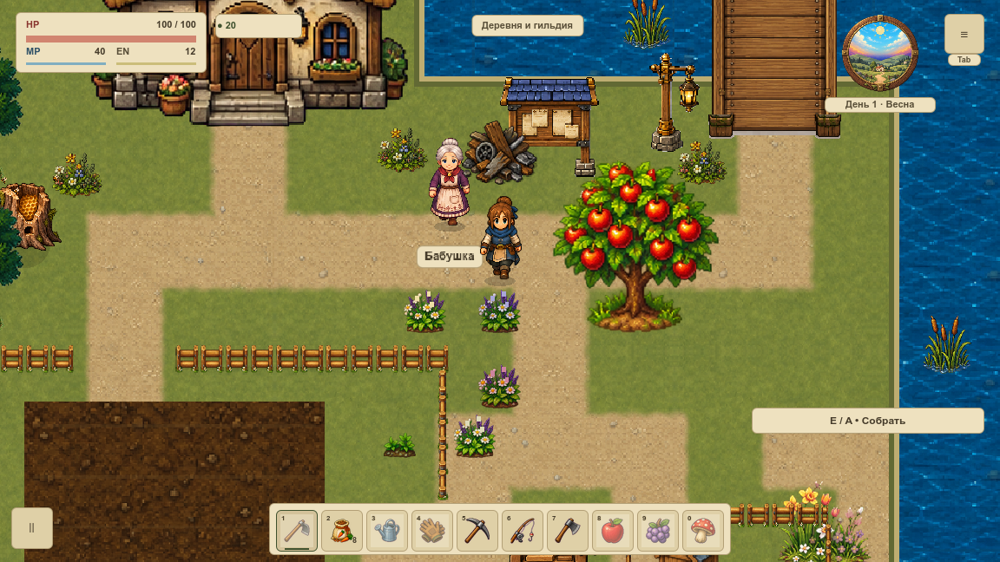
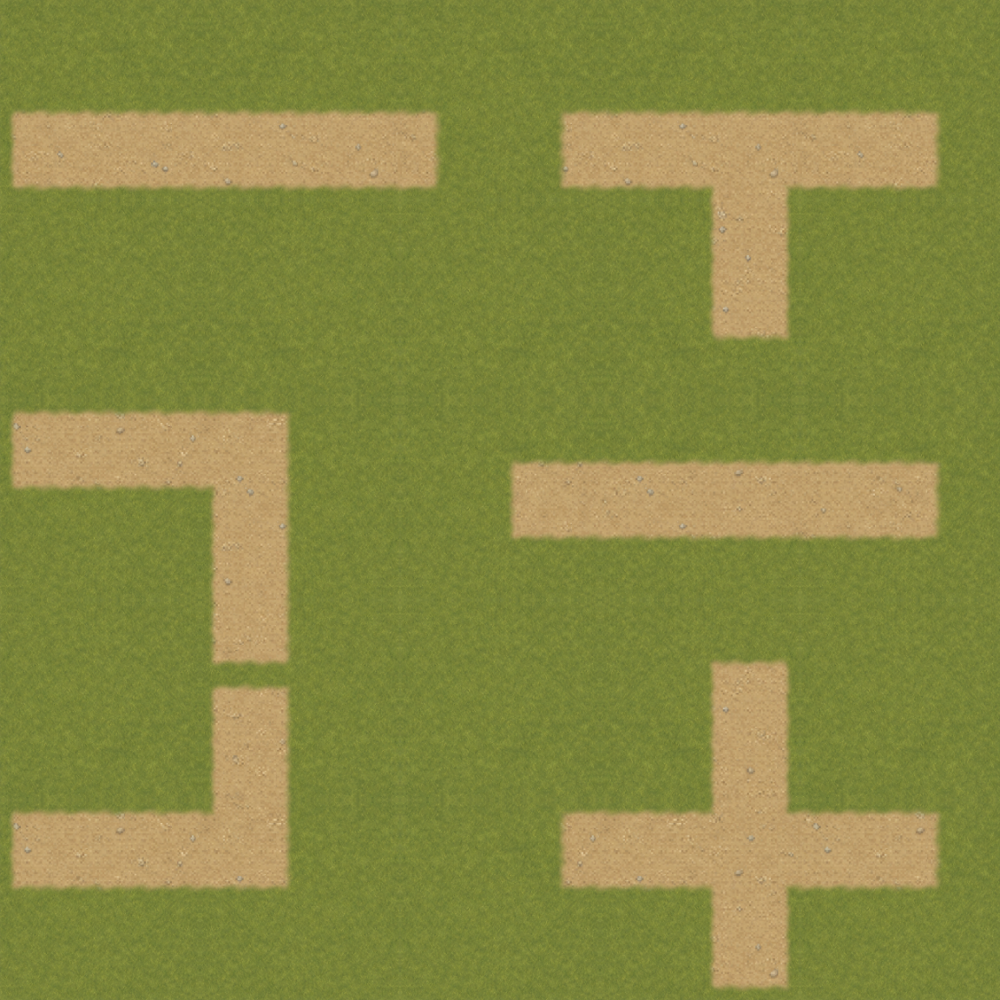
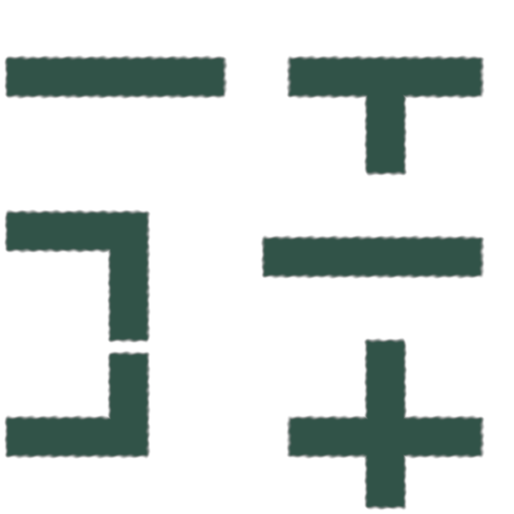

# Осевые дороги без капсул

VGROUND-004 заменила широкие полукруглые окончания дорог первой `overworld` плоскими торцами с небольшим скруглением. [Мягкая кромка](ground-edges.md) сохранена. Оси и концы существующих путей прежние; художественная неровность не управляет движением. [Карточка](#/development/tasks/visual--VGROUND-004) · [Курс первой локации](visual-pilot.md).

## До и после

Коллизии, правила земли и классификация дорог не менялись. В **1 200 точках** навигация и вспашка совпали; восемь диагональных движений у углов обоих мостов дали прежние конечные позиции. Контур внутри прежнего AABB изменился, но новые диагональные проходы не создаются. Другие карты используют прежний renderer.

## Проверка формы

В трёх одинаковых точках новой маски альфа **255/255/255**, прежнего полукруга — **166/255/141**. Это изменение формы, а не дополнительное размытие капсулы. Малое скругление — 4 мира, мягкий переход — 9. В поперечном сечении 11 уровней альфы, max шаг 42/255. При смене материала весь альфа-канал совпал побайтно. Листы сняты на GPU в 1152×1152 при игровом масштабе 120%.

## Кеш и границы приёмки

Две новые готовые маски работают внутри единственного существующего кеша. Новых постоянных узлов, targets или обновлений каждый кадр нет. Прежние ресурсы сохранены; флаг возвращает мягкие капсулы без миграции слотов. Цвет и альфа разделены.

Серия A: **54 нативных PNG / 162 наблюдения draw**, два окна, четыре тона сезона, дождь, оба моста и настоящий вход/выход дома. Холодный первый кадр равен direct эталону, непрозрачный HUD и интерьер точны, полные saves/геометрия/очередь сохранены. За 120 callbacks кеш не перестраивался и его байты не менялись. 24 профильных утверждения и 11 Python-тестов проверяют форму, источники, движение и отрицательные сценарии.

Это **не FPS-замер**: симуляция остановлена, GPU timer — `null`. Объём `.res` не является RSS/VRAM. Новые материалы дороги, берег, снежный набор и вся локация до VMAP-003 ещё не приняты. [Итоги](../../docs/reports/visual-overhaul/vground-004/summary.json) · [Точные исходники и маски](../../docs/reports/visual-overhaul/vground-004/native/source.json) · [120 кадров без перестройки](../../docs/reports/visual-overhaul/vground-004/native/1152/retained.json).
