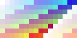
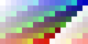

# Цвет рисунка и числа для шейдеров

VPIPELINE-005 добавила явное разделение рисунков и числовых масок. Это основа будущих воды, берегов, изгиба травы и света: значение глубины или гибкости должно доходить до шейдера с тем же смыслом, с которым оно было подготовлено.

## Зачем разделять

У рисунка RGB описывает цвет. У маски это могут быть глубина воды, сила изгиба, влажность или вес эффекта. Например, середина диапазона — `128/255 ≈ 0,502`. Если прочитать такое число как цвет sRGB на линейном HDR-полотне, получится примерно `0,216`. Берег и растительность тогда будут реагировать на другую величину.

В паспорте теперь есть два назначения:

| Назначение | Что хранится | `source_color` в шейдере |
|---|---|---|
| `color_srgb` | Рисунок, цвет поверхности | Обязателен |
| `data_rgba8` | Четыре числовых канала | Запрещён |

Назначение и фильтр — разные решения. Linear сглаживает выборку между соседними texel; `source_color` определяет цветовое преобразование RGB. Правильный nearest не спасает от ошибочного преобразования числа.

## Как защищён импорт

Числовой профиль сохраняет lossless RGBA8 без изменения каналов, premultiply, исправления прозрачного края, normal-map преобразования, уменьшения и автоматических mipmaps. Скрытый RGB под нулевой альфой также считается данными. У цветового пилота сохранена прежняя подготовка края, полезная для рисунка.

Фабрика материала проверяет назначение каждой текстуры до создания материала. Она требует явный фильтр и запрет повторения, обнаруживает пропуски и лишние привязки. Сейчас поддержан ограниченный явный синтаксис `canvas_item`; неподдерживаемые объявления и директивы препроцессора получают отказ. Материал создаётся владельцем один раз, а не заново на каждом кадре. Изображения не копируются ради смены роли.

## Что проверено на видеокарте

Две контрольные маски 16×8 прошли настоящий импорт Godot, затем каждый texel прочитан шейдером. Проверены все четыре канала, включая прозрачность. Стенд работает отдельно от игры и сохранений.

| Проверка | Результат |
|---|---|
| RGBA после импорта | Каждый байт совпал с исходником |
| Compatibility и Mobile без HDR | Числа совпали с точностью readback |
| Mobile HDR | Ошибка правильных масок меньше 0,0005 |
| Намеренно ошибочный `source_color` в HDR | Искажение до 0,287 |
| Намеренно включённое исправление прозрачного края | Изменились 30 скрытых RGB-байт |

Ниже — **диагностические маски**, не новый художественный вид воды. Их цвет показывает значения разных каналов. Первая прочитана правильно; вторая намеренно проходит ошибочное цветовое преобразование. В обычном LDR эта ошибка незаметна, поэтому проверен и HDR.

HDR хранит результат в half-float: побайтовая точность требуется от импорта RGBA8, а выборка имеет отдельный малый числовой допуск. Альфа проверяется независимо от приближённого декодирования sRGB на GPU.

## Подключение к игре и следующим задачам

Три ракурса действующего дубового стола получили явную цветовую роль. Полный нативный кадр комнаты и сериализуемое состояние до/после изменений совпали. Художественные PNG, размеры, опоры, фильтры, инвентарь и сохранения остались прежними.

Готовых игровых масок глубины и гибкости пока нет. WATER/VSHORE и VFOLIAGE будут создавать свои изображения и эффекты по этому контракту; VLIGHT и погода смогут использовать те же правила. Вся игра на другой рендерер или HDR этой задачей не переключается.

`python3 tools/texture_intents.py` проверяет политику, настоящий импорт, все сохранённые значения GPU и кадр комнаты. Отдельные тесты намеренно портят копии ресурсов и доказательств; обновление контрольной суммы не скрывает неверные пиксели. Подробные числовые результаты и журналы сохранены в репозитории: `docs/reports/visual-overhaul/vpipeline-005/`.

Предыдущие основы: [паспорт рисунка](visual-resources.md), [адресная фильтрация](visual-sampling.md), [поля атласов](padded-atlases.md). Задача и её зависимости доступны в меню «Разработка → Задачи», поиск `VPIPELINE-005`.

Техническое основание: [Godot: source_color](https://docs.godotengine.org/en/stable/tutorials/shaders/shader_reference/shading_language.html#using-source-color), [HDR 2D](https://docs.godotengine.org/en/stable/classes/class_viewport.html#class-viewport-property-use-hdr-2d), [импорт текстур](https://docs.godotengine.org/en/stable/classes/class_resourceimportertexture.html).

## Повторить проверку

Создать новый отдельный проект: `python3 tools/texture_intents.py --fixtures /private/tmp/vpipeline005-fresh`. Затем импортировать его через Godot: `--headless --editor --path /private/tmp/vpipeline005-fresh --import`. Рабочий игровой проект для этого не используется.

Запустить `--path /private/tmp/vpipeline005-fresh --script res://probe.gd` в трёх конфигурациях:

| Имя результата | Метод и драйвер | `VTEXTURE_HDR` |
|---|---|---|
| `compatibility` | `--rendering-method gl_compatibility --rendering-driver opengl3` | `0` |
| `mobile-ldr` | `--rendering-method mobile --rendering-driver vulkan` | `0` |
| `mobile-hdr` | `--rendering-method mobile --rendering-driver vulkan` | `1` |

Для каждого запуска `VTEXTURE_OUTPUT` указывает новый одноимённый подкаталог проекта. Вывод сохраняется в `compatibility.log`, `mobile-ldr.log`, `mobile-hdr.log` рядом с ними. Существующие результаты не перезаписываются. Godot должен работать с настоящей видеокартой.

Числовые пределы: LDR — `0,0000002`; HDR для правильных данных и любой альфы — `0,0005`; отдельный sRGB-декодер GPU сравнивается с точной формулой в пределах `0,0025`. Последний допуск не распространяется на числовые маски. У текущей видеокарты отклонение преобразованного цвета достигло `0,001912214`, а исходный RGBA8 после импорта остался побайтово точным.

`python3 tools/test_texture_intents.py` запускает 12 отрицательных сценариев на отдельных копиях. `tools/texture_intent_review.gd` проверяет 40 правил в Godot; тот же suite входит в полный игровой набор. Проверяется и невозможность скрыть sampler за макросом. Откат — обычный revert задачи без преобразования сохранений.
