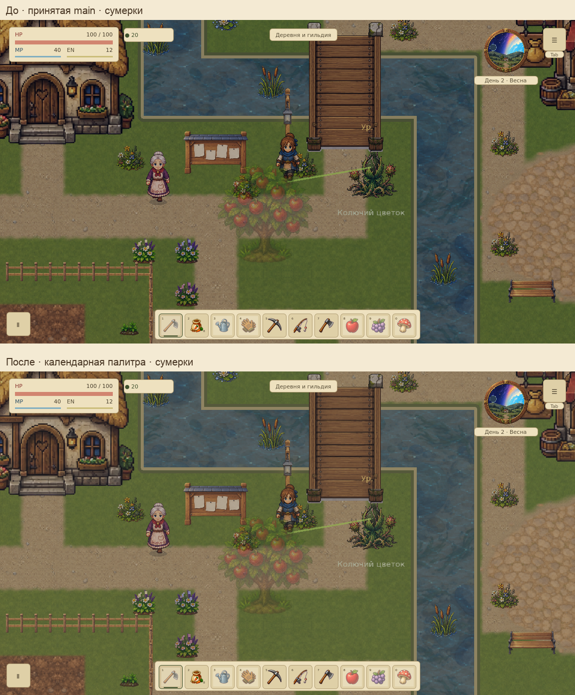
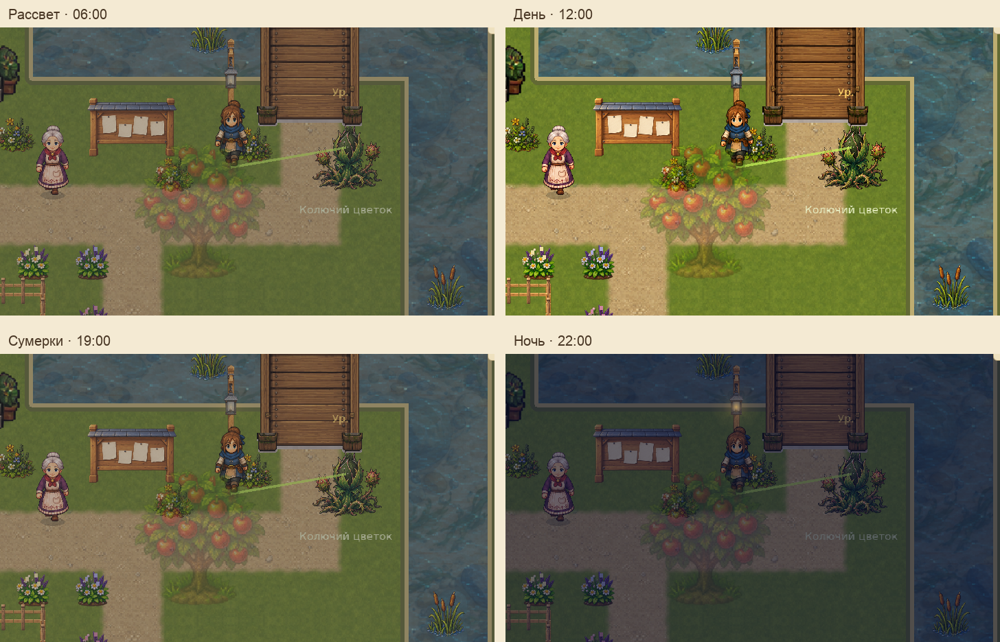
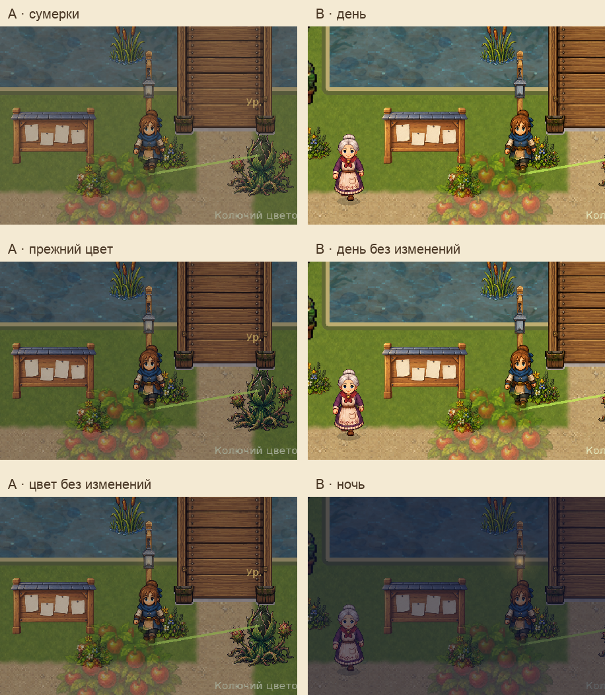

# День и сумерки

Первая деревня получает мягкий переход от ночи к дню и обратно: небольшой тёплый
оттенок внутри рассвета и сумерек. Числовое время в HUD не возвращается.
VLIGHT-003 принята 21 ноября 2026 в
[PR №82](https://github.com/sergey-leonidovich-shevchenko/babushkina-ferma/pull/82):
независимое ревью точного head abb32457, все10 CI checks и решение Team Lead.
[Запись приёмки](../../docs/reports/visual-overhaul/vlight-003/closeout/result.json)
сохраняет SHA, родителей merge, исходные проверки и границы решения.

[Карточка VLIGHT-003](#/development/tasks/visual--VLIGHT-003) ·
[Первый живописный участок](visual-pilot.md) ·
[Инвентарь света](light-inventory.md) ·
[Метод фонаря](lantern-light-methods.md)

## До и после

Одна камера, seed и масштаб120%. Верхний кадр — принятая main c1f2eda0,
нижний — реализация1abc82b2. Это настоящий игровой root с обычным HUD.
Подписи находятся за пределами кадра; native-пиксели не перекрашивались и не масштабировались.

Изменение намеренно небольшое: база графики сохраняется, переход становится плавным.
Используются дробные игровые минуты и один цветной прямоугольник поверх мира перед
HUD. Новых часов, текстур, узлов света и растущих кешей не добавлено.

## Четыре фазы

Дневной и ночной endpoints совпадают с прежними. Меняется только первая
`overworld` на рассвете и в сумерках. Комната, рынок, затмение, геометрия и игровые
события сохраняются. Часы в подписях листа относятся к отчёту, а не к игровому интерфейсу.

## Независимые миры

Переключение первого мира на прежний цвет не меняет второй. Смена времени второго
не влияет на первый. Снимки полных сохранений и геометрии остаются неизменными от draw.
Legacy — временный флаг одного canvas; он не сохраняется в пользовательских настройках.

## Что проверено

Успешный CI3 на официальном Godot4.7.1, X11/Compatibility и llvmpipe сохранил
222 исходных PNG,256 артефактов и34 QA-входа. Два размера окна —1152×648 и1280×720.
Legacy совпадает со старой main во всех десяти случаях обоих окон. HUD дополнительно
сравнен со старым кадром при тех же часах; герой и угроза имеют отдельные native
контроли без одного объекта. Настоящее перекрашивание HUD отвергается reader.

[Исходная запись до ревью и границы](../../docs/reports/visual-overhaul/vlight-003/acceptance.json) ·
[Исходный manifest](../../docs/reports/visual-overhaul/vlight-003/native/source.json) ·
[Происхождение всех 12 native-вставок](../../docs/reports/visual-overhaul/vlight-003/gallery.json)

Полный парный опыт проверил три переподписанных дефекта timing-контекста.
Старая функция timing их принимала, новый reader отклонил каждый; неизменённый
реальный пакет прошёл. Использована историческая функция d5 в общем полном
verifier с исправленной P1 closure, а не весь старый head с другим manifest.

[Парный протокол P2](../../docs/reports/visual-overhaul/vlight-003/review-regressions.json)

## Затраты и ограничения

Сохранены2160 сырых samples: три чередующихся повтора,20 warm-up и60 измеряемых
redraw каждого режима. В1152 median CPU всего production draw —2.994мс против
2.987мс legacy; в1280 —3.043мс против3.146мс. Разница мала относительно разброса
серии и не объявляется изолированным ускорением эффекта. Reference выключает
прежний набор FX целиком. Драйвер предупреждает о неподдерживаемой смене VSync.

[Все исходные samples CSV](../../docs/reports/visual-overhaul/vlight-003/samples.csv) ·
[Медианы, p95 и повторения](../../docs/reports/visual-overhaul/vlight-003/metrics.json)

Это фиксированная сцена с остановленной симуляцией и software renderer. GPU,
аппаратный FPS, Retina, долгая сессия и вся первая локация этим опытом не принимаются.
Принята ограниченная палитра первой деревни; VMAP-003 ещё впереди.
Отдельный учёт получает собственные проверки, CI, независимое ревью и решение
Team Lead. Результаты реализации не заменяют проверок учётного PR.

## Сохранённая диагностика

[CI1: отсутствующий в Git UID](../../docs/reports/visual-overhaul/vlight-003/failures/ci-01.json) ·
[CI2: runtime-тип массива](../../docs/reports/visual-overhaul/vlight-003/failures/ci-02.json) ·
[Headless18/0 модели и реального dispatch](../../docs/reports/visual-overhaul/vlight-003/dispatch-review.json) ·
[Методика до реализации](https://github.com/sergey-leonidovich-shevchenko/babushkina-ferma/blob/d5cd791284e2a516b46ee7ca1eba085277f98f90/docs/reports/visual-overhaul/vlight-003/PLAN.md)
