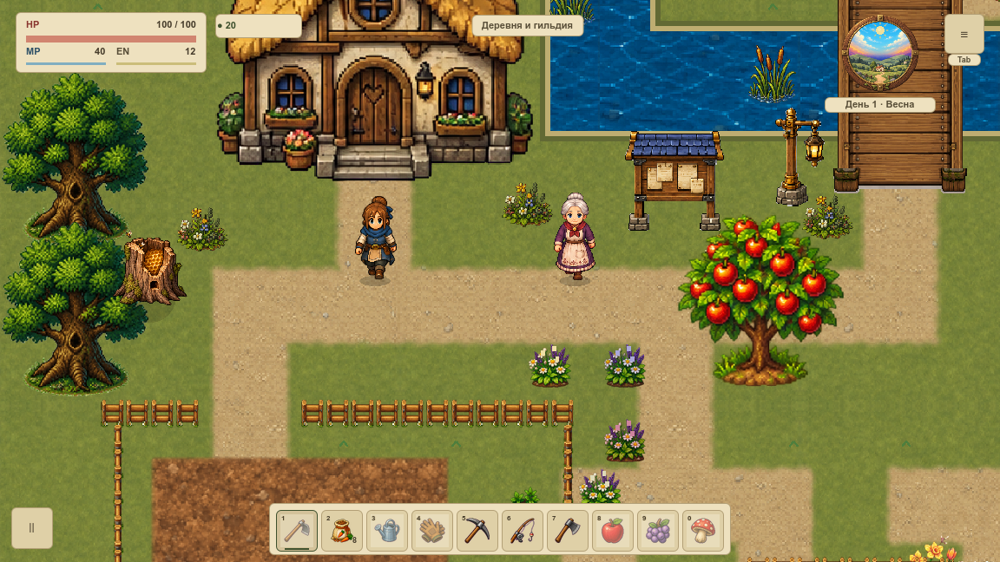
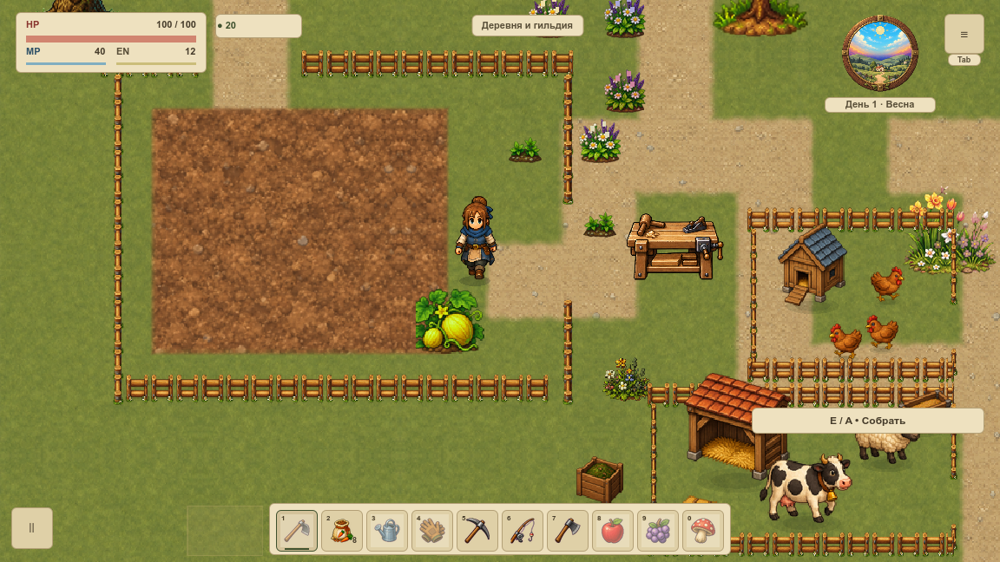

# Декор и свободные проходы

VGROUND-008 ограничивает запасной процедурный посев первой `overworld`. Трава не должна закрывать двери, служебные подходы, грядки, воду, мосты и ручные элементы. [Карточка](#/development/tasks/visual--VGROUND-008) · [Курс первой локации](visual-pilot.md).

Важная граница: в обычной первой сцене цветы и акценты уже расставлены вручную. Старый процедурный посев сейчас не вызывается. Эта задача защищает запасной метод и задаёт общий ограничитель для будущих размещений; она не добавляет в деревню новую траву.

## Диагностическое сравнение

Это диагностические кадры, а не изменение плотности обычной сцены. Камера, герой и состояние мира одинаковые. Из 286 прежних травинок приняты 86; 200 пересекают защищённые области. Ограничитель читает существующую геометрию, включая 161 прямоугольную зону и точные многоугольники реки и пруда.

## Что защищено

Проверяется весь след спрайта с запасом 4 мировые единицы. Поэтому травинка рядом с разрешённым центром тоже отклоняется, если её край задевает дорогу или соседний объект. Вода проверяется точным пересечением: сухие четыре угла ещё не означают, что середина не пересекает реку. Проходимый настил моста остаётся запретным для посева.

Ручные цветы, предметы, фасады, огород, загоны и служебные подходы получают приоритет. Дополнительные ручные прямоугольники передаются вызывающим кодом: автоматическая поддержка произвольного документа F12 здесь не заявлена. Другие карты не изменены.

План ограничен 512 кандидатами и 512 дополнительными ручными зонами; повреждённые записи отклоняются. Встроенный план вычисляется один раз и возвращается копией. Кадры, сезоны и погода не увеличивают кеш, генератор случайных чисел не используется. Ограничитель не создаёт коллизий, таймеров или узлов.

## Проверки и границы

47 профильных утверждений: целые следы у дверей, служб, грядок, воды и мостов, ручной приоритет, границы, испорченные данные, ограниченность, независимость кеша, полный save, 1 200 правил земли и восемь движений у мостов. 10 Python-тестов проверяют поломанные метаданные, изменённый пиксель обычной сцены, ложный FPS и повреждение источников.

Нативная серия: 108 PNG / 416 наблюдений настоящего draw в двух окнах при 120%. По 10 ясным случаям штатные кадры до/после совпадают точно; прозрачный лист проверяет сохранность всех разрешённых травинок и удаление запрещённых. Четыре сезона, дорожный поворот и тупик, службы, огород, оба моста, вход в дом и возврат представлены отдельно.

Дождь движется по системным часам при остановленной симуляции. Его кадры проверяют полные состояния и геометрию, но равенство пикселей дождя не заявляется. Полная первая серия сохранена с этим явно ограниченным протоколом. Дождь продолжается также в её кадрах дома и возврата; эти три случая не принимают равенство пикселей. Два незавершённых повторных процесса не приняты.

Это статическая проверка, не FPS, RSS или VRAM. Обычное окно Godot сохраняется; сосуществование записано явно. VPERF и итог всей карты VMAP-003 остаются открытыми. Откат — возврат прежнего вызова запасного метода; сохранения не мигрируются.

[Результаты](../../docs/reports/visual-overhaul/vground-008/summary.json) · [Точные источники](../../docs/reports/visual-overhaul/vground-008/native/source.json) · [Координаты и решения посева](../../docs/reports/visual-overhaul/vground-008/native/1152/policy.json).
