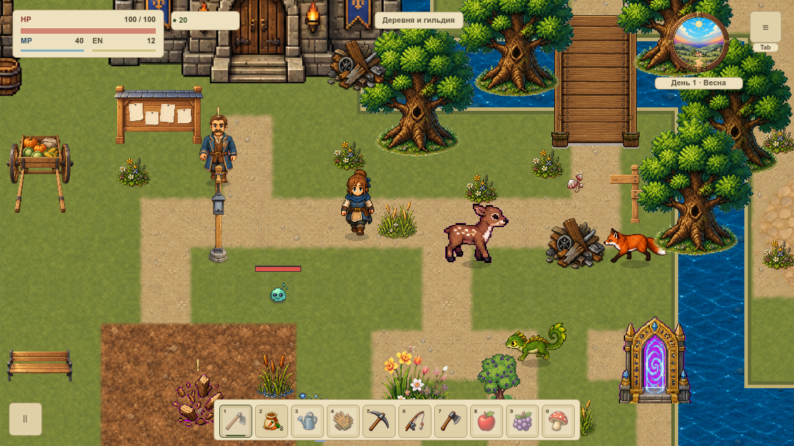
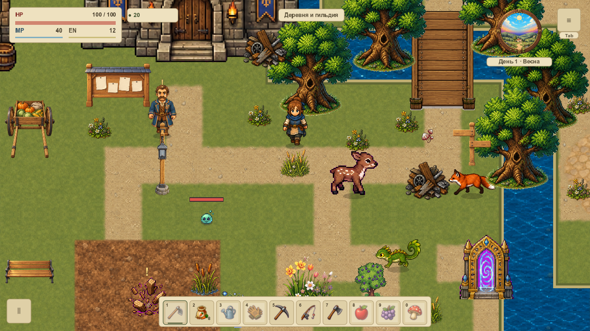
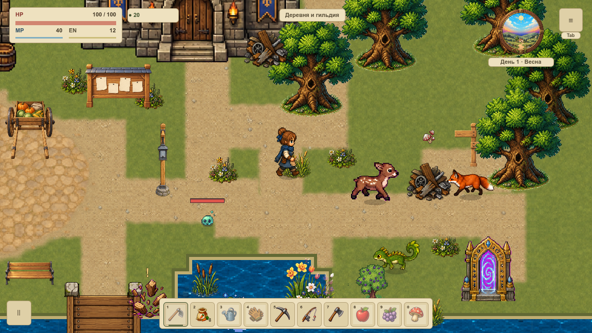

# Трава отклоняется от героя

VFOLIAGE-004 добавляет мягкую реакцию восьми существующих пучков травы и камыша первой карты. Растение отклоняется от видимой стопы, а его корень остаётся на месте. Ветер продолжает работать поверх этой реакции.

[Карточка VFOLIAGE-004](#/development/tasks/visual--VFOLIAGE-004) · [Первая локация](visual-pilot.md) · [Фоновый ветер](foliage-wind.md).

## Четыре стороны и точный центр

Реакция начинается в радиусе 36 мировых единиц. Она плавно усиливается и снова ослабевает при приближении точно к корню. В самом центре отклонение равно нулю: нет случайного направления, деления на ноль или перелома при переходе на другую сторону. Максимум реакции — меньше 2,3 единицы, вместе с ветром — меньше 3,65; нижняя полоса закреплена.

Это контролируемые нативные выборки позы, сохранённые без потерь в APNG. Повтор демонстрации возвращает героя к началу прохода; в самой игре такого сброса нет. Частота демонстрации не является измерением FPS или физической клавиатуры.

## Стопа совпадает с изображением

Реакция берёт окончательную позицию после коллизий и ту же отображаемую стопу, что персонаж. Между физическими тактами герой и растение используют одну интерполированную позу. При упоре в стену растение не реагирует на желаемое движение за препятствие.

Пауза замораживает текущую реакцию. Телепорт, устаревший физический кадр, другая карта, low, reduced motion и эталонный режим очищают её. При возвращении из-за экрана старый буфер явно обновляется, даже если часы не продвинулись. Отдельный технический флаг контакта позволяет оставить только ветер. Нового меню качества нет.

Остаются один владелец, один ограниченный target и две группы. Геометрия и список растений не пересобираются при движении. Меняется только небольшой числовой буфер контакта; мировые координаты не упаковываются в неточные цветовые каналы. Разная сила от шага и бега относится к VFOLIAGE-005, мягкое восстановление после выхода — к VFOLIAGE-006.

## Проверка

Проверены 178 нативных случаев двух окон: четыре стороны, точный центр, остановка, интерполяция, пауза, стена, offscreen, fallback и штатный QA-телепорт. GPU побайтно совпал с независимой CPU-геометрией. Есть 108 положительных и 52 нулевых on/off-контроля, 1424 точные нижние полосы, 700 игровых callback и 1400 сигналов групп. В каждом draw сохраняемый snapshot одинаков до и после.

Профиль проверяет 1189 условий; 20 отрицательных сценариев ловят неверные индексы, направление, NaN, изменённый пиксель/корень, потерю кадров и ложную приёмку. На headless нельзя проверить GPU-атрибуты: их точные индексы отдельно прочитаны в нативной серии. Это не приёмка FPS, всей растительности или VMAP-003.

[Нативная сводка](../../docs/reports/visual-overhaul/vfoliage-004/summary.json) · [Изменённые исходники](../../docs/reports/visual-overhaul/vfoliage-004/changes.json) · [Условия приёмки](../../docs/reports/visual-overhaul/vfoliage-004/native-admission.json).
