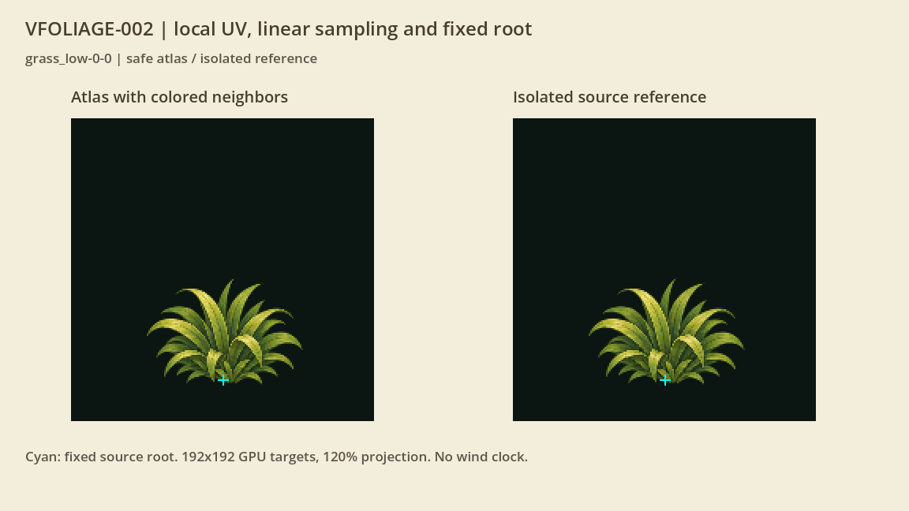
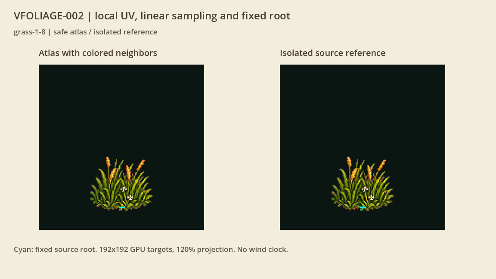
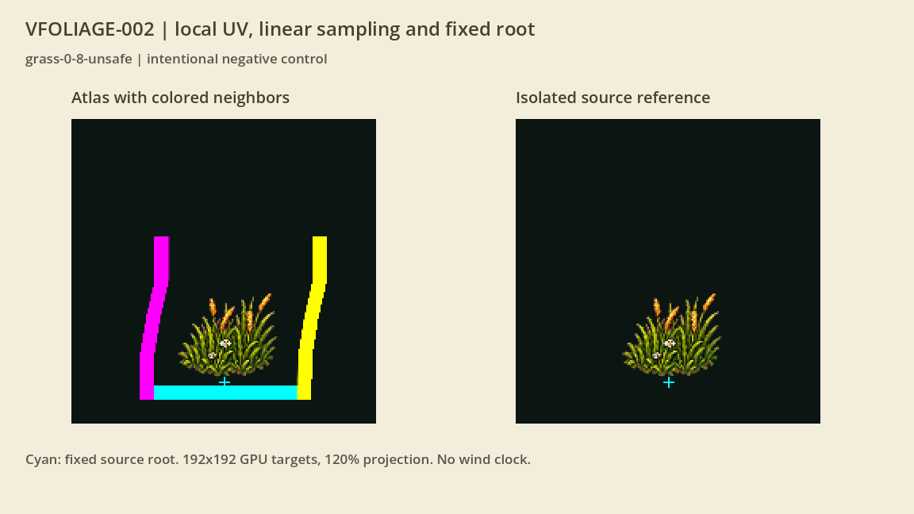

# Локальные UV растений

VFOLIAGE-002 подготовила отдельный материал и сетку для каждого растения. UV — координаты выборки внутри его картинки. Они остаются локальными, а shader переводит их в нужную ячейку атласа. Это следующий шаг после [реальных опор](foliage-roots.md), перед подключением ветра. [Карточка](#/development/tasks/visual--VFOLIAGE-002) · [Курс первой локации](visual-pilot.md).

## Край не захватывает соседей

Выборка ограничена центрами крайних пикселей своей ячейки. Линейный фильтр не подмешивает соседний рисунок, включая проверочную деформацию и выход UV за область. Слева на витрине — выборка из большого атласа с яркими соседями, справа — отдельная исходная картинка.

Отражается только горизонталь. Вертикальная координата корня и нижние ряды сетки сохраняются, поэтому закреплённое основание остаётся внизу. У жёстких и плавающих объектов изгиб выключен. Каждый материал хранит собственную область и параметры; другие материалы или viewport их не перезаписывают.

## Проверка должна замечать ошибку

На следующем кадре намеренно неверный shader лишён ограничения области. Появившиеся яркие участки — захваченные соседи. Это отрицательный контроль стенда, он не подключается в обычную игру.

Проверены все 13 профилей, два отражения и три статических воздействия: **156 корректных GPU-троек и 4 ошибочных**. Основная пара на одинаковой сетке допускает максимум 1/255 RGBA; независимый геометрический эталон отражения — 2/255. Нижняя закреплённая полоса остаётся побайтно одинаковой. Ошибочный контроль даёт до 244/255 различия, поэтому не может незаметно пройти.

Серия содержит 480 target PNG, 960 реальных callback mesh, по 320 игровых и витринных callback. Тестовые узлы каждого viewport возвращаются к нулю; полный игровой snapshot сохраняется. Профиль прошёл 413 условий, Python — 21 сценарий. Фокус записан честно: статический протокол не принимает физический ввод или FPS.

Это готовые данные и материал для последующего подключения. По умолчанию воздействие нулевое, часов ветра нет. Обычный renderer, игровые PNG, механики и сохранения сохраняют текущий путь. Ветер относится к VFOLIAGE-003; вся первая карта — к VMAP-003. Mipmap-минификация атласа требует отдельной подготовки, здесь проверен линейный фильтр без mipmaps.

[Нативная сводка](../../docs/reports/visual-overhaul/vfoliage-002/summary.json) · [Параметры и shader](../../docs/reports/visual-overhaul/vfoliage-002/changes.json) · [Условия GPU-проверки](../../docs/reports/visual-overhaul/vfoliage-002/native-admission.json).
