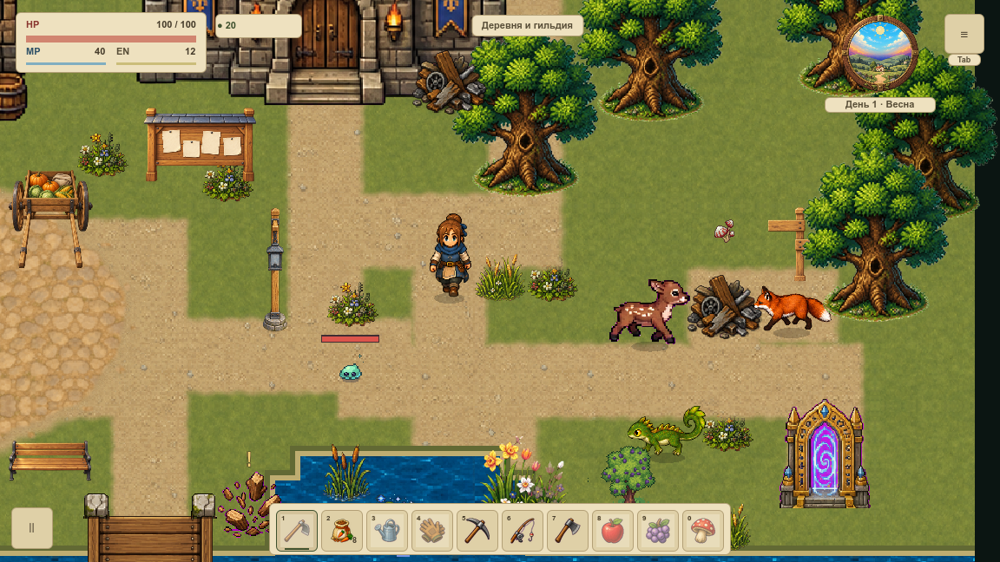
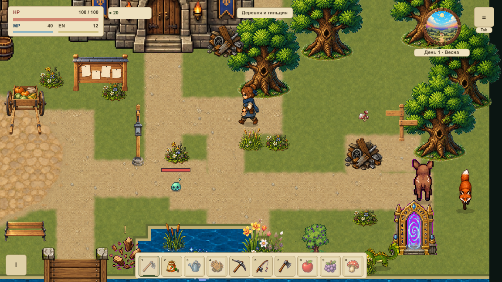

# Трава мягко выпрямляется после прохода

VFOLIAGE-006 добавляет короткое плавное восстановление восьми существующих пучков травы и камыша. После выхода героя из радиуса контакта растение постепенно возвращается к обычному ветру; основания остаются на месте.

[Карточка VFOLIAGE-006](#/development/tasks/visual--VFOLIAGE-006) · [Первая локация](visual-pilot.md) · [Сила шага и бега](foliage-speed.md).

Реализация проверена в ветке задачи. [PR #1](https://github.com/sergey-leonidovich-shevchenko/babushkina-ferma/pull/1) ожидает ревью Tech Lead Agent и решения Team Lead Agent; в `main` задача ещё не перенесена.

## Проход и возвращение

Усиленный проход с существующим эффектом скорости:

Обычный проход через тот же пучок по вертикали:

Это нативные кадры Godot с фиксированной камерой и настоящими вызовами игрового физического цикла. Время между отсчётами в анимации соответствует времени симуляции; последний кадр задержан на 350 мс перед повтором. Героя возвращают в начало только в QA-стенде. Это не запись физической клавиатуры и не измерение FPS.

## Мягкость без накопления состояния

Нарастание имеет постоянную времени 0,08 с, восстановление — 0,18 с. Аналитическая экспонента не перелетает через цель и даёт одинаковое затухание при 30, 60 и 120 Гц. В конце записи удаляются при отклонении не больше 0,005 мировой единицы — менее 0,006 логического пикселя при принятом масштабе 120%.

Эффект хранит только числовые векторы в одном владельце. Предел — 64 записи; подключено восемь прежних размещений. Сохраняются один target и две группы, геометрия не пересобирается. Общий предел контакта меньше 4,36, вместе с ветром меньше 5,71 мировой единицы. Это проверка ограниченности ресурсов, не замер быстродействия всей карты.

Пауза замораживает текущий изгиб и часы без долга. Повторный draw одного такта не двигает фильтр; отображаемая стопа задаёт цель, а затухание продвигается только с симуляцией. При выходе за экран удаляются невидимые записи. Телепорт, устаревший кадр, low, reduced motion и эталон очищают след сразу. Остановка и упор сохраняют мягкий контакт тела без дополнительного усиления скорости.

Технический флаг `foliage_recovery_enabled=false` возвращает мгновенное поле VFOLIAGE-005 и очищает фильтр; ветер остаётся включённым. Это служебный откат, не новый пункт настроек. В сохранения фильтр не записывается.

## Проверка

Проверены четыре направления, ускорение, остановка, настоящая коллизия со стеной, пауза, перенос между картами и отключения эффекта. Нативная серия включает 118 случаев двух окон и все промежуточные отсчёты. GPU-буферы сверяются с независимым расчётом, кадры — с отдельной CPU-геометрией, нижние полосы — побайтно.

Это локальная динамика прежних пучков; FPS, другие устройства и VMAP-003 остаются открытыми. Общая очистка всех переходных визуальных данных при любых загрузках — отдельная VCOMPAT-010.

[Нативная сводка](../../docs/reports/visual-overhaul/vfoliage-006/summary.json) · [Изменённые исходники](../../docs/reports/visual-overhaul/vfoliage-006/changes.json) · [Условия приёмки](../../docs/reports/visual-overhaul/vfoliage-006/native-admission.json).
