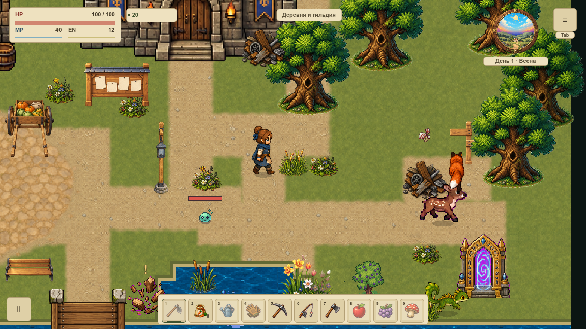
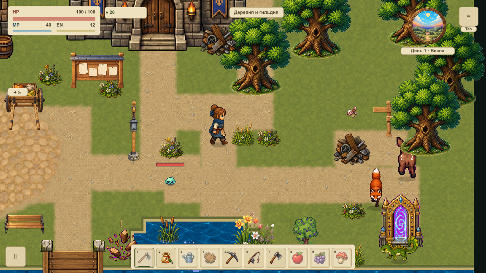
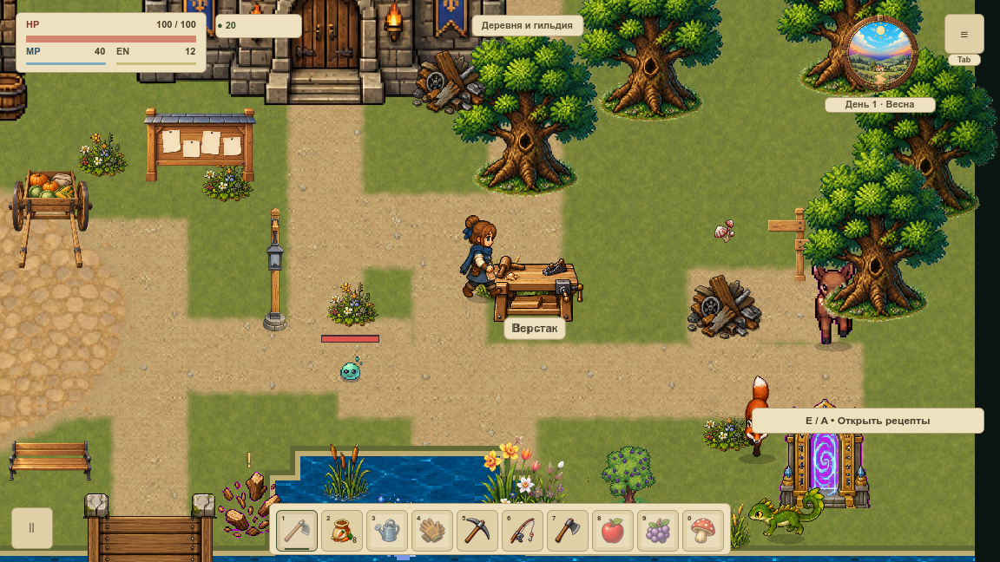

# Шаг и бег по-разному отклоняют траву

VFOLIAGE-005 усиливает реакцию восьми существующих пучков травы и камыша по реальной скорости героя. Кнопка направления сама по себе не даёт усиления: если путь перекрыт, растение сохраняет только мягкий пространственный контакт из VFOLIAGE-004.

[Карточка VFOLIAGE-005](#/development/tasks/visual--VFOLIAGE-005) · [Первая локация](visual-pilot.md) · [Пространственный контакт](foliage-contact.md).

## Одна точка, разная сила

Скорость берётся из разрешённого коллизиями смещения за фактический игровой такт. Проверены 30, 60 и 120 физических тактов в секунду, четыре направления, обычная скорость и существующий эффект ускорения. Отдельный медленный режим управления не добавлен: 70 единиц/с — контролируемый QA-пример; обычный шаг — 210, ускорение даёт 273.

Ниже показаны одни и те же точки пути с одинаковой частотой демонстрации: сравнивается сила отклонения, а не скорость воспроизведения. Каждый отсчёт получен настоящим вызовом игрового физического цикла; в начале повтора героя возвращают к старту только в стенде. Это не запись физической клавиатуры, измерение FPS или времени кадра.

Медленный контроль:

Существующее ускорение:

## Упор, остановка и пауза

При упоре в препятствие фактическая скорость равна нулю. При скольжении вдоль стены берётся только разрешённое перемещение вдоль неё. Сокращённый такт во время короткой остановки от удара использует свою игровую длительность, поэтому скорость не занижается из-за внешнего такта.

Остановка сразу снимает добавочное усиление. Пауза сохраняет текущий изгиб; телепорт, чужая карта и устаревший кадр не превращаются в мощный импульс. Low, reduced motion, эталон и уход за экран сохраняют прежний fallback. Технический флаг скорости возвращает поведение VFOLIAGE-004, не выключая ветер. Плавное восстановление после выхода остаётся отдельной VFOLIAGE-006.

Усиление ограничено множителем 1,9. Радиус контакта остаётся 36; вместе с ветром смещение меньше 5,71 мировой единицы и помещается в прежние границы. Сохраняются один ограниченный target, две группы и восемь прежних размещений. Геометрия при смене скорости не пересобирается, временный замер не входит в сохранение.

## Проверка

200 нативных случаев: 16 сравнений медленного и ускоренного прохода при одинаковой камере и фазе ветра, 1 600 неподвижных нижних полос, 788 игровых callback и 1 576 сигналов групп. GPU/CPU RGBA совпали побайтно. Полные сохраняемые состояния не меняются при отрисовке.

Профиль: 1 559 условий, включая прежний пространственный контакт. Отрицательные сценарии портят скорость, такт, источник, GPU-буфер, кадры, сохранение и настоящий пиксель копии. Матрица двух окон и три частоты физики не принимают FPS, всю растительность или VMAP-003.

[Нативная сводка](../../docs/reports/visual-overhaul/vfoliage-005/summary.json) · [Изменённые исходники](../../docs/reports/visual-overhaul/vfoliage-005/changes.json) · [Условия приёмки](../../docs/reports/visual-overhaul/vfoliage-005/native-admission.json).
