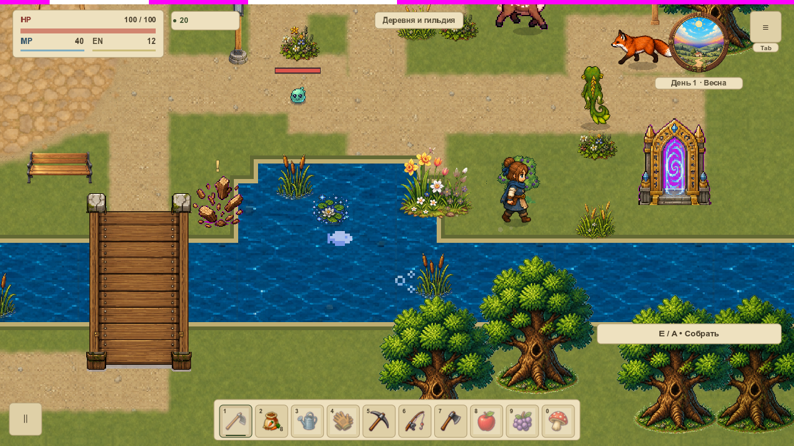

# Трава у краёв камеры — VFOLIAGE-010

**Локальная проверка завершена; [PR #7](https://github.com/sergey-leonidovich-shevchenko/babushkina-ferma/pull/7) ожидает ревью текущего head.** Проверены четыре края камеры, переход через границу чанка и проход вдоль ягодного куста. Игровая графика, коллизии и восемь прежних растений не менялись.

В окнах 1152×648 и 1280×720 снято 512 настоящих кадров. В 36 контрольных парах обычное отсечение даёт те же пиксели, что вывод всех восьми слотов при одинаковых камере и состоянии. Рисование не двигает симуляцию. Автоматический профиль проверяет 131 условие.

## Посмотреть проходы

Ролики замедлены в 2.5 раза:36 кадров при 24 кадрах/с, между кадрами два контролируемых физических шага по 1/120 с. Это просмотр поведения, не FPS. Первые четыре — панорамы камеры; последние два — настоящее движение героя.

Окно 1152×648:

Окно 1280×720:

## Что с нагрузкой

У травы один общий target768×384, две группы и две canvas draw calls,192 треугольника. Номинальный RGBA8 payload —1.125MiB. В выбранном неподвижном ракурсе вся сцена даёт 127 root canvas draw calls с эффектом и 124 в low. При уходе за экран и в low очередь target отключается, восстановление очищается; возвращение использует тот же ресурс.

Для scale1/2/4 и максимального допустимого изгиба отдельно проверены настоящие bounds и покрытие: слоты не пересекаются, максимум один фрагмент в пикселе. Сумма покрывает 52.7…59.8% площади target, включая прозрачные texel. Это измерение геометрии подсистемы, а не аппаратного whole-scene overdraw или GPU-времени. FPS, VRELEASE-003 и вся первая локация остаются отдельными этапами.

[План и границы проверки](../../docs/reports/visual-overhaul/vfoliage-010/plan.json) · [Независимые числа](../../docs/reports/visual-overhaul/vfoliage-010/verification.json) · [Исходная серия](../../docs/reports/visual-overhaul/vfoliage-010/native-01/source.json) · [Курс первой локации](visual-pilot.md).
