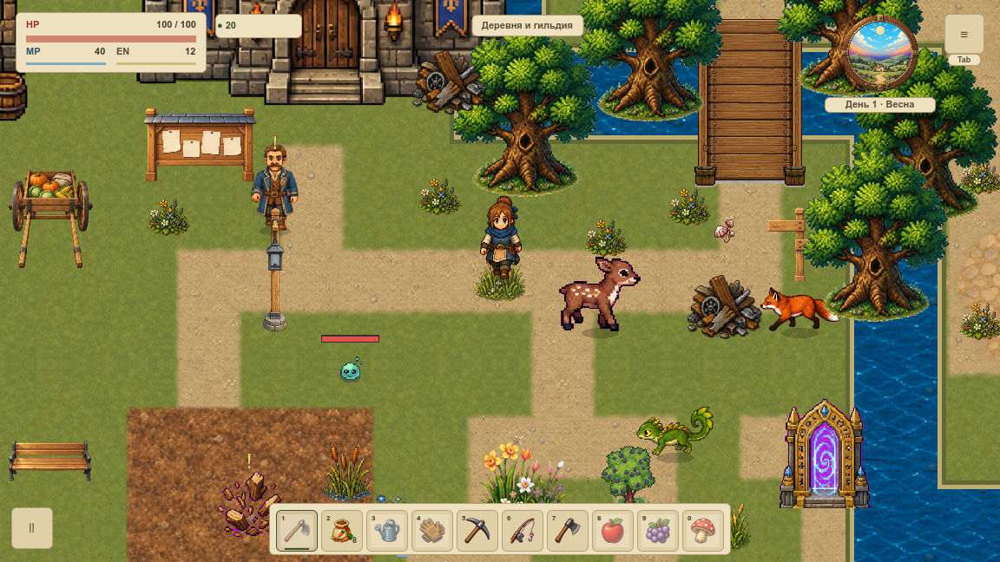

# Мягкий ветер у земли

VFOLIAGE-003 подключает ветер к восьми уже размещённым пучкам травы и камыша первой локации. Верхушки слегка наклоняются, корни остаются на прежнем месте. Фаза зависит от мировой опоры: растения рядом не двигаются строем, а камера не меняет их фазу. Вертикального скольжения и пульсации прозрачности больше нет.

[Карточка VFOLIAGE-003](#/development/tasks/visual--VFOLIAGE-003) · [Курс первой локации](visual-pilot.md) · [Опоры](foliage-roots.md) · [Локальные UV](foliage-local-uv.md).

## Движение в игре

Ниже — 49 нативных кадров при управляемом времени шейдера от 0 до 4 секунд. Анимация APNG сохраняет исходные пиксели без потерь. Это показ движения, её частота 12 отсчётов в секунду не является измерением FPS игры. Для просмотра можно открыть изображение отдельно.

Максимальный горизонтальный изгиб верхушки — 1,35 мировой единицы; нижняя полоса и вертикаль закреплены. Мягкая основная волна дополнена слабой второй. Атлас ограничен центрами пикселей своей ячейки. Кувшинки сохраняют свой прежний отдельный плавающий слой; этот ветер их не деформирует.

## Ограниченный слой

На все восемь растений создаётся один отдельный target и две MultiMesh-группы — трава и камыш. Геометрия строится один раз, дальше меняется только время в двух материалах. Группа допускает максимум 64 растения; новые размещения этой задачей не добавляются. Полный экран не становится шейдерным материалом: подготовленные участки рисуются в прежней фазе декора перед героем и интерфейсом.

Пауза останавливает визуальные часы и обновления target. За экраном target выключается, возврат использует прежние ресурсы. Low, reduced motion, эталонный режим, редактор и выключенный флаг оставляют неподвижный исходный спрайт. На других картах этого слоя нет; зимой сохраняется прежнее сезонное скрытие растений. Low пока доступен как технический профиль; нового пользовательского меню качества здесь нет. Размер target подстраивается под проекцию окна с верхней границей 4×.

## Что проверено

В каждом из двух видимых окон 1152×648 и 1280×720 проверены 68 случаев: выборка движения, пауза, уход за экран и возврат, выключенные эффекты, четыре настоящих подхода к корню, остановка, стена и переходы штатным QA-камнем. На каждом кадре полный snapshot до и после отрисовки одинаков. Контрольная CPU-геометрия рассчитывает изгиб отдельно от production MultiMesh; нижние полосы сравниваются побайтно, вместе с прозрачными полями и нарисованными корнями.

Материалы и число владельцев постоянны. На восемь пучков не создаются восемь отдельных узлов. Одинаковые ввод и seed с ветром и без него дают одинаковую сохраняемую игру. Проверка графики не принимает физическую клавиатуру, FPS, контактное отгибание растений или готовность всей карты: взаимодействие относится к VFOLIAGE-004, вся `overworld` — к VMAP-003.

[Нативная сводка](../../docs/reports/visual-overhaul/vfoliage-003/summary.json) · [Изменённые исходники](../../docs/reports/visual-overhaul/vfoliage-003/changes.json) · [Условия приёмки](../../docs/reports/visual-overhaul/vfoliage-003/native-admission.json).
