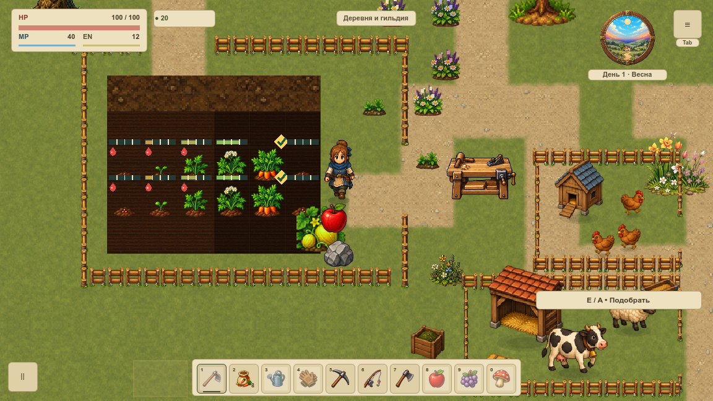
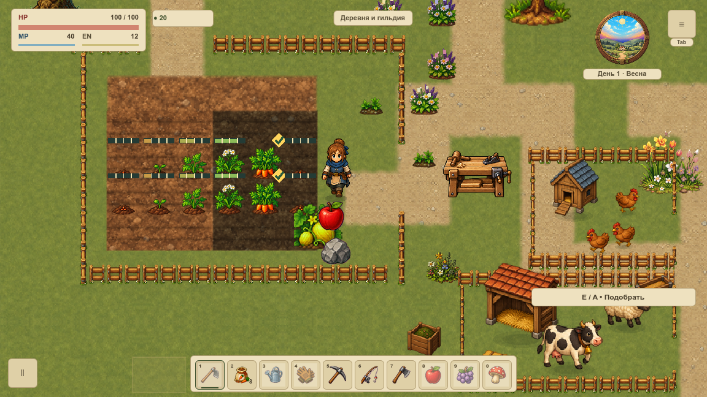
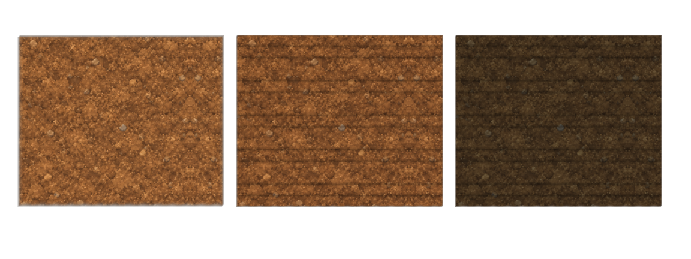
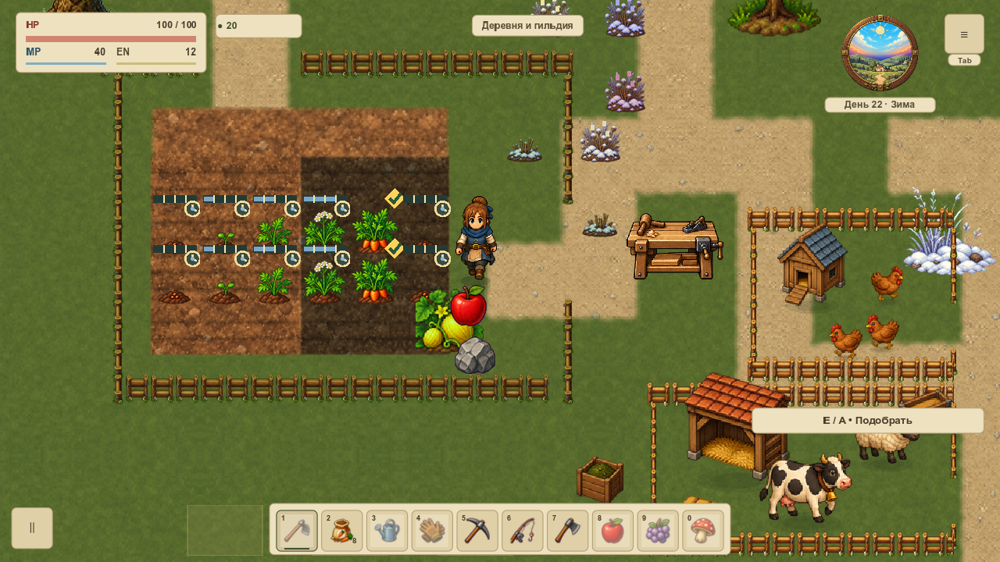

# Огород и влажная почва

VGROUND-007 обновила землю домашнего огорода первой `overworld`. Крошковатая почва, неглубокие горизонтальные борозды и тёмная влажная земля заменяют мелкий старый тайл и красные капли. Обрабатывать по-прежнему можно только прежние 30 клеток у дома. [Карточка](#/development/tasks/visual--VGROUND-007) · [Курс первой локации](visual-pilot.md).

## До и после

Камера, герой, растения, урожай и предметы в обеих версиях одинаковые. Нетронутый верхний ряд не имеет борозд; ниже показаны обработанные клетки. Слева — сухая земля, справа — влажная. Соседние клетки одинаковой влажности соединяются без светлой сетки. Подсказка выбранного растения по-прежнему сообщает, нужен ли полив; прогресс и готовность урожая сохраняются.

## Как различается земля

Влажность отличается яркостью, а не только цветом: на нативном листе средняя яркость сухой земли 88,07/255, влажной — 50,88/255. Разница видна и в оттенках серого. Это контроль рисунка; число само по себе не принимает художественное качество.

Материал 512×512 создан встроенным image_gen. Мастер и точные промпты хранятся отдельно; в игре повтор имеет размер 384 мировых единицы, сглаживание и mipmaps. Борозды и мягкая кромка — отдельная геометрия, поэтому генерация не задаёт направление дороги или разрешённые клетки.

## Что проверено

70 нативных PNG / 242 полных наблюдения draw: два окна, масштаб 120%, четыре настоящих календарных сезона, дождь, края огорода, Т-стыки и повороты дорог, оба моста, вход/выход дома. Полные состояния мира, геометрия и непрозрачный HUD сохранены; интерьер и контрольные дорожные стыки совпадают побайтно. Первый холодный кадр равен прямому fallback. Кеш земли и идентичность удержанных ресурсов не менялись за 120 callbacks.

32 профильных утверждения проверяют материал, границы, соседство влажности, полный цикл мотыга → посадка → два полива → урожай, откат, 1 200 правил земли и восемь движений у мостов. 12 Python-тестов отклоняют неверное окно/камеру/состояние, пустую или неразличимую почву, повреждение альфы, перестройку кеша и ложный FPS.

Ресурсы удерживаются их CanvasItem-владельцем: предпросмотр не освобождает меш, который ещё рисует игра. Общие ресурсы ограничены основой и 30 шаблонами; у владельца не больше 30 текущих вариантов. Новых узлов, targets, таймеров и пересборки геометрии на неизменном кадре нет. Старый рисунок возвращается флагом `soft_garden=false`; сохранения не мигрируются, другие карты используют прежний путь.

Это статичная художественная проверка, не FPS. Обычный открытый Godot сохранён, сосуществование записано явно. GPU timer — `null`; Image-данные и размеры файлов не равны RSS/VRAM. Снег, берег, стоимость живого мира VPERF и итог всей карты VMAP-003 остаются открытыми.

[Итоги](../../docs/reports/visual-overhaul/vground-007/summary.json) · [Материал и промпты](../../docs/reports/visual-overhaul/vground-007/art-source.json) · [Точные источники](../../docs/reports/visual-overhaul/vground-007/native/source.json).
