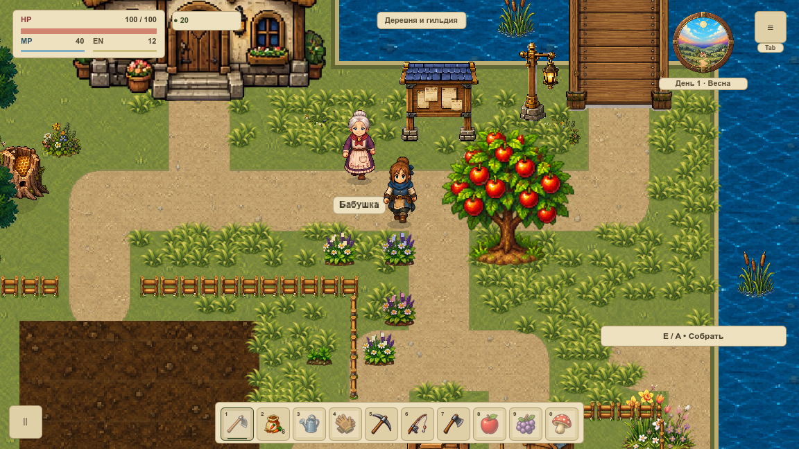

# Живая трава · сравнение трёх способов

**VRENDER-002:** выбираем статическую геометрию группами по 64 куста и общий шейдер движения. Это технический прототип для [первой живописной локации](visual-pilot.md); плотность травы и старая карта на кадре не являются финальным дизайном. [Каноническая карточка](#/development/tasks/visual--VRENDER-002?queue=village-pilot) хранит статус задачи.

## Как движется рисунок

Используется один PNG травы из VART-008. На каждый куст приходится небольшая сетка: 18 вершин и 20 треугольников. Верхние листья плавно отклоняются, корень остаётся на месте. Разная фаза соседних кустов убирает одновременный наклон всего участка. Масштаб мира — принятые 120%; HUD остаётся 100%.

Сравнили три способа с одинаковыми опорами, UV, формулой и изображением:

| Способ | Что обновляется | Узлы при 256 / 1024 кустах |
|---|---|---:|
| CPU mesh | GDScript пересчитывает вершины и передаёт позиции каждый кадр | 4 / 16 |
| Отдельный CanvasItem | Один узел на куст; общий шейдер | 256 / 1024 |
| Группы + shader | Статическая сетка по 64 куста; меняется только общее время | 4 / 16 |

Ветер использует собственный `wind_time`: игровая пауза останавливает движение и CPU upload, после продолжения движение возвращается. При входе в существующий дом слой скрывается; выход повторно не строит meshes. Встроенный TIME шейдера не следует паузе, поэтому здесь не применяется. [Документация Godot](https://docs.godotengine.org/en/stable/tutorials/shaders/shader_reference/canvas_item_shader.html).

## Что показала стоимость

Тридцать отдельных нативных запусков: исходные **24** — три повтора двух плотностей и четырёх методов с пустым контролем, ещё **6** — повтор оптимизированного CPU. Каждый измеряется 20 секунд после прогрева. Один MacBookPro16,1 / i7-9750H / Radeon Pro 5300M, питание AC, Godot 4.7.1 Compatibility, фокус и камера одинаковые. CPU-строка ниже взята из повторной серии; начальная сохранена отдельно.

| 1024 куста | update p95, мс | CPU всего процесса, % одного ядра | Draw calls всего кадра | render interval p95, мс |
|---|---:|---:|---:|---:|
| Пустой контроль | 0,280 | 24,12 | 140 | 14,933 |
| CPU mesh | 3,879 | 56,90 | 156 | 12,345 |
| Отдельные CanvasItem | 0,126 | 87,61 | 1164 | 9,407 |
| **Группы + shader** | **0,286** | **25,52** | **156** | **14,382** |

Числа — медиана трёх повторов; для времени — медиана p95. `update` измеряет только код слоя. Поэтому маленькое update у отдельных узлов не означает низкую полную стоимость: их работа в движке видна в CPU всего процесса. 100% CPU здесь равно одному ядру, а не всему ноутбуку.

**У отдельных узлов render p95 лучше.** Выбор групп основан на меньшей CPU-нагрузке, числе объектов и времени создания при одинаковой картинке. Улучшение FPS этим опытом не доказано. Интервал настоящего `frame_post_draw` — граница отправки рендера, не GPU completion и не физический показ. GPU timer недоступен (`null`). Симуляция игры остановлена; [живой измерительный контракт](performance-contract.md), бюджет FPS и длинный маршрут памяти остаются отдельными воротами.

После вынесения общих весов из внутреннего CPU-цикла p95 снизился с 4,995 до 3,879 мс при 1024 кустах. Повтор имеет свой архив исходников и не смешан с первым CPU-замером. Частоты CPU не зафиксированы; небольшие различия не выдаются за гарантированное преимущество. RSS около 1 GiB содержит всю контрольную сцену и движок; редкие наблюдения не доказывают пиковую VRAM или отсутствие утечек. В JSON доступны все p50/p95/p99/max без удаления хвостов.

## Проверка изображения и паузы

**54 нативных PNG и 216 draw callbacks** при 1152×648 и 1280×720. Проверены три фазы, герой/дерево/куст, мост, Escape-пауза и вход/выход из карты. Полные RGB-кадры CPU и групп совпали. У отдельных узлов максимум 3/255; допуск сравнения 8/255, средний — 0,1. Realtime-пауза проверяется по фактическим часам/uniform; её разные стартовые фазы не сравниваются попиксельно.

До/после настоящего `super._draw()` равны полные SaveSystem.snapshot и геометрия; очередь переднего плана потреблена. Две непрозрачные части HUD в обоих окнах совпали с прежним кадром без травы. Прозрачные края панелей не считаются непрозрачными. Методные сравнения проверяют весь framebuffer без масок.

1437 headless-проверок геометрии и жизненного цикла дополняют нативные кадры. 18 Python-сценариев проверяют отказы и сохранность raw; секундный синтетический рывок не исчезает из максимума. Это не физическое устройство и не FPS-приёмка.

## Что переносим дальше

Прототип лежит отдельно от игровых ресурсов и пока не включён в обычный запуск. Группы сортируются по Y/X, bounds учитывают ветер. Это низкая растительность за актёрами по [принятому порядку кадра](render-order.md). Высокая трава вокруг ног, контакт, тени, художественная плотность, погода, сортировка и скорость всей карты ещё требуют своих задач. Старые перила пока запечены в грунт. Групповой culling и 64 куста — отправная точка, не доказанный оптимум всех зон.

Следующее подключение должно сохранить управляемое время, неподвижную опору, масштаб/UV/bounds и отсутствие изменений геймплея. Вода и движущаяся растительность получают живой слой отдельно от неподвижного грунта. Очередь берётся из канонических задач; новых механик эта работа не добавляет.

[Итоги и полные распределения JSON](../../docs/reports/visual-overhaul/vrender-002/summary.json) · [Исходная серия: источники и SHA256](../../docs/reports/visual-overhaul/vrender-002/bench/source.json) · [Оптимизированный CPU: источники и SHA256](../../docs/reports/visual-overhaul/vrender-002/cpu-only/source.json) · [Финальные кадры: источники и SHA256](../../docs/reports/visual-overhaul/vrender-002/quality/source.json).
