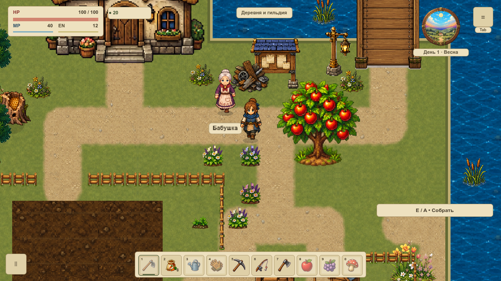
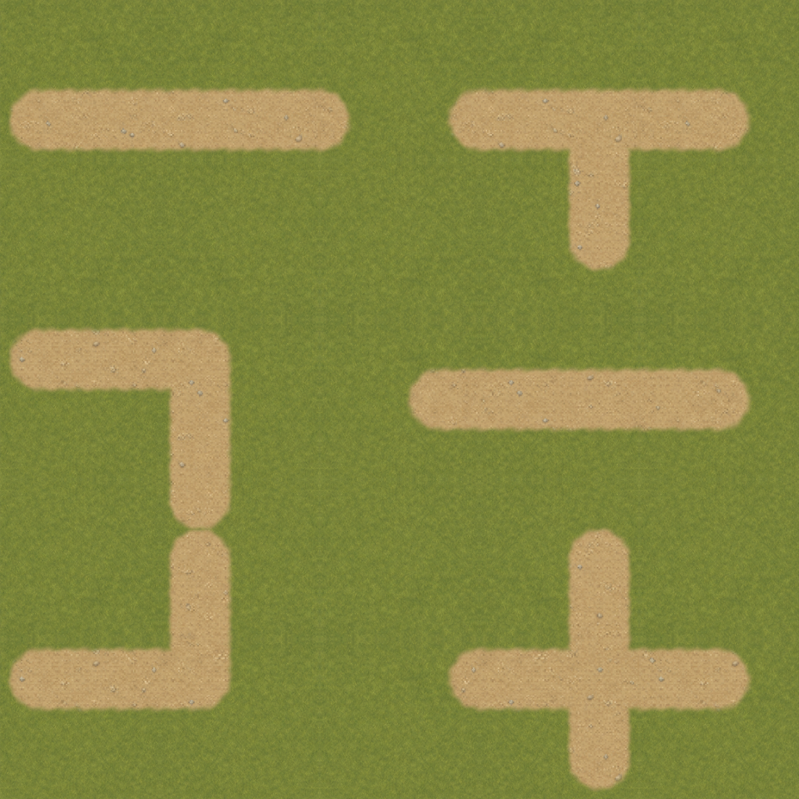
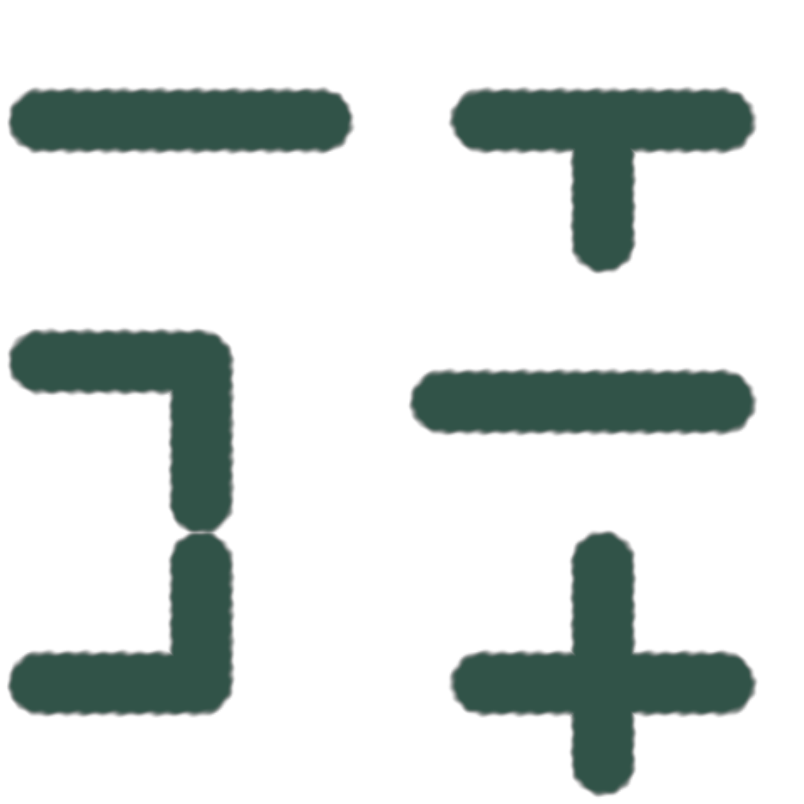

# Мягкие края травы и земли

VGROUND-003 убрала жёсткую окантовку дорожек первой `overworld`. Мягкое покрытие смешивает прежний материал земли с [живописной травой](meadow-base.md). [Карточка](#/development/tasks/visual--VGROUND-003) · [Курс первой локации](visual-pilot.md).

## До и после

Цвет покрытия и альфа-маска разделены. Маска заранее подготовлена по существующим осевым дорожкам; в игровом цикле её не вычисляем. Проходимость и вспашка совпали в **1 200 точках**, полный сохранённый мир не изменился. Положение выходных дорожек после цветов/мостов сохранено. Другие карты используют прежнее покрытие.

## Стыки и независимый цвет

Листы сняты на GPU в 1152×1152 при игровом масштабе 120%. В контрольном сечении **11 уровней альфы**, максимальный соседний шаг **42/255**, без бинарного скачка. При смене материала весь альфа-канал совпал побайтно, RGB изменился. Белые RGB вершин и отдельная альфа позволяют менять материал без перерисовки покрытия.

## Проверка и стоимость

Финальная серия B: **52 нативных PNG / 162 наблюдения draw**, два окна, четыре сезонных тона, дождь, оба моста и настоящий вход/выход дома. Первый холодный кадр точно равен полному direct эталону; непрозрачный HUD и интерьер точны. За 120 callbacks ни байты кеша, ни число перестроений не менялись. 18 профильных утверждений проверяют исходники/маски/правила, девять Python-тестов — отрицательные сценарии.

Два mesh вместо отдельных капсул работают внутри [прежнего единственного кеша](ground-layers.md). Новых постоянных узлов, targets или обновлений каждый кадр нет. **Это не FPS-замер**: симуляция остановлена, GPU timer — `null`. Объём `.res` на диске не является RSS или памятью GPU. Исходная версия сохраняется для отката флагом без миграции слотов.

Новая кромка воды, текстуры дорог, снежный набор и вся локация до VMAP-003 ещё не приняты. Эта задача принимает геометрию перехода травы и земли. [Итоги](../../docs/reports/visual-overhaul/vground-003/summary.json) · [База, точные исходники и бинарные маски](../../docs/reports/visual-overhaul/vground-003/native/source.json) · [120 кадров без перестройки](../../docs/reports/visual-overhaul/vground-003/native/1152/retained.json).
