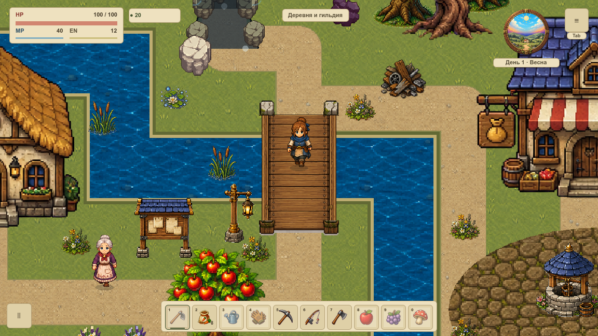
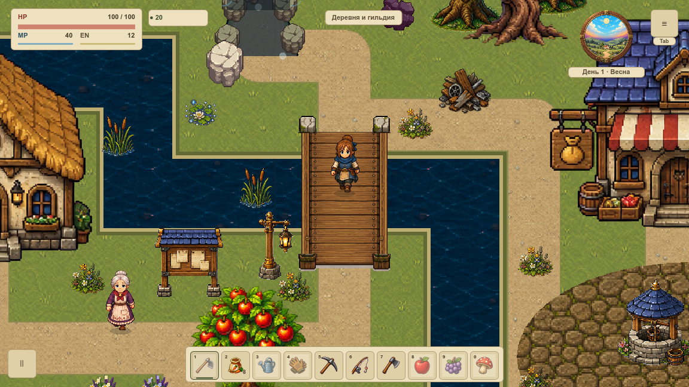

# Земля и вода · отдельные проходы

**VRENDER-003:** в штатной первой локации поверхность воды отделена от кеша земли. Статичные предметы сохраняют прежнюю детализацию, а существующая живая растительность и водные эффекты используют игровые визуальные часы. [Каноническая карточка](#/development/tasks/visual--VRENDER-003?queue=village-pilot) содержит статус и подтверждения; курс остаётся на [всю первую overworld](visual-pilot.md).

## Что теперь находится в кеше

Остался **один SubViewport 2400×1368**. При изменении карты или окружения в него рисуются земля, тропы, огород и берег. Специальный материал вырезает водные полигоны в прозрачность, затем возвращаются ограды, неподвижные цветы и мосты. Выходные дорожки идут последними, как раньше.

Вода — отдельный CanvasItem позади WorldBackground. Она видна через вырезы, а непрозрачный настил и предметы её закрывают. Статичный кеш явно переводится в UPDATE_DISABLED после готовности. При первой отрисовке или инвалидировании используется полный прямой fallback; вода и мост не исчезают на холодном кадре. Другие карты сохраняют прежний путь.

Так удалось сохранить прежнюю выборку спрайтов и не создавать второй render target. [Порядок от земли до HUD](render-order.md) остаётся основой. Старые перила пока входят в PNG моста; отдельное перекрытие героя перилами ещё не принято.

## Движение и пауза

Трава, камыши, кувшинки, рыба и пузырьки существующего первого участка уже рисовались живыми проходами Game. Теперь их декоративная фаза берётся из `VillageGroundClock`, а не системного Time.get_ticks. Разрешённый такт мира продвигает только временное число вне сохранения.

Пауза, рюкзак, игровые окна, потеря фокуса, редактор и другая карта останавливают фазу. Reduced motion и режим эталона тоже неподвижны. После возвращения движение продолжается без догоняющего скачка. Игровые события рыбалки и поплавок сохраняют прежние часы рыболовной системы.

Это подготовка живого покрытия. [Выбранная группировка новой травы](grass-methods.md) ещё не переносилась в обычный запуск; новая водная живопись, отражения, пена, взаимодействие с растениями и весь художественный результат до VMAP-003 остаются следующими задачами.

## Как проверили

**64 нативных PNG и 250 настоящих draw callbacks** в окнах 1152×648 / 1280×720. У каждой пары legacy/split одинаковые камера, поза, окружение и меню. Проверены герой, настоящее дерево с двух сторон, куст на востоке, оба моста, зима, дождь, Escape-пауза, вход в дом и возврат. Прежний village-кадр точно совпал с историческим VRENDER-001 по Git.

Полные RGB-пары отличаются максимум на **1/255**, средняя ошибка меньше 0,1 уровня канала. Это округление при другом маршруте непрозрачной воды через RGBA8, без маскирования изображения. Непрозрачные части HUD равны точно. Все snapshots до/после draw и геометрия совпали, очередь переднего плана пуста. Первый холодный кадр проверяется одной реальной записью, а не четырьмя копиями, и точно совпадает с полным прямым RGB-эталоном.

В каждом окне 300 callbacks продвинули управляемую фазу на **5 модельных секунд**. Ни запросы кеша, ни построения base/surface/cover/cutout не изменились; SHA256 RGBA текстуры остался тем же. Пауза ещё на 30 callbacks заморозила фазу; продолжение добавило только 0,25 с. Это фиксированные часы диагностической проверки, не FPS-замер.

Цвет WaterSurface меняется без перестройки кеша; непрозрачная точка настила остаётся с тем же RGB. Отдельная область камышей подтверждает видимое движение. В начале проверки выносили весь static cover, но он менял выборку мелких деталей. Этот вариант отклонён. Прозрачные вырезы сохраняют спрайты в исходном кеше. Также восстановлен прежний порядок выходной дороги над цветком.

21 профильная игровая проверка включена в общий набор. 20 Python-сценариев проверяют лишний viewport, UPDATE_ALWAYS, утечки и порядок, перестройку/изменение кеша, фальшивый первый кадр, HP/камеру, цветовой предел и переподпись исходников. Проверка первого изображения также поймала исчезавшую воду: инвалидация теперь сама запрашивает перерисовку фона; сравнение с прямым эталоном исключает повторение дефекта.

## Что известно о стоимости

В village-кадре общие draw calls **140 → 142**, render target остался один. Это счётчики кадра, не обещание роста FPS. Съёмка выполнялась с остановленной симуляцией и readback. GPU timer недоступен (`null`), живой бюджет и память проверяются по [измерительному контракту](performance-contract.md). Нативные картинки подтверждают разделение покрытия, а не завершённую перерисовку первой карты.

[Итоги и сравнения JSON](../../docs/reports/visual-overhaul/vrender-003/summary.json) · [Исходники и подписи серии](../../docs/reports/visual-overhaul/vrender-003/native/source.json) · [300 callbacks и неизменный кеш](../../docs/reports/visual-overhaul/vrender-003/native/1152/hot-loop.json) · [Первый холодный кадр](../../docs/reports/visual-overhaul/vrender-003/native/1152/cold.json).
