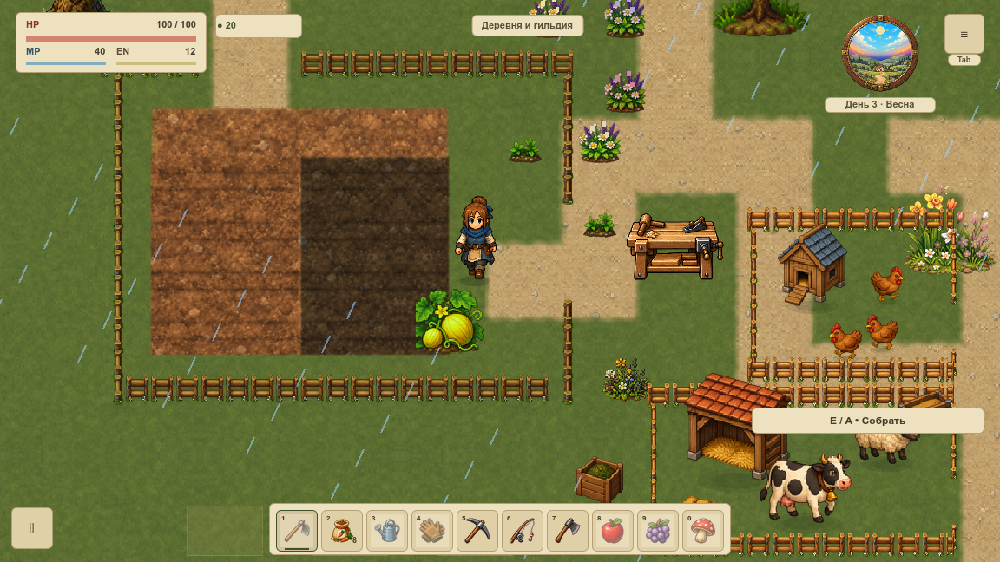

# Сезонные переходы земли

VGROUND-010 проверяет четыре сезона и дождь на одной геометрии первой `overworld`. Приняты существующие материалы и правила; новый renderer или снег здесь не добавлены. [Карточка](#/development/tasks/visual--VGROUND-010) · [Курс первой локации](visual-pilot.md).

Весна — день 1, лето — 8, осень — 15, зима — 22, дождливая весна — 3. Это настоящий календарь и его естественная погода. Во всех профилях совпадают 41 меш, их вершины/UV/альфа и ID, 1 200 правил прохода/вспашки и восемь движений у мостов. Возврат весны даёт точный прежний кадр и полный RGBA-кеш.

## Дождь и огород

Тон луга и площади меняется, дождь затемняет их также в сером; полная альфа покрытия сохраняется. Дороги, берега и основание огорода не получают нового климатического материала. Влажность клеток — отдельное состояние. Здесь для визуального сравнения она фиксирована одинаково; настоящий автоматический полив дождём проверяет отдельный игровой профиль. Зимняя пауза роста и ровно 30 домашних клеток сохраняются.

Обычный дождь движется по системным часам, поэтому его кадры предназначены для осмотра. Для точных сравнений reference mode временно подавляет воду, движение окружения, погоду сада, атмосферу и обратную связь действий, сохраняя HUD. Отключение режима не меняет кеш земли.

## Проверки и расход ресурсов

34 профильных утверждения, 11 Python-сценариев отказов, 88 нативных PNG / 304 наблюдения настоящего draw. Два окна, масштаб 120%, шесть одинаковых камер каждого климата: дом, огород/тупик, площадь/Т-стык, оба моста и поворот. Полные save и геометрия до/после каждого draw равны. Настоящий вход/выход дома сохранён; интерьеры не переделаны.

Сезоны используют одну текстуру 2400×1368. На смену — одно обновление; десять повторов того же профиля ничего не пересобирают. За 120 статичных callbacks и паузу/продолжение кеш, геометрия и ресурсные ID не меняются. Само открытие меню записывает два прежних события `pause_menu` в обучение и первую главу; остальные поля полного save сохраняются. Эти события не скрыты как «неизменный save».

Зима пока означает существующий холодный тон: новый снежный покров не добавлен. Новые механики и другие локации не расширены. Статическая приёмка не измеряет FPS, GPU-время, RSS/VRAM или долгую утечку; VPERF и вся карта VMAP-003 остаются открытыми. Первые две неполные попытки съёмки отклонены и описаны в протоколе; принята только полная серия.

[Результаты](../../docs/reports/visual-overhaul/vground-010/summary.json) · [Точные источники](../../docs/reports/visual-overhaul/vground-010/native/source.json) · [Нативная серия](../../docs/reports/visual-overhaul/vground-010/native/1152/capture.json)
