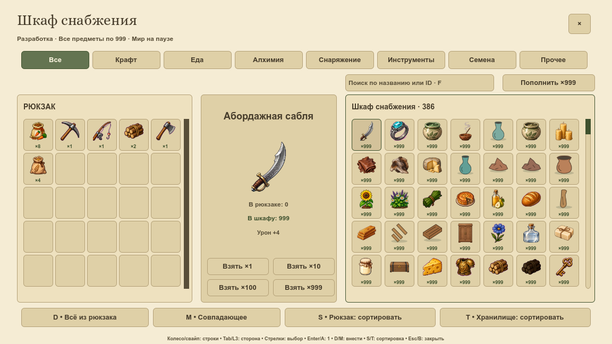

# Иконки для сетки и крупного превью

VPIPELINE-006 закрепила два размера предметных изображений для всех 386 предметов. Сетка берёт подготовленную миниатюру, а выбранный предмет — отдельный крупный рисунок. Размер ячейки и само изображение предмета сохраняются.

## Как выбирается размер

| Где показывается | Подготовленный источник |
|---|---|
| Ячейка 40 px | Кадр 64 px в защищённом атласе |
| Показ 64 px | Тот же 64 px |
| Показ больше 64 px, включая карточку 104 px | Отдельное превью 160 px |
| Сильное уменьшение | Независимые страницы 32/16/8 px из VPIPELINE-004 |

Большой рисунок создаётся прямо из целого исходника. Все 386 файлов 160 px совпали с повторным экспортом этих исходников. Растягивание маленькой иконки для получения большого файла не используется. Прозрачные поля — 3 px у базы 64 и 8 px у превью 160; силуэт должен целиком помещаться внутри.

Цвет, источник материала и выбранные замены остаются общими для инвентаря, рецептов и Wiki. Новый крупный PNG в будущем обновляется вместе с подготовленным пакетом. Нулевые и нечисловые размеры не запускают загрузку оригинала.

## Что происходит при открытии шкафа

Проверка выполнена в свежих процессах Godot. До окна крупные превью отсутствовали. Первый видимый кадр загрузил **ровно одно** — для выбранного предмета. Повторные кадры и закрытие/открытие использовали ту же текстуру. Оригинальные PNG ради окна не загружались.

Этот отложенный путь уже работал до задачи. Проверка закрепила его и добавила счётчики, чтобы будущая замена графики не вернула массовую загрузку. У стартующей игры есть свои ранее загруженные ресурсы; речь о дополнительных загрузках окна.

## Кеш и мягкий край

В памяти поставщика удерживаются не более **16 крупных превью**. Недавно просмотренные остаются; самые давно использованные освобождаются. При возвращении к вытесненному предмету загружается только он. Слабые ссылки в тесте подтвердили освобождение и обёртки, и исходника.

Крупное превью получило свой линейный фильтр: уменьшение 160→104 px выглядит мягче. На нативной паре изменились только 2016 пикселей выбранного рисунка; сетки, шрифты, кнопки и количества совпали.

Для пиксельных данных 16 превью требуется до 1,5625 МиБ. Это расчёт без драйвера и графических накладных расходов, не измерение VRAM или FPS. Полная оптимизация времени открытия и длительной памяти остаётся OPT/VPERF.

## Проверки

`python3 tools/item_sizes.py` проверяет каталог, настоящие PNG и импорты, безопасные края и нативную загрузку. `tools/test_item_sizes.py` запускает 9 сценариев с намеренной порчей отдельных копий. Профиль Godot `tools/item_sizes_review.gd` содержит 1204 утверждения, включая проверку всех 386 больших рисунков. Он также включён в полный игровой набор.

В обоих вариантах окно записало только два прежних флага первого посещения шкафа. Остальная сериализуемая модель совпала: предметы, здоровье, энергия, день и деньги сохранились. Полная комната до и после изменений тоже совпала.

Повтор нативного запуска: задать новый `VICONS_OUTPUT`, профиль `VICONS_PROFILE=Codex-VPIPELINE-006-new` и запустить Godot с `--path . --script res://tools/item_sizes_capture.gd`. Результат содержит первый, стабильный и повторно открытый кадр, списки ресурсов и счётчики запросов загрузки. Счётчик запроса не равен числу дисковых чтений: ResourceLoader может вернуть готовый ресурс.

Эта задача закрепляет подготовку изображений. Перерисовка предметов в принятом стиле продолжается в VICON. Подробные журналы и методика лежат в `docs/reports/visual-overhaul/vpipeline-006/`. Предыдущие основы: [поля атласов](padded-atlases.md), [адресная фильтрация](visual-sampling.md), [цвет и данные](data-textures.md).
