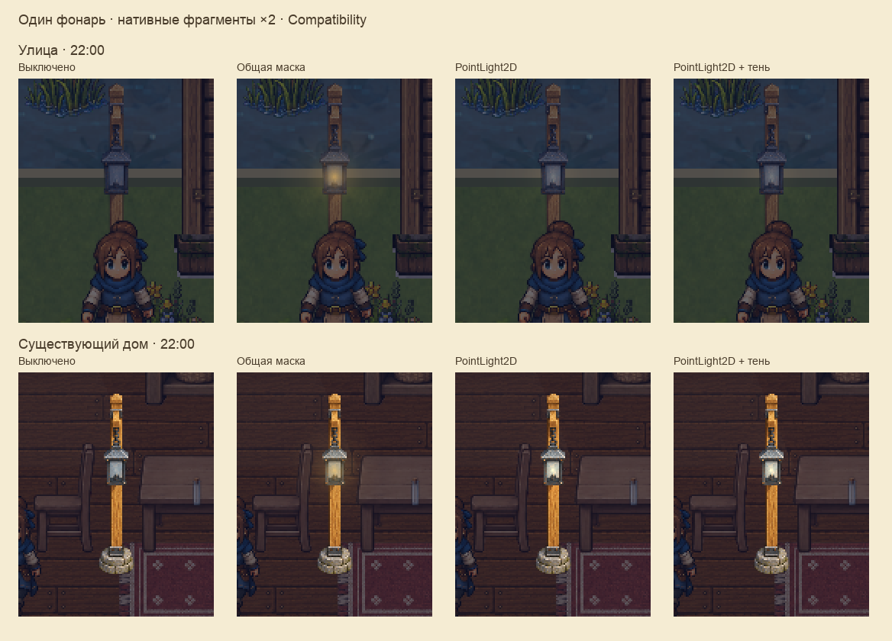
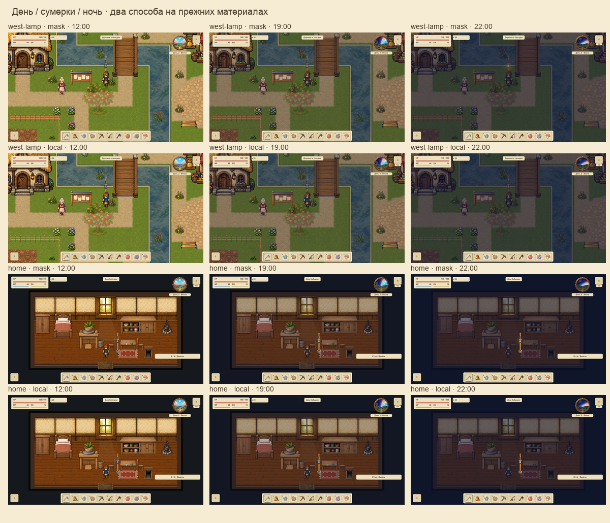
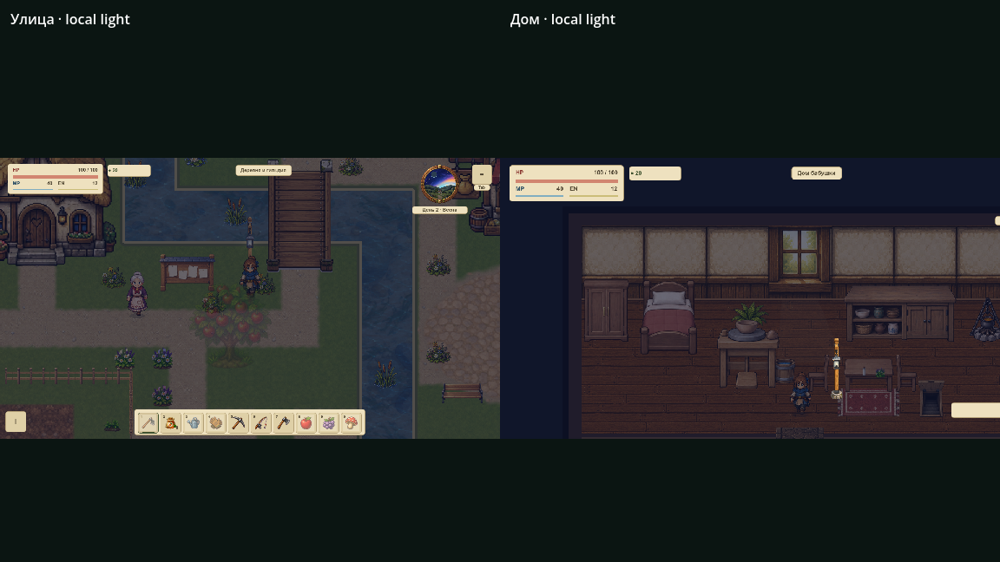

# Как светится один фонарь

Для малого свечения нынешнего фонаря выбираем **общую тёплую маску**. Она сохраняет цвет стекла и подходит текущему рисунку. PointLight2D с динамической тенью тоже работает на Compatibility, но требует другого владения слоями/материалами; простая подстановка на весь игровой canvas даёт иной результат.

Это авторское решение VLIGHT-002 по отдельному прототипу. Задача ещё проходит проверки и независимое ревью; обычная игра, другие эффекты освещения и вся первая локация этим опытом не принимаются.

[Текущая задача](#/development/tasks/visual--VLIGHT-002) · [Где уже есть свет](light-inventory.md) · [Первый живописный участок](visual-pilot.md)

## Четыре способа показать одно стекло

Слева направо: источник выключен, общий цветной меш, PointLight2D, PointLight2D с мягким PCF5-окклюдером стойки. Последняя геометрия — явно обозначенный QA-пример, а не готовый контур игрового предмета.

Сравниваются один корпус, центр стекла и камера. На улице учтено настоящее смещение опоры renderer(0,24). Первая версия прибора его пропустила; ошибочные кадры сохранены отдельно и не вошли в окончательную серию C. Проверка теперь различает правильную привязку к телу и одинаковую ошибку двух вариантов.

Радиус PointLight проверяется по фактическим размеру текстуры и масштабу, независимо от подписи в записи. Reader также сверяет реальное включение, мощность и тени с нужным временем: выключенный источник нельзя принять за замер local/PCF5. Эти проверки усилены после независимого ревью; исходные изображения и замеры C сохранились.

## Днём, вечером и ночью

Два настоящих окна 1152×648 и 1280×720; улица и существующий дом. Материалы, текстуры и календарные часы сохранены. Для комнатного контроля поставлен только временный QA-корпус, новая мебель в игре не добавляется.

114 исходных PNG включают 48 игровых кадров,48 отдельных HUD,12 независимых targets и 6 root-composites. HUD сохраняется, включение источника не меняет save/геометрию и не влияет на соседний viewport. Все 3755 production/asset blobs и 30 QA-входов проверены по фактическим байтам.

Правый target960×540 проверяет изоляцию источника. Компоновка узкого игрового HUD этой витриной не принимается.

## Что со скоростью

Временная серия содержит три повтора каждого режима:4320 CPU и 4320 native frame samples без readback. Фактические cap 0/VSync 0, окно, фокус и продвижение process frames записаны в каждом семпле.

Разницы малы, иногда меняют знак; режим с добавленным эффектом бывает быстрее off. Это разброс, а не обещание ускорения. Выбор для этого стационарного halo сделан по контролируемому рисунку и сложности подключения. GPU timer и FPS живой игры остаются отдельной приёмкой.

[Все результаты](../../docs/reports/visual-overhaul/vlight-002/results.json) · [Три повторения и парные разницы CSV](../../docs/reports/visual-overhaul/vlight-002/costs.csv) · [Источник native-серии](../../docs/reports/visual-overhaul/vlight-002/native/source.json) · [3755 проверенных Git blobs](../../docs/reports/visual-overhaul/vlight-002/native/exported-blobs.json) · [Происхождение листов](../../docs/reports/visual-overhaul/vlight-002/gallery.json).
