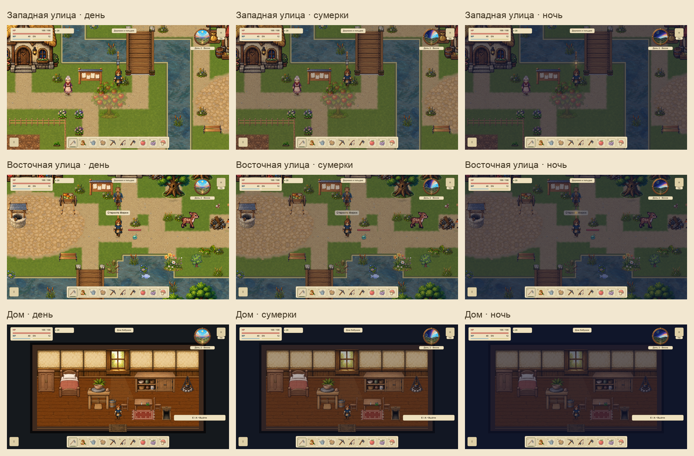
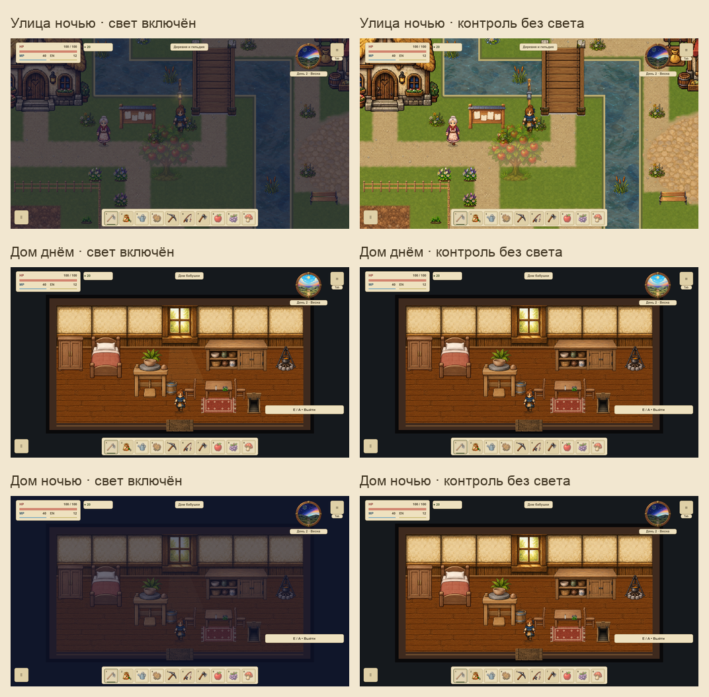
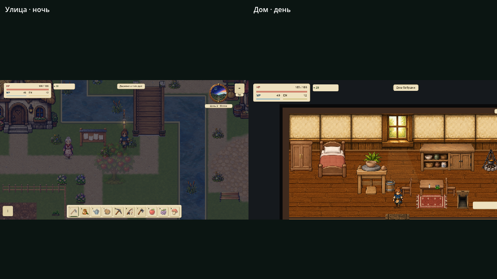

# Где уже есть свет

Свет первой локации сейчас создают **экранное затемнение, цветные меши и рисованные маски**. Физическая система локальных источников ещё не внедрена. VLIGHT-001 составила карту текущего состояния, чтобы заменять эффекты последовательно и сохранить рабочую игру.

**20 ноября 2026 — аудит VLIGHT-001 принят.** [PR №77](https://github.com/sergey-leonidovich-shevchenko/babushkina-ferma/pull/77) влит после независимого ревью коммита `4f5122c` и девяти успешных проверок CI. Merge `f74d1afa` сохраняет тот же проверенный tree. [Запись приёмки](../../docs/reports/visual-overhaul/vlight-001/closeout/result.json) различает локальные и CI-проверки; учёт проходит собственный PR. Принят аудит существующего света и CPU-отправки команд. Новая графика, аппаратный FPS/GPU и вся первая локация этим решением не принимаются.

[Задача VLIGHT-001](#/development/tasks/visual--VLIGHT-001) · [Курс первой локации](visual-pilot.md)

## Что меняем следующим

| Сейчас | Сохраняем | Дальше |
|---|---|---|
| Ночная полупрозрачная маска поверх мира | Календарь, время, условия затмения | Согласовать дневную и вечернюю палитру: VLIGHT-003 |
| Общий цветной меш свечения фонарей | Корпус, emitter, три ракурса и отдельную тень | Сравнить способы света на Compatibility: VLIGHT-002, затем VLIGHT-004 |
| Постоянная трапеция света из окна | Само окно, комнату, привязку и коллизии | Связать луч со временем и окружением: VLIGHT-005 |
| Круглые ореолы порталов | Условия и места переходов | Отделить освещение от символа: VLIGHT-002/009 |
| Нарисованный огонь и пар | Оплаченный крафт, прогресс и анимацию | Отдельно добавить свет на окружение: VLIGHT-006 |
| Градиенты пещерных жил, растений и кристаллов | Игровые условия, истощение ресурсов и clock босса | Аудит совместимости; графика пещеры не переносится в текущую работу первой локации |

Грозовая вспышка относится к погоде, а небесный венец затмения — к декору: выключатель света их сохраняет. Их clock и комфорт проверяются отдельно в VLIGHT-009.

Тёмные щели, затенённая крыша и рисунок подвального фонаря остаются частью текстуры. Их нельзя просто удалить вместе со световой маской или перекрыть вторым одинаковым ореолом. Контактные и солнечные тени принадлежат VSHADOW.

## Как проверяется замена

Сравнение проходит при одинаковой камере днём, в сумерки и ночью — на двух участках улицы и в существующем доме, в двух размерах окна. Отдельная контрольная копия выключает только пять объявленных световых draw-вызовов; вода, погода, тела предметов и декор не меняются.

Включённый прибор должен точно совпасть с исходной production-картинкой. HUD снимается отдельно на прозрачном фоне; освещение не должно менять его пиксели. Два настоящих viewport получают собственные настройки: выключение света в одном не должно затронуть второй. Сохранения и геометрия сравниваются до и после отрисовки по полным значениям.

Измеряется CPU draw submission с одинаковым прибором при включённом и выключенном эффекте. Это помогает выбрать следующий способ реализации, но не означает приёмку аппаратного FPS или GPU-бюджета.

Полная новая графика `overworld` принимается в VMAP-001…003. Эта инвентаризация не завершает остальные карточки освещения и не меняет приоритет первой локации.

## Кадры существующего света

Проверены две ширины окна, три времени и три режима: 54 игровых PNG, 54 отдельных HUD и 18 кадров изоляции viewport. Включённый прибор точен с исходным production; свет не перекрашивает отдельный HUD, а непрозрачные участки полного игрового HUD сохраняются в пределах 1/255.

Последняя картинка — диагностическая витрина двух экземпляров. Правый target имеет 960×540; здесь проверяется изоляция света, а не адаптивная компоновка его HUD. Основной интерфейс проверен отдельно в окнах 1152/1280.

Это текущая production-графика. Здесь выключается и общая ночная маска, поэтому контрольный ночной кадр становится светлым при тех же часах. Новая художественная система будет реализована после сравнения способов в VLIGHT-002.

## Что показали замеры

В каждой сцене — три повтора, 270 samples со светом и 270 без. Измерена CPU-отправка команд, GPU-время и аппаратный FPS здесь не принимаются.

| Окно | Сцена | On, мс | Off, мс | Разница, мс |
|---|---|---:|---:|---:|
| 1152 | Улица ночью | 7.613 | 7.602 | +0.011 |
| 1152 | Дом днём | 4.262 | 4.032 | +0.230 |
| 1280 | Улица ночью | 7.594 | 8.072 | −0.478 |
| 1280 | Дом днём | 4.261 | 4.022 | +0.239 |

Разница на улице меняет знак и сопоставима с разбросом. По этим цифрам нельзя обещать прирост FPS или выбирать новую технологию. Сырые значения и все три повторения сохранены.

CPU-пары сняты после прогрева дома: существующие поля открытия локации и pottery инициализированы. Полные сохранения внутри каждой on/off серии и повторов одинаковы, камера и масштаб совпадают с визуальным случаем; отличие от раннего уличного save показано в сводке явно.

[Подробная ведомость 15 групп](../../docs/reports/visual-overhaul/vlight-001/native/inventory.json) · [CSV для работы](../../docs/reports/visual-overhaul/vlight-001/inventory.csv) · [Результаты и повторения](../../docs/reports/visual-overhaul/vlight-001/results.json) · [Происхождение картинок](../../docs/reports/visual-overhaul/vlight-001/gallery.json).
