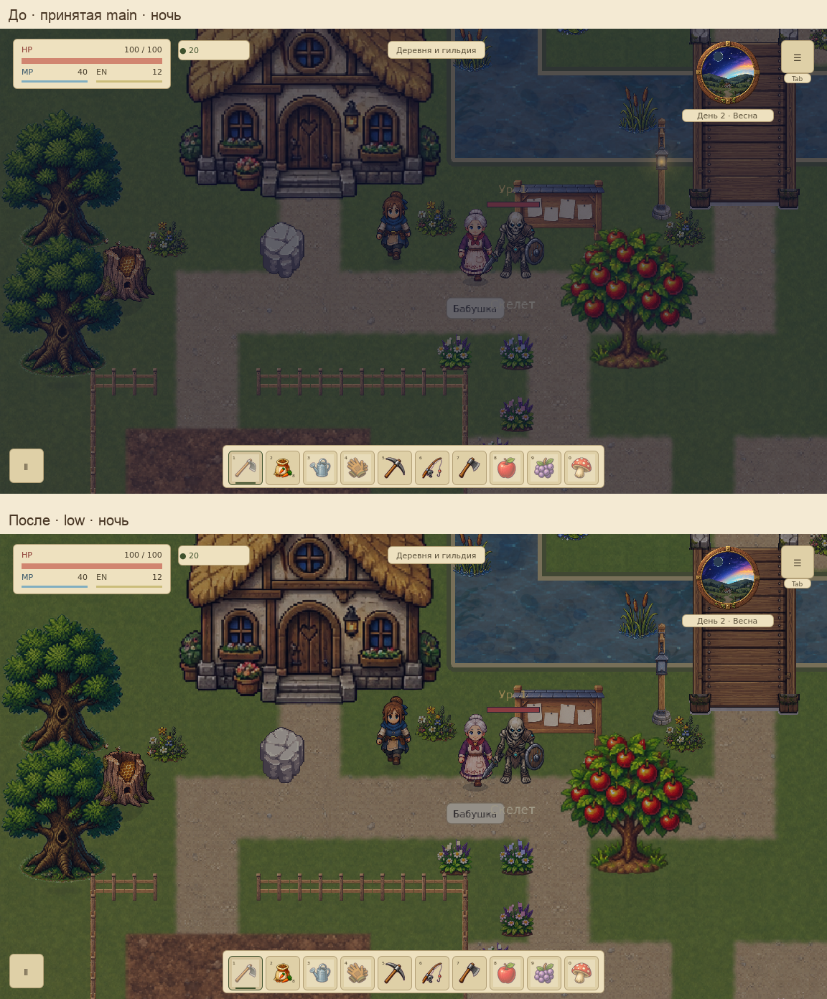
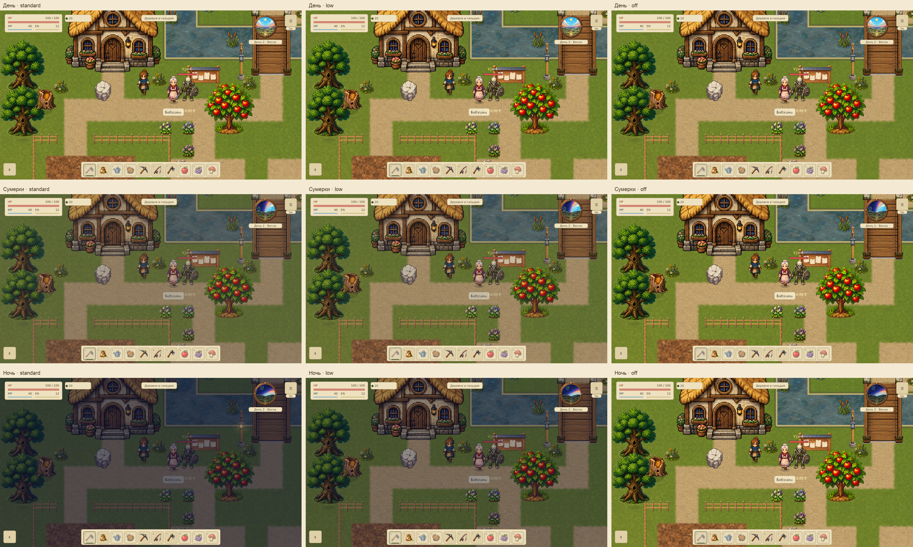
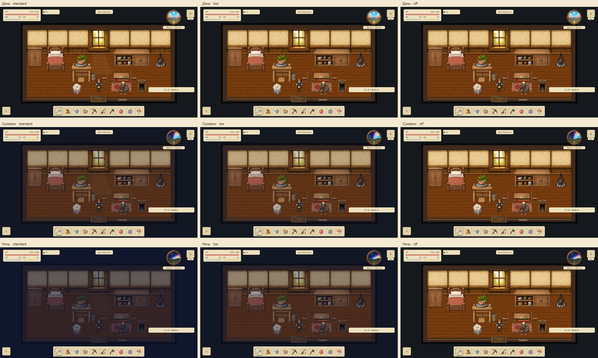
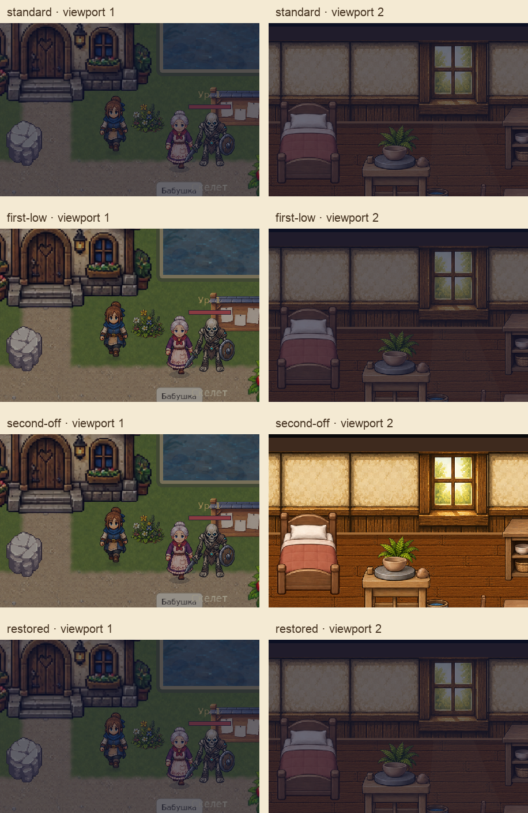

# Упрощённый свет первой деревни

Для первой деревни приняты три обратимых режима света. 23 ноября 2026
[PR №90](https://github.com/sergey-leonidovich-shevchenko/babushkina-ferma/pull/90)
принят на head a1e9c8d (.493) после независимого APPROVED 6018708449,
всех 12 CI и решения Team Lead. Обычный merge 2ad79b4e сохранил точное дерево.

[Карточка VLIGHT-010](#/development/tasks/visual--VLIGHT-010) ·
[Первая локация](#/development/first-location) · [День и сумерки](daylight-cycle.md)

## Обычный и упрощённый свет

`standard` сохраняет прежний рисунок. В `low` остаётся та же плавная смена суток,
но непрозрачность затемнения составляет 65% прежней; декоративные ореолы и
оконный луч пропускаются. Двери, враги, ресурсы, корпуса фонарей и контактные тени
остаются видны. `off` выключает этот световой проход. Игровой календарь,
события и погода продолжают работать по прежним правилам.

Верхний кадр — прежний standard ночью, нижний — low при той же камере и времени.
Это исходные игровые пиксели, без изменения размера или цвета.

## Дом и независимые миры

Профиль временно принадлежит одному игровому владельцу, не попадает в сохранение
и не меняет соседний viewport. Дом участвует как проверка существующего перехода;
его интерьер в этой задаче не переделывался. Другие карты сохраняют прежний свет.
Меню качества всего приложения относится к VPERF-010.

При отключении новой графики первой карты возвращается прежний свет. Запрошенный
low/off остаётся в памяти и восстанавливается при повторном включении графики.

## Что проверено

[Первая native-серия](https://github.com/sergey-leonidovich-shevchenko/babushkina-ferma/actions/runs/45095929093)
на коммите 93df8ef6 сохранила 270 PNG, 304 артефакта и 46 входных файлов проверки.
Два размера окна —1152×648 и 1280×720; улица/дом, день/сумерки/ночь, три режима.
Обычный standard совпал с прежними кадрами, HUD проверен отдельно. Автор
просмотрел 48 полных кадров и крупные ночные сцены: двери, скелет и камень
различимы. Скелет и камень — существующие объекты, неподвижно поставленные для QA.

Модель 257/0 охватывает старые слоты, настоящие сохранения, вход/выход дома,
паузу и общий откат графики. Полный source2 hook,167 тестов Wiki и браузер 1280/390
прошли. Девятнадцать повреждённых копий реального пакета отвергнуты. В парном
опыте прежние функции reader принимали standard вместо off; исправленные
отклонили подмену. Оригинальный ZIP сохранён побайтно в трёх частях.

[Сводка исходной серии](../../docs/reports/visual-overhaul/vlight-010/native-ci-01/summary.json) ·
[Протокол отрицательных проверок](../../docs/reports/visual-overhaul/vlight-010/native-ci-01/regressions.json) ·
[Происхождение иллюстраций](../../docs/reports/visual-overhaul/vlight-010/native-ci-01/figures/gallery.json) ·
[Части оригинального архива](../../docs/reports/visual-overhaul/vlight-010/native-ci-01/archive.json)

## Затраты и следующие рубежи

Сохранены 1440 сырых CPU/frame samples, по три чередующихся повтора. Медианы
полного CPU draw standard/low/off:1152 —3.652/3.578/3.517 мс;1280 —3.582/3.627/3.534 мс.
Разброс пересекается, заметное ускорение не доказано. PNG не читались внутри
измеряемого участка. Software X11 не принимает GPU или аппаратный FPS.

[Все исходные samples CSV](../../docs/reports/visual-overhaul/vlight-010/native-ci-01/samples.csv) ·
[Медианы и повторы](../../docs/reports/visual-overhaul/vlight-010/native-ci-01/metrics.json) ·
[Снимок проверки до отчётного коммита](../../docs/reports/visual-overhaul/vlight-010/verification.json)

Окончательный a1e9c8d отдельно прошёл полный hook, Wiki 167/0, браузер 1280/390,
clean strict-current и 12/12 новых CI. Свежие 270 PNG равны исходным; оба текущих
Linux guard подтвердили отказ до движка и сохранность 351 файлов. P2 ссылки PR
исправлен и независимо закрыт. [Точная запись приёмки](../../docs/reports/visual-overhaul/vlight-010/closeout/result.json).
Отдельный учёт получает собственные проверки и ревью.
Новые рисунки источников, маски крыш, аппаратные бюджеты, долгая сессия,
VRELEASE-003 и VMAP-003 этим сравнением не принимаются.
