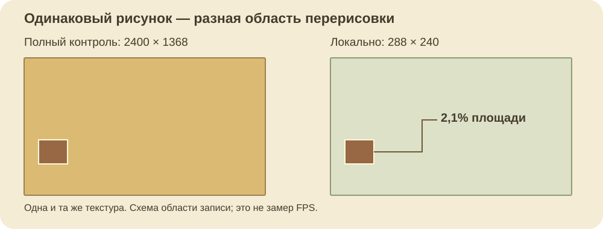
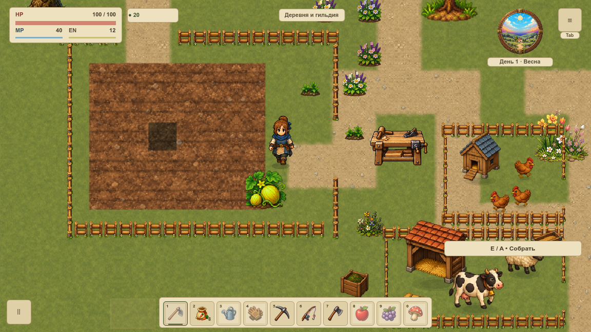

# Локальное обновление земли

VGROUND-009 обновляет нужную часть покрытия первой `overworld` в существующей текстуре. Переключение оформления огорода больше не требует полного прохода карты. [Карточка](#/development/tasks/visual--VGROUND-009) · [Курс первой локации](visual-pilot.md).

Нативная проверка: меняется ровно 69 120 пикселей огорода, снаружи — ноль. Область 288×240 занимает 2,1% целевой текстуры 2400×1368. Результат побайтно совпадает с полным обновлением; target и его текстура сохраняют идентичность. Это размер области записи, а не утверждение о росте FPS или снижении памяти.

## Как работает обновление

Локальный прямоугольник ограничивает отрисовку. Остальные пиксели кеша сохраняются; прозрачная очистка действует внутри того же участка, включая водные вырезы. Отдельные текстуры или SubViewport для каждой секции не создаются. Добавлены только постоянные контейнер отсечения и узел очистки внутри прежнего target.

Далёкие запросы остаются раздельными. Соседние и пересекающиеся объединяются; повтор во время активного прохода остаётся в очереди. Предел — 32 ожидающих участка плюс один активный, не более 60 номеров секций. Смена сезона, карты или общего профиля заменяет очередь полным проходом. Переполнение возвращает полный fallback, испорченный или внешний прямоугольник ничего не инвалидирует. Внутренние прямоугольники не перехватывают игровой ввод.

## Проверка одной грядки

Обычный полив и прежде не требовал пересборки фоновой текстуры. Проверка сохраняет это поведение: меняются меши только клетки и четырёх соседей, остальные 25 удерживаются. Полный RGBA-кеш фона остаётся прежним. В этих кадрах влажность задаёт QA-профиль; настоящие мотыга, посадка и лейка проверены отдельно, физический ввод этим изображением не подтверждается.

## Что принято и что остаётся открытым

60 профильных утверждений и 9 Python-сценариев: очередь, неверные координаты, ограниченность, потеря повторного запроса, независимость диагностики, сохранения, прежние 1 200 правил земли и восемь движений у мостов. Отрицательные проверки портят также скрытую альфу вне участка, контрольный пиксель, идентичность target и данные полива.

80 нативных PNG / 212 наблюдений настоящего draw: два окна, масштаб 120%, прямые края, поворот/Т-стык/тупик, оба моста, четыре календарных сезона, вода, действительный вход/выход дома. Полный и локальный методы дают одинаковые кадры и одинаковый первый fallback. Очередь отрабатывает три далёких участка и повторную запись; глобальная смена удаляет старую очередь. За 120 неизменных callbacks фон, ресурсы и счётчики не меняются.

У прежнего прямого рисунка и offscreen-кеша есть различие семплирования. Эта задача его не исправляет и не объявляет их одинаковыми: первый локальный кадр сравнивается с первым кадром полного метода при одном состоянии. Историческая серия VGROUND-008 имеет другой исходный loot/RNG и поэтому не принимается как точный контроль новых кадров. Сравнения полного и локального метода выполнены внутри новой серии с равными полными save-снимками.

Откат: `local_terrain_updates=false` возвращает полное обновление. Сохранения не мигрируются. Автоматическая интеграция всех инструментов F12, новые карты и механики здесь не добавлены. Статическая съёмка не принимает FPS, GPU-время, RSS/VRAM, живой бюджет VPERF или всю карту VMAP-003.

[Результаты](../../docs/reports/visual-overhaul/vground-009/summary.json) · [Точные источники](../../docs/reports/visual-overhaul/vground-009/native/source.json) · [Операции и ревизии](../../docs/reports/visual-overhaul/vground-009/native/1152/capture.json).
