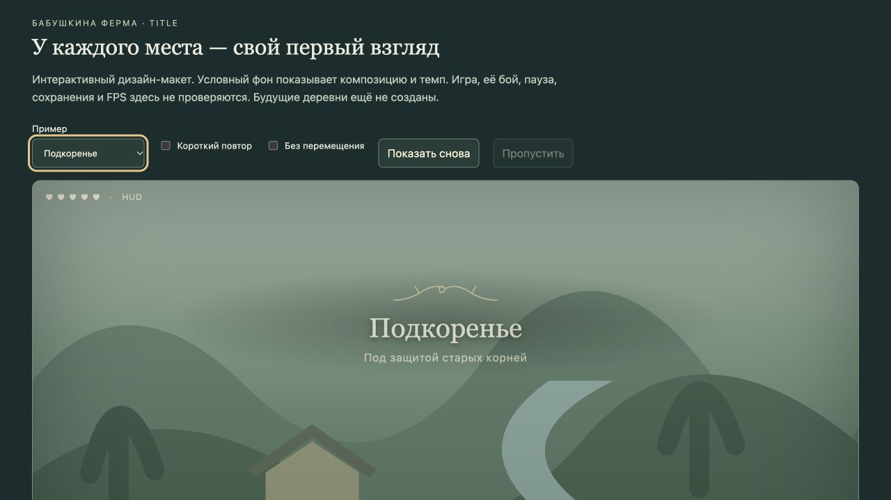

# Названия мест и представление боссов

**Это согласованная механика по прямому поручению 28 октября, не IDEA.** Подготовлен отдельный [эпик TITLE](#/development/epics/location-titles--TITLE): [постановка TITLE-00](#/development/tasks/location-titles--TITLE-00) ждёт независимого ревью, 24 игровых этапа остаются в плане. Эффект ещё не добавлен в игру.

Полная постановка: `docs/epics/location-title-reveals/README.md`. [52 профиля мест](location-title-places.md) · [20 встреч с боссами](location-title-bosses.md) · [данные каталога](../../docs/reports/title-00/profiles.json).

## Как это выглядит

По центру верхней трети полезного экрана появляются тонкий орнамент, название и короткая подпись. Имя целиком мягко поднимается на несколько пикселей и проявляется; орнамент раскрывается, потом всё спокойно исчезает. Герой при обычном входе продолжает идти. Титр не перекрашивает мир, не трясёт камеру и не закрывает атаку.

Первое поселение — примерно 3 секунды; основная область — 2,6; район/интерьер — 1,35; повтор — 1,05 без подписи. У первого безопасного боя — 2,8, у супербосса — 3,2. Это начальные параметры для будущей нативной пробы, а не принятый игровой баланс. Опорное окно игры — 1152×648; макет в браузере не принимает размеры игрового HUD или FPS.

## Шесть поселений с разным характером

| Поселение | Свой узнаваемый жест |
|---|---|
| Домашняя деревня | Деревянная черта, колос и тёплая строчка. Ферма позднее получит отдельный короткий титр внутри карты |
| Ивовые Мостки | Две ивовые ветви расходятся над водой, под именем затухает рябь |
| Медный Уступ | Медные скобы сходятся, словно противовес удержал строку |
| Подкоренье | Две корневые линии дорисовывают арку, открывается маленький лист |
| Соляная Пристань | Расправляется канат, под ним проходит одна волна |
| Бродячий Двор | Раскрывается складка дорожного полотна со стежками и колесом |

Домашняя деревня существует; остальные пять — будущие поселения атласа. Нынешние Сад травницы, Речная переправа, Торговая слобода, Ремесленный двор и Яблоневый сад — районы одной домашней деревни. Им достаются маленькие вариации общего материала. Не устраиваем длинное представление после каждого похода в лавку.

Лес, каменные области, пещеры, замок и север имеют свои мотивы. У Инейного хребта снежные грани расходятся вокруг маленькой тёплой точки. Лунный грот, Лунная поляна и Беззвёздная поляна получают разные имена и профили. Весь [каталог](location-title-places.md) различает нынешние карты и ещё не созданные места.

## Вход к боссу

Алтарь/ритуал сначала проверяет условия встречи. Если её владелец обеспечивает безопасное начало, мир останавливается **до начала боя**, появляется имя; после завершения или пропуска управление возвращается, начинается прежняя битва с видимым предупреждением атаки. Остановка должна охватывать и яд/муху, и снаряды, и игровые часы, и срочные поручения. Одна блокировка движения героя недостаточна.

Для открытой стычки — короткое неблокирующее имя. Сейчас у капитана нет принятой безопасной сцены: красивый показ не должен подарить ему бесплатную атаку или герою защиту. Обычный cave_guardian не является особым Хранителем только потому, что имя вида совпало. Лесной «Страж чащи» пока задан квестовым условием plant уровня5+, а не уникальным encounter ID. Точные привязки — в [каталоге боссов](location-title-bosses.md).

После поражения по умолчанию короткий повтор, фазы не перезапускают представление. Побеждённый босс не получает новую заставку/награду. Сохранение посреди боя не возвращает ритуал, не лечит и не меняет фазу. Неподтверждённая встреча не выдаёт секретное имя через карту или близость.

## Чтобы не надоело и не мешало

Одновременно один титр, очередь максимум три. Новое место отменяет устаревшее название; на границе нужны действительный выход и устойчивый вход. Одна дверь не создаёт два показа и два звука. Первое имя и короткий возврат различаются; у Бродячего Двора перенос стоянки не стирает первое посещение.

Инвентарь, карта, речь, обучение, редактор, пауза и потеря фокуса сохраняют оставшееся время. В обычном бою название уступает опасности и не копится бесконечно. Текущие Discovery/message объединяются с титром места; помощь пещеры и предметные карточки сохраняются, а не исчезают за новым украшением.

После 0,25 секунды новое нажатие пропускает показ; удержанная с двери кнопка не пропускает и не переходит в атаку. Есть reduced motion, компактный режим и показ только при первом посещении. Полная информация остаётся доступна без звука и анимации; шесть локалей проверяются с длинными именами и CJK.

## Что внедрять первым

Первый полезный выпуск — действующие шесть домашних районов, один экранный компонент, снятие дублей, повторы, доступность и старые слоты. Затем остальные 24 нынешние карты. Безопасное представление Хранителя, Стража затмения и Регента — после отдельной приёмки общего начала боя. Будущие поселения/боссы подключаются только когда их собственный контент готов.

Нынешнее поручение разрешает дизайн. Завершение REFACTOR-03 и остановка от 28 октября сохраняются; новая прямая команда нужна для начала игрового внедрения. Приоритет полной первой локации до VMAP-003 не меняется. Дизайн-макет хранится отдельно в `wiki/design/title-reveals.html`; он показывает композицию и темп, не меняет игровую сцену.
