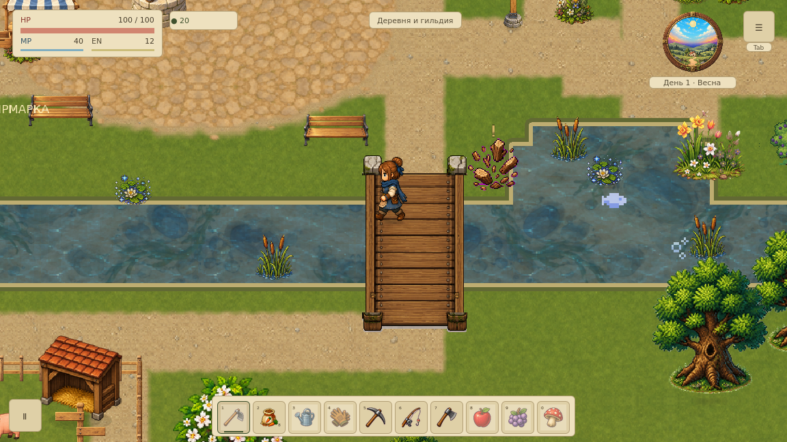

# Движущийся пилот первой деревни

Один маршрут снят с обычными эффектами и с настройкой «Меньше движения».
Камера, действия героя и исходное состояние в каждой паре совпадают.
[Карточка VRELEASE-003](#/development/tasks/visual--VRELEASE-003) ·
[Курс первой локации](visual-pilot.md)

## Окно 1152×648

## Окно 1280×720

## Что происходит на маршруте

Первые кадры дают сравнить траву и рябь при неподвижной камере. Затем герой идёт
вдоль реки, поворачивается к передним перилам и переходит на другой берег.
За паузой следуют камень телепортации, обычные двери дома и выход из дома после
загрузки слота v1. Последние три кадра показывают включённую графику, отключение
и восстановление при той же камере.

Все 476 кадров получены из нативного окна Godot 4.7.1 на Linux/X11.
В каждом из четырёх роликов 119 кадров. Их содержание и порядок сверены с
исходными PNG. В паузе стоят герой, календарь и фаза
течения. В обычной серии панель появляется плавно, а маленький верхний маркер
продолжает движение. С включённым «Меньше движения» совпал весь кадр паузы.

Проверка выполнена на `646c18c0` с GL Compatibility и программным рендерером.
Аппаратная производительность пилота проверяется отдельно в VRELEASE-004.
[Сводка и контрольные суммы](../../docs/reports/visual-overhaul/vrelease-003/native-ci-02/review.json) ·
[Проверка подмены видео](../../docs/reports/visual-overhaul/vrelease-003/native-ci-02/video-binding.json) ·
[Нативный прогон](https://github.com/sergey-leonidovich-shevchenko/babushkina-ferma/actions/runs/45724146564) ·
[PR №95](https://github.com/sergey-leonidovich-shevchenko/babushkina-ferma/pull/95)
