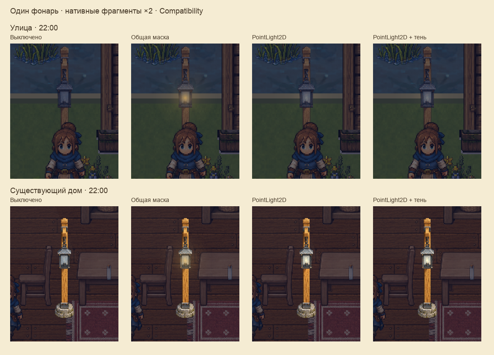
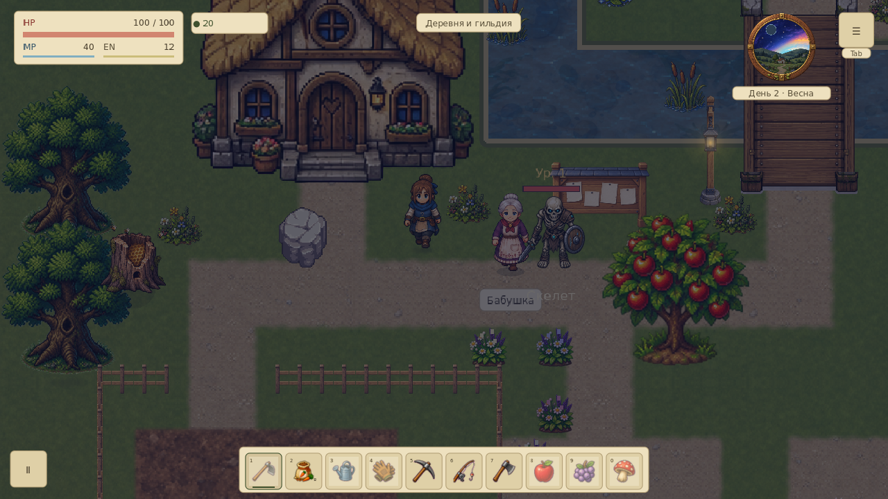
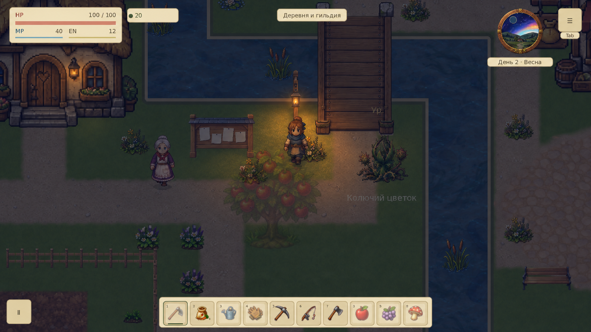

# Мягкий ночной свет

Фонарь должен не только светиться сам, но и мягко освещать ближайшую тропинку. Цель — небольшой тёплый центр, плавное рассеивание по земле и спокойная холодная ночь вокруг. Без заметных колец, белых пятен, дрожания и навязчивого мигания.

По поручению владельца **23 ноября 2026** свет сразу проектируется для **будущей перестановки предметов**. Перенесли или повернули фонарь — его свечение и перекрытия последовали за ним. На старом месте ничего не осталось. Размеры и якоря хранятся у предмета, а не в отдельном списке координат карты. Это требование к ближайшей реализации; сам режим перестановки сейчас не добавляется.

У будущей [перестановки мастерской IDEA-173](#/development/epics/idea-173--IDEA-173) уже предусмотрено сохранение прежнего экземпляра предмета. Свет использует ту же личность и подтверждённое положение; отмена предпросмотра оставляет настоящий источник на месте. Предложение IDEA-173 сохраняет свою очередь после VMAP-003 и не задерживает подготовку уличного фонаря.

[Постановка LIGHT-00](#/development/tasks/night-light--LIGHT-00) · [Эпик освещения](#/development/epics/visual--VLIGHT) · [Дизайн и проверки](https://github.com/sergey-leonidovich-shevchenko/babushkina-ferma/blob/bf3a791cc03ee8901b2493dccd42932a152532f0/docs/epics/night-light/DESIGN.md) · [Полная постановка и осмотр в PR №91](https://github.com/sergey-leonidovich-shevchenko/babushkina-ferma/pull/91/files).

## Что делаем

1. **VLIGHT-004 — один красивый фонарь.** Свет стекла и мягкое пятно на земле, плавное включение в сумерках, согласованное перемещение с предметом. Сначала проверка одного источника у дороги, стены и берега.
2. **VLIGHT-009 — свет окружения.** Несколько источников, тени и дождь сочетаются без пересвета; интерфейс сохраняет свои цвета. Печи VLIGHT-006 позднее используют тот же принцип по очереди своих помещений.
3. **Игровая приёмка.** Видео движения, перенос/поворот/удаление в QA, два размера окна, слабое качество и отключение эффекта. Результаты входят в существующую приёмку первой локации.

## Что уже увидели

На сохранённых нативных кадрах фонарь даёт в основном маленький тёплый акцент у стекла. Отдельного мягкого освещения земли в нынешнем проходе нет. Уже существуют профиль трёх ракурсов и локальная точка лампы — их переиспользуем. Статические размещения должны стать одним из поставщиков данных общего контракта предмета.

Это исторические кадры VLIGHT-002, не новая картинка «после». Также изучены принятая палитра VLIGHT-003 и вечерний кадр VCOMPAT-010. Свежий обход игры и видео плавности пока не выполнены; статичные картинки этого не доказывают.

Дополнительно проверены три свежих полных кадра VLIGHT-010: улица standard/low и дом standard из [CI run45095929093](https://github.com/sergey-leonidovich-shevchenko/babushkina-ferma/actions/runs/45095929093), head93df8ef6 (.490). Их байты совпадают с членами исходного архива; самостоятельная проверка всего прогона и приёмка010 этим осмотром не заявляются.

В standard сохраняется маленький свет стекла. В low декоративный ореол выключен и ночь светлее для читаемости — будущий эффект должен уважать этот выбор. Герой, враг и ресурс расположены сценарием QA. Это реальный игровой рендер, но не новый обход игры и не новая графика004.

## Художественный ориентир

Выбранное направление: маленький тёплый центр и мягкое пятно на земле. Это **AI-концепт**, а не готовая игровая графика. Небольшие детали сцены и интерфейса перерисованы генератором; они не являются частью задания. В игре сохраняем настоящие предметы и HUD, принимаем только свет по нативным кадрам и видео. [Исходный кадр, prompt и происхождение](https://github.com/sergey-leonidovich-shevchenko/babushkina-ferma/blob/bf3a791cc03ee8901b2493dccd42932a152532f0/docs/concepts/night-light-2026-11/v1/README.md).

**Постановка LIGHT-00 принята 23 ноября 2026** в [PR №91](https://github.com/sergey-leonidovich-shevchenko/babushkina-ferma/pull/91) после [независимого ревью](https://github.com/sergey-leonidovich-shevchenko/babushkina-ferma/pull/91#pullrequestreview-6017256101), проверок и решения Team Lead. Новый свет ещё не реализован; его плавность предстоит принять в игре. VLIGHT-001…003 уже приняты, VLIGHT-010 сохраняет свою очередь и отдельную проверку низкого качества. Внутренние окна и пещеры остаются на своих этапах, снег отложен. [Принятая карточка подготовки](#/development/tasks/night-light--LIGHT-00).
