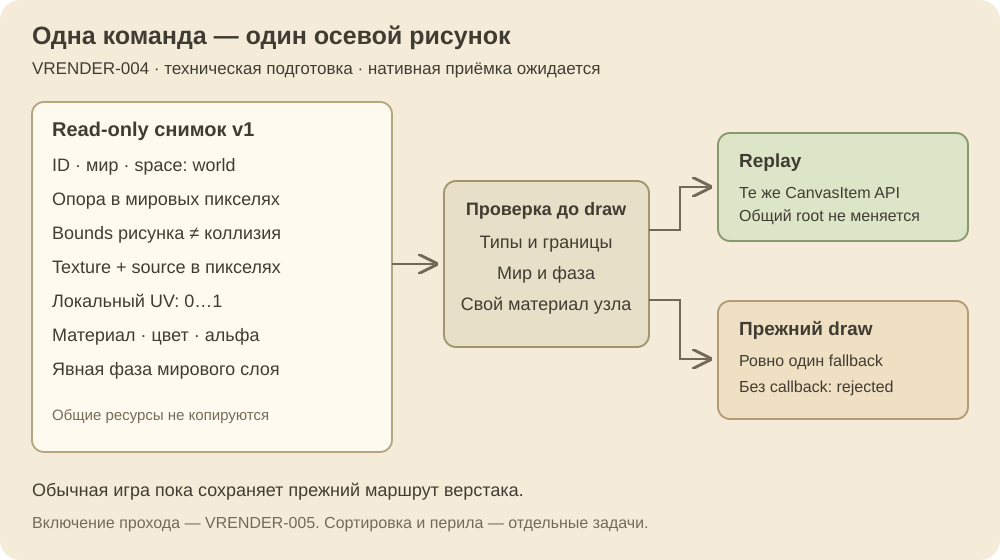
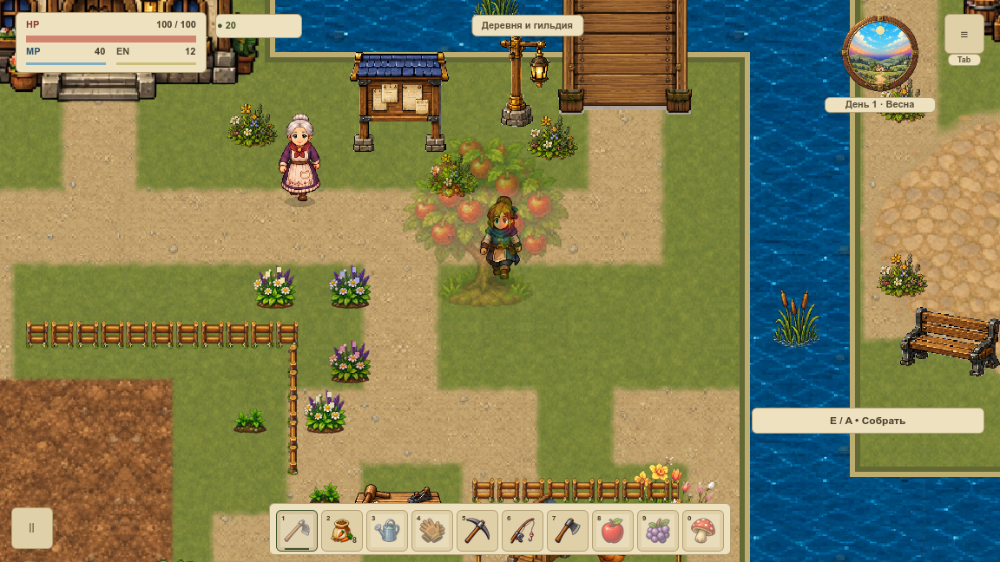

# Команда отрисовки объекта

**Нативная серия VRENDER-004 проверена.** Два настоящих окна, 80 PNG / 248 draw callbacks: все пары изображений побайтно равны, сохранения и материалы не изменены. Обычная игра пока сохраняет прежний проход. [Задача и актуальный статус](#/development/tasks/visual--VRENDER-004) · [Курс первой локации](visual-pilot.md).

Команда содержит ID/мир/версию, нижнюю опору, границы рисунка, текстуру и её регион в пикселях, локальный UV 0…1, материал, цвет/альфу и мировой слой. Границы рисунка не заменяют коллизию. Камера применяется общим мировым проходом; экранный HUD не попадает в пакет.

Снимок словаря read-only; общие Texture2D/Material сохраняют идентичность и не копируются. Их внешнее изменение остаётся ответственностью владельца. Неверные значения отклоняются до рисования. Replay принимает только совпавшие мир, фазу и собственный материал CanvasItem; общий материал root, HUD и трансформация не меняются. При отказе прежний callback вызывается ровно один раз, без callback возвращается `rejected`.

## Что проверено

41 профильная проверка прошла: три настоящих ракурса верстака — вниз, влево и вправо, реальные ресурсы/пропорции, границы, UV, материалы и отказы, независимость полного save и физической позиции. Прежние 1 200 правил прохода/вспашки и восемь движений у мостов сохранены. Десять Python-сценариев проверяют валидатор на явно синтетических schema fixtures; ещё пять проверяют настоящий архив и порчу его временных копий. Все 15 прошли.

Обычная игра сохраняет прежний `draw()` верстака. Новые runtime-узлы, viewport, таймеры или readback не добавлены. VRENDER-005 отдельно включит выбранный проход; общая сортировка, перила и несколько viewport остаются следующими задачами. `local_uv` сейчас описывает данные команды; отдельный shader-атрибут и новый GPU-batching ещё не включены.

## Нативная серия

В окнах 1152×648 и 1280×720 сравнили изображения, материалы, HUD, героя за растениями, мост, паузу и вход/выход дома; отдельно проверили replay и пять fallback-сценариев. Это 80 PNG / 248 draw callbacks, привязанных к исходникам commit `91620aa7`. При каждом отказе старый API вызывается ровно один раз; частичная альфа и отдельный shader дают точное совпадение со старым рисованием. Native verifier включён в обязательный architecture gate. Две прежние неполные попытки остаются отклонёнными и не использованы в принятой серии.

Новый снег, прирост FPS, GPU-время, RSS/VRAM и приёмка всей первой карты VMAP-003 здесь не заявляются. Новые механики и другие локации не расширены.

[Три настоящих дескриптора](../../docs/reports/visual-overhaul/vrender-004/contract.json) · [Результат нативной сверки](../../docs/reports/visual-overhaul/vrender-004/summary.json) · [Исторические непринятые попытки](../../docs/reports/visual-overhaul/vrender-004/sampling-notes.json)
