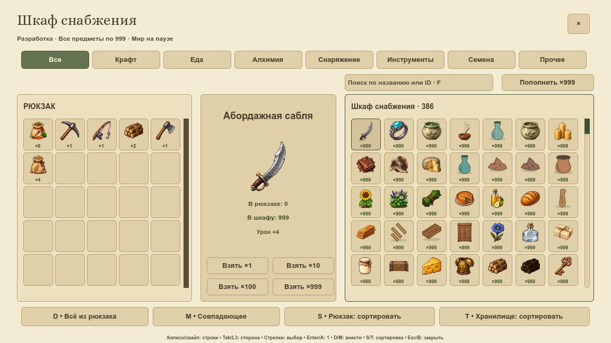
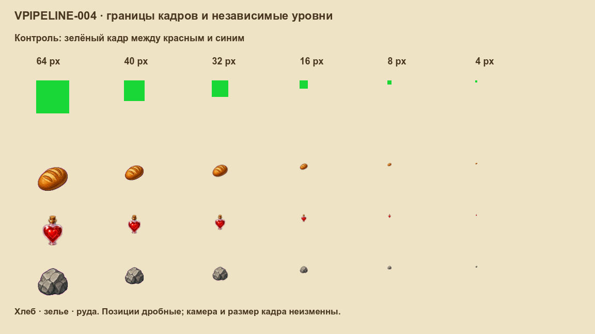

# Атласы без чужих краёв

VPIPELINE-004 подготовила защищённые страницы миниатюр для всех 386 предметов. Небольшие иконки теперь рисуются с линейной фильтрацией и выбирают готовый размер 64, 32, 16 или 8 px. Крупное превью остаётся отдельным рисунком 160 px. Размер ячейки, количество предметов, поиск, переносы и содержимое инвентаря сохраняются.

## Как защищён край

У каждого кадра есть два дополнительных пикселя со всех сторон. Они продолжают его собственный RGBA-край, включая углы. Эти поля не входят в видимую область и не растягивают рисунок. `AtlasTexture.filter_clip` дополнительно ограничивает выборку своим регионом.

Просто добавить поле к большому листу и включить автоматические mipmaps недостаточно: на глубоких уровнях уменьшенный лист снова смешивает соседние кадры. Поэтому сначала отдельно уменьшается каждый предмет, затем он получает собственные поля и упаковывается в страницу соответствующего размера. У четырёх страниц аппаратные mipmaps выключены.

| Размер показа | Выбранный кадр |
|---|---|
| 33–64 px | 64 px |
| 17–32 px | 32 px |
| 9–16 px | 16 px |
| 8 px и меньше | 8 px |
| Больше 64 px | Отдельное превью 160 px |

Для дробных размеров действуют точные пороги 64/32/16/8; например, 32,1 px ещё использует 64. При показе меньше 8 px последний подготовленный уровень остаётся отдельным источником: скрытого общего mip-уровня, смешивающего предметы, нет. При таком уменьшении мелкие детали могут теряться, но соседний предмет не попадает в рисунок.

## Что проверено в движке

Ниже целый нативный кадр Godot: контрольный зелёный кадр расположен между красным и синим, а под ним — настоящие хлеб, зелье и руда. Проверяются 64/40/32/16/8/4 px, дробные положения и два фона.

Новый атлас совпал по всем пикселям с отдельными изображениями тех же кадров на обоих фонах. Негативный контроль с тесной упаковкой и автоматическими mipmaps показал примесь красного к зелёному краю на уменьшении. Это намеренно небезопасная тестовая конфигурация; прежняя выпущенная игра не объявляется использовавшей такой режим.

В настоящей комнате изменения ограничены миниатюрами нижней панели и двумя предметными значками на столе, использующими того же поставщика. Герой, мебель, стены, шрифты, HUD и камера за пределами этих областей совпали с исходным кадром.

## Память и кеш

Все страницы, включая 64 px, загружаются только по запросу. В нативной комнате потребовалась одна страница 32 px; после открытия шкафа — 32 и 64 px. Кадры переиспользуются; максимальное число страниц — четыре, максимальное число кешированных регионов — четыре на предмет. Крупные превью сохраняют прежний предел 16 изображений.

Основная страница занимает 7 398 400 байт RGBA вместо прежних 6 553 600: поля добавляют 844 800 байт, около 0,81 МиБ. Все четыре страницы — 10 342 400 байт, около 9,86 МиБ. Это расчёт пиксельных данных, без накладных расходов драйвера; измерение FPS и длительной памяти остаётся у OPT/VPERF.

## Подготовка нового набора

`python3 tools/run.py assets.contracts.padded_atlases --write` пересоздаёт только производные страницы и их паспорт из действующих миниатюр. После импорта `python3 tools/run.py assets.contracts.padded_atlases` сверяет каждый пиксель рисунка, поля, регионы, хеши и настройки импорта. Если исходный набор изменился, устаревшие страницы явно отклоняются.

Семейство `painted_atlas` допускается только через опубликованный паспорт страниц. Произвольное имя PNG или строка «подготовлен» не разрешают обычному атласу линейную выборку. Остальные неподготовленные атласы остаются защищены `nearest`.

Это первый подключённый пакет. Атласы персонажей, станков и тайлов продолжают свои карточки; автоматический перенос всего мира не выполнен. Основы — [паспорт рисунка](visual-resources.md) и [адресная фильтрация](visual-sampling.md). Общий процесс публикации набора описан в [IDEA-001](IDEA-001.md).
