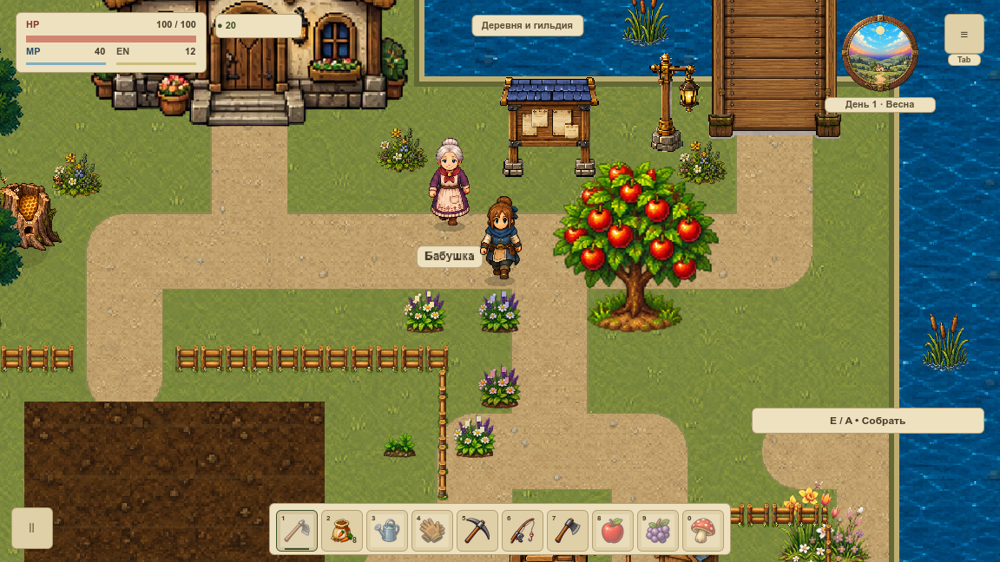
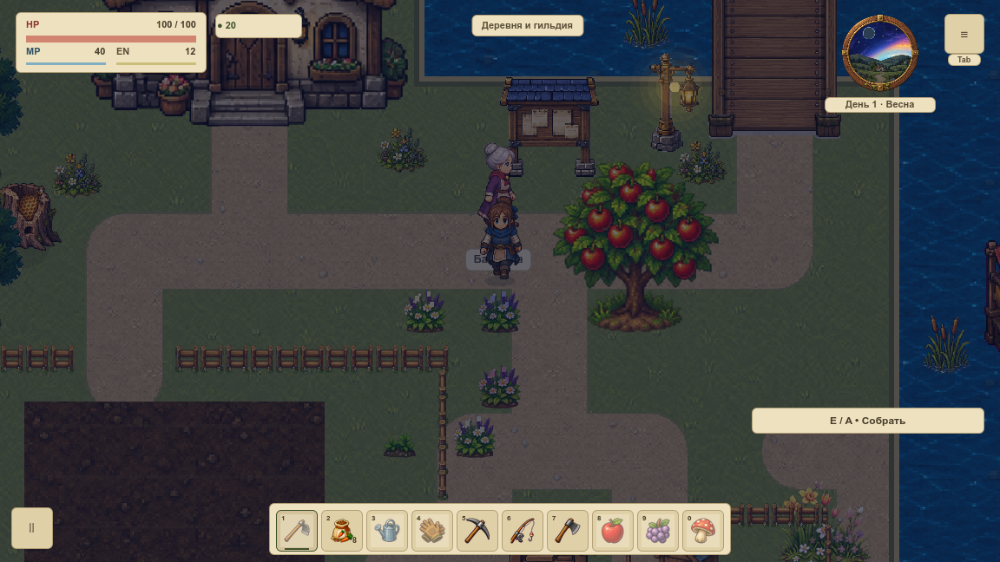

# Измерения первой локации · контракт

**Контракт измерений принят:** полная новая серия 3×30 с + 600 с, раздельные idle и render-журналы, реальные отрицательные контроли. Это основа дальнейших сравнений, а не улучшение FPS. Актуальная готовность задачи берётся из [канонической карточки](#/development/tasks/visual--VPERF-001?queue=village-pilot).

## Почему нужны разные показатели

| Показатель | Что показывает |
|---|---|
| Интервал callbacks | Наблюдаемую длительность основного цикла с ожиданиями; это не отдельное время GPU |
| Граница `frame_post_draw` | Отдельный журнал отрисовки с настоящим счётчиком кадров; не GPU completion и не момент физического показа на экране |
| Мониторы кадра и физики Godot | Отдельные снимки движковых времён; обновление может отставать от кадра |
| CPU процесса | Разность накопленных CPU-секунд по внешнему опросу ОС |
| RSS | Резидентную память процесса; отдельно от static/texture-счётчиков движка |
| Draw calls | Число вызовов рендера, отдельно от длительности кадра |
| GPU-время | Пока неизвестно, сохраняется `null`; не вычисляется вычитанием CPU из интервала |

По [документации Godot](https://docs.godotengine.org/en/stable/classes/class_performance.html), некоторые мониторы доступны только в debug, а обновление может запаздывать до секунды. Нельзя называть короткий CPU-side callback доказательством стабильных 60 FPS.

## Подготовленный протокол

Одна камера `(120.25,430.25)`, масштаб мира 120%, HUD 100%, окно и настоящий framebuffer 1152×648. Новые профиль и процесс, 120 callbacks прогрева, живая автоматическая физика и часы. Три повтора по 30 секунд и один непрерывный цикл 10 минут. Все raw интервалы, p50/p95/p99/max, память, draw calls, питание, VSync и фокус сохраняются.

Readback и CSV наблюдателя выполняются вне измерений. Внешний опрос RSS/CPU/питания — каждые пять секунд; вклад измерителя не скрывается. Заранее выделенные 15,84 МБ журналов входят в память процесса. Потеря фокуса, пауза, другой размер окна, движение камеры или конкурирующий Godot делают серию непригодной для сравнения. Новые настоящие resize/pause-контроли успешно отклонены.

## Что фактически есть

После согласованного сеанса с активным окном записана отдельная полная серия. Все четыре процесса и профиля новые; Git-база и семь входов измерителя сохранены по SHA256. OpenGL Compatibility, одна машина VBASE-002 и питание AC. Прочая нагрузка ОС не контролировалась, результаты не сравниваются напрямую с прежней батарейной серией.

| Запуск | Render p95 / max, мс | RSS max, МиБ |
|---|---|---:|
| Повтор 1 | 81,453 / 155,503 | 968,06 |
| Повтор 2 | 56,306 / 75,199 | 978,81 |
| Повтор 3 | 52,072 / 67,997 | 983,65 |
| Длинный цикл | 51,737 / 119,547 | 986,04 |

Точные длительности — 30,012 / 30,034 / 30,030 и 600,022 с. Все p50/p95/p99/max, CPU и поминутные окна доступны в полном JSON ниже.

Медиана p95 трёх повторов — **56,306 мс**. Это подтверждает проблему плавности. В длинном цикле 16 515 idle / 16 514 render строк, 20 циклов обслуживания; RSS вырос примерно на 1,9 МиБ. Первый короткий повтор содержит резкий спад RSS; причина не установлена, его нельзя выдавать за успех очистки памяти. Все хвосты сохранены. Стоимость наблюдателя, неопределённость редкого опроса и разброс повторов остаются частью результата.

[Полный результат JSON](../../docs/reports/visual-overhaul/vperf-001/summary.json) · [Паспорт и подписи серии](../../docs/reports/visual-overhaul/vperf-001/native/source.json) · [Паспорт отрицательных контролей](../../docs/reports/visual-overhaul/vperf-001/controls/source.json).

Прежняя неполная серия содержит три пригодных коротких запуска и отказ через 495,505 с с потерей фокуса. Её `complete=false` и `acceptance_granted=false` сохраняются. Офлайн-аудит не принимает контракт или FPS. Исходники, raw строки, изображения и подписи истории не переписаны и не смешаны с новой принятой серией.

[Аудит отклонённой серии JSON](../../docs/reports/visual-overhaul/vperf-001/partial-audit.json) · [Ранняя история JSON](../../docs/reports/visual-overhaul/vperf-001/attempt.json).

VPERF-002 сохраняет бюджет, VPERF-009 — 30–60 минут смены карт/боя/шкафов/стройки, VRELEASE-004 — стоимость живого пилота. Эти ворота и [вся первая локация](visual-pilot.md) не объявляются выполненными из-за принятого измерителя. GPU timer остаётся недоступным, `release_fps_accepted=false`, `leak_plateau_accepted=false`.
