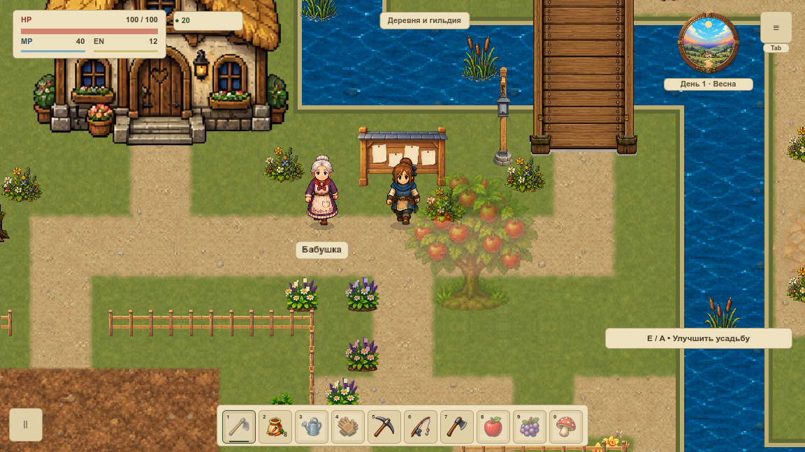
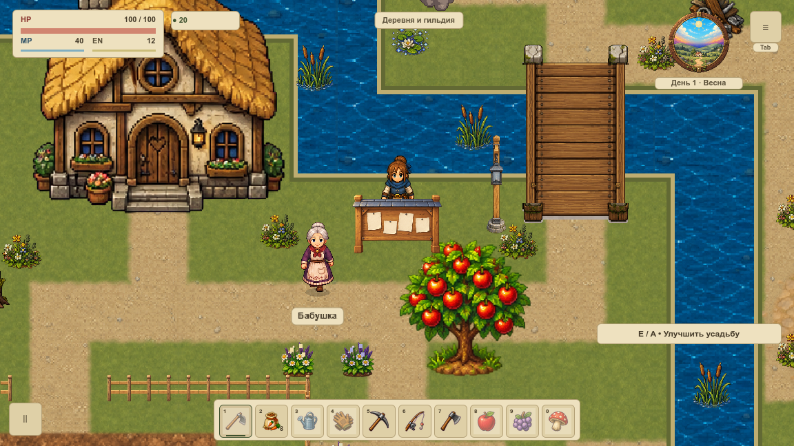
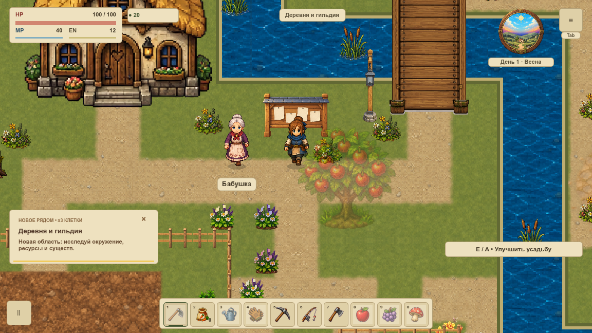
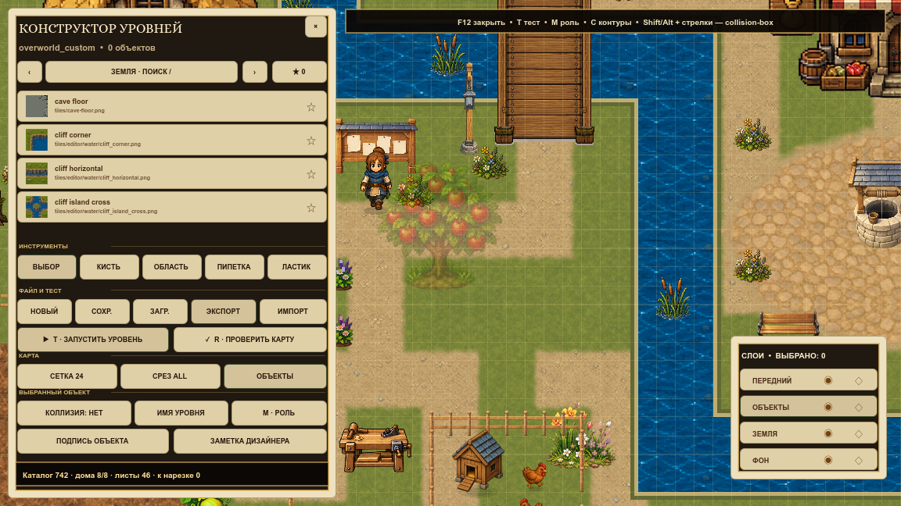
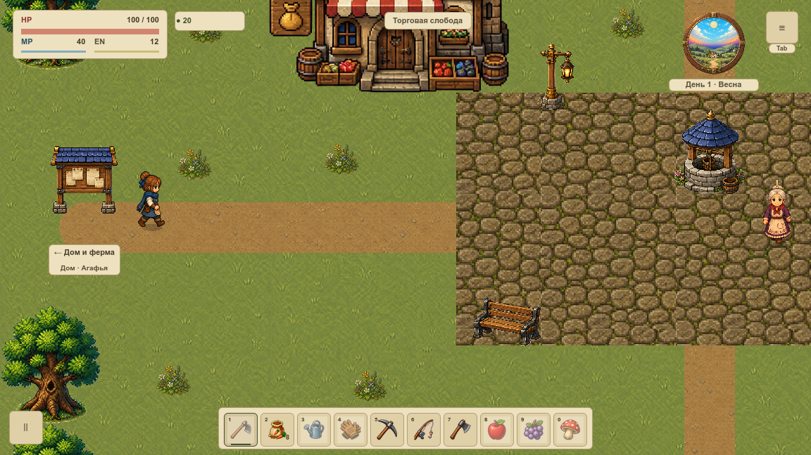

# Выбранный проход первой карты

VRENDER-005 включила в обычной игре один проход: тело доски объявлений `(648,576)` в фазе `behind_actors`. Используется контракт VRENDER-004, с прежним изображением и геометрией. [Карточка и статус](#/development/tasks/visual--VRENDER-005) · [Главный курс](visual-pilot.md).

## Прежний и включённый путь

Кадры выглядят одинаково — это ожидаемый результат. Меняется способ отправки команды рисования. Исходный код снят отдельно до подключения; затем сравниваются выключенный флаг, включённый флаг и default-on.

Эталонная область `(240,312,960,576)`, нижняя опора доски `(648,600)`. Вторая доска, другие предметы и карты сохраняют прежний путь. Кеш содержит до трёх read-only команд без ссылки на Game/Node/callback; в обычной сцене нужен передний вид. Пакет не создаётся заново каждый кадр.

## Перекрытие и отказ

Когда герой проходит за доской, её прежний передний проход сохраняется. Общая сортировка растений/героя относится к VRENDER-006.

Неверный source, чужой мир/слой, отсутствующий ресурс, чужой или наследуемый материал возвращают прежний callback ровно один раз. Материал CanvasItem не переписывается, частичного нового рисунка нет.

## F12 и другие карты

Флаг по умолчанию включён только для выбранного объекта и задней фазы. Временная metadata `pilot_object_pass_enabled=false` возвращает старый маршрут; удаление ключа возвращает default-on. Флаг не записывается в save и не добавляет настройку игрока.

## Проверка

136 PNG / 544 production draw callbacks, два окна 1152×648 и 1280×720, все кадры с фокусом.90 полных RGBA-сравнений совпали побайтно. На каждом размере записаны 32 успешных команды и 24 реальных отказа с однократным fallback. Проверены оба моста, дерево/куст, Escape, хранилище, F12, дом и настоящий переход/возврат.

33 профильных условия защищают область, флаг, кеш, полный save и 1200 правил движения.16Python-контролей отвергают порчу доказательств, неверный default, выход за фазу/область, рост кеша, утечку материала и двойной fallback. Диагностика существует только в QA и ограничена 8 записями.

Новый арт, ветер, общая сортировка, живой пилот, FPS и вся VMAP-003 остаются отдельными этапами. Это включённый технический проход; скорость этим результатом не объявляется улучшенной.

[Нативная сводка](../../docs/reports/visual-overhaul/vrender-005/summary.json) · [Исходный renderer и конфигурация](../../docs/reports/visual-overhaul/vrender-005/native/before/source.json) · [Включённый проход и конфигурация](../../docs/reports/visual-overhaul/vrender-005/native/after/source.json)
