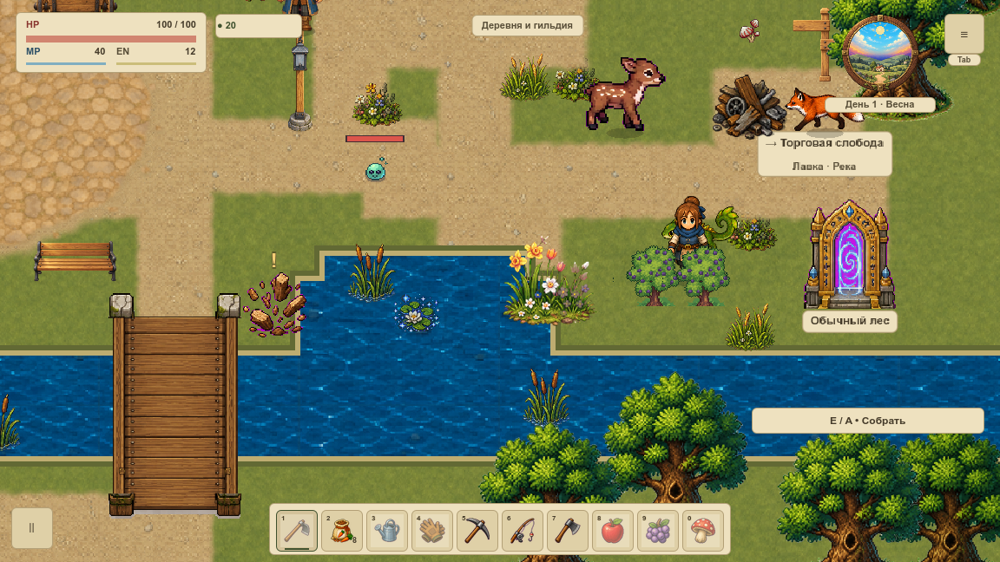
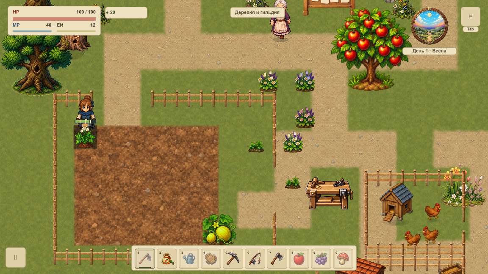
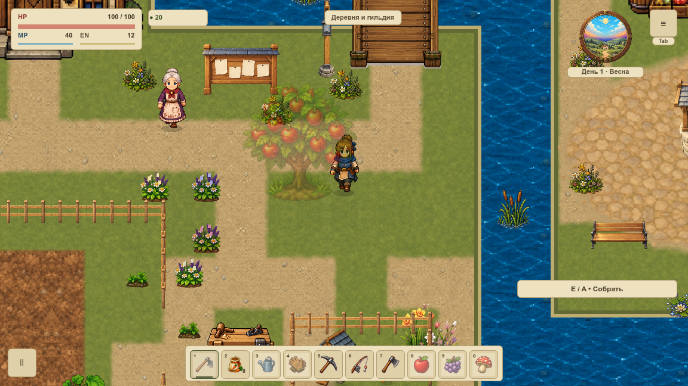

# Герой и растения · порядок глубины

VRENDER-006 сводит существующие деревья, кусты, травы и грядки к одной границе героя. **При равной линии земли герой рисуется поверх растения.** Передний рисунок отправляется ровно один раз, без непрозрачного дубля под ним. [Карточка и статус](#/development/tasks/visual--VRENDER-006) · [Главный курс](visual-pilot.md).

## Куст: до и после

Камера, рисунок, положение героя, коллизии и сохранение одинаковы. У куста с героем сзади листва теперь перекрывает ноги. Низкое растение не получает кроновую прозрачность дерева.

## Грядка и дерево

Грядка передаёт растение, индикаторы и прогресс одним составным рисунком; земля остаётся в грунтовом проходе. Деревья сохраняют прежние прозрачность и погодный слой. Одна отображаемая стопа используется всеми растениями кадра.

При hero_y < ground_y -6 растение находится в переднем проходе. Точная граница и равная опора принадлежат заднему проходу, герой рисуется позже. Равные передние корни упорядочены по постоянному ключу; две картинки с переставленным входным массивом побайтно совпали. Это правило героя и растений, общая сортировка всех NPC остаётся отдельным вопросом.

## Проход и контроли

В роликах24 настоящих шага вдоль дерева через границу, точные дробные положения, куст/грядка, равные корни, оба моста, Escape, хранилище, F12, дом и рынок/возврат. **Физика30Гц, запись10кадров/с: диагностическое замедление, не FPS.** Во время draw QA-режим фиксирует декоративные эффекты для повторяемого сравнения. Новый ветер или художественная вода этими роликами не принимаются.

## Границы и проверка

Новый путь действует только overworld вне F12. plant_depth_enabled=false и неверный тип флага возвращают прежний рисунок. Другие карты сохраняют свой путь. Callback существует только в очереди текущего кадра; после flush очередь пуста, при переносе старый callback отбрасывается. В save не добавлены очередь, GPU-объекты, флаг или положение корня. Геймплей, урожай и коллизии сохранены.

**288 PNG / 576 production callbacks**, два физических окна,96 точных пар старого/выключенного пути и96 полных троек состояния. На размер изменились только четыре кадра с перекрытием куста/грядки. Остальные пиксели и HUD проверены отдельно;30 профильных условий защищают единственность и границу. Новые художественные растения, ветер/вода, FPS, VRELEASE-003 и вся VMAP-003 остаются впереди.

[Нативная сводка](../../docs/reports/visual-overhaul/vrender-006/summary.json) · [Исходные слои и конфигурация](../../docs/reports/visual-overhaul/vrender-006/native/before/source.json) · [Единичные проходы и конфигурация](../../docs/reports/visual-overhaul/vrender-006/native/after/source.json)
