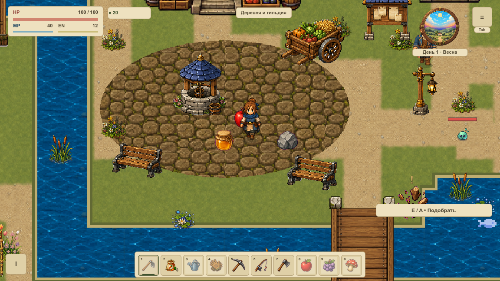
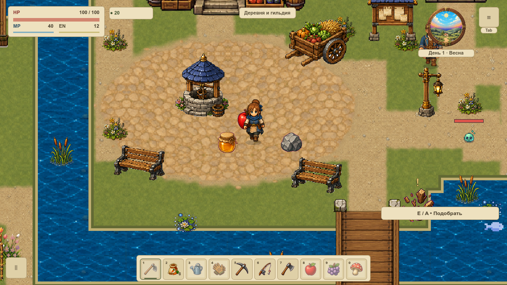
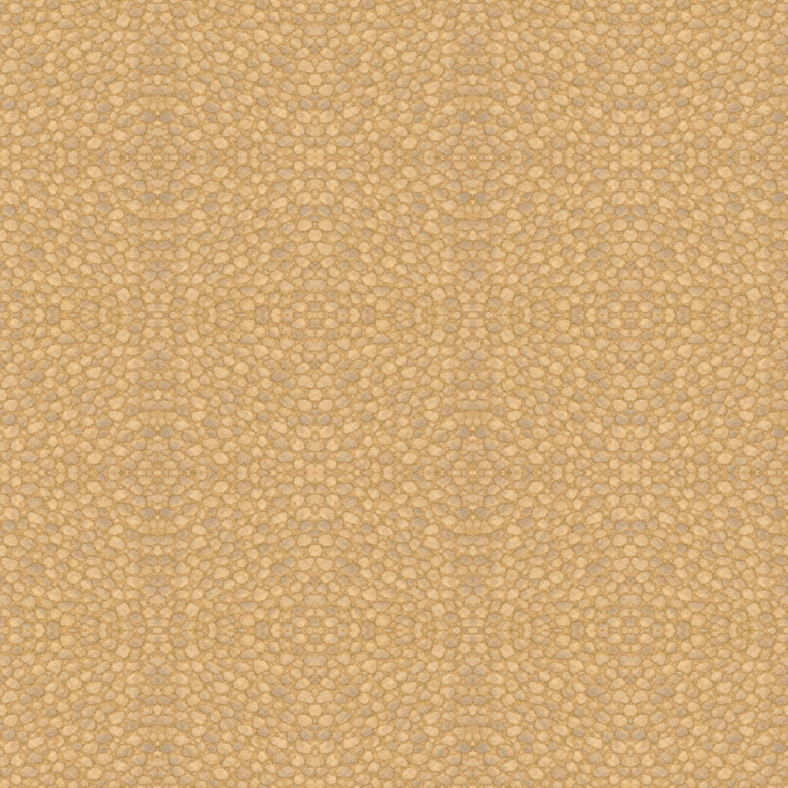
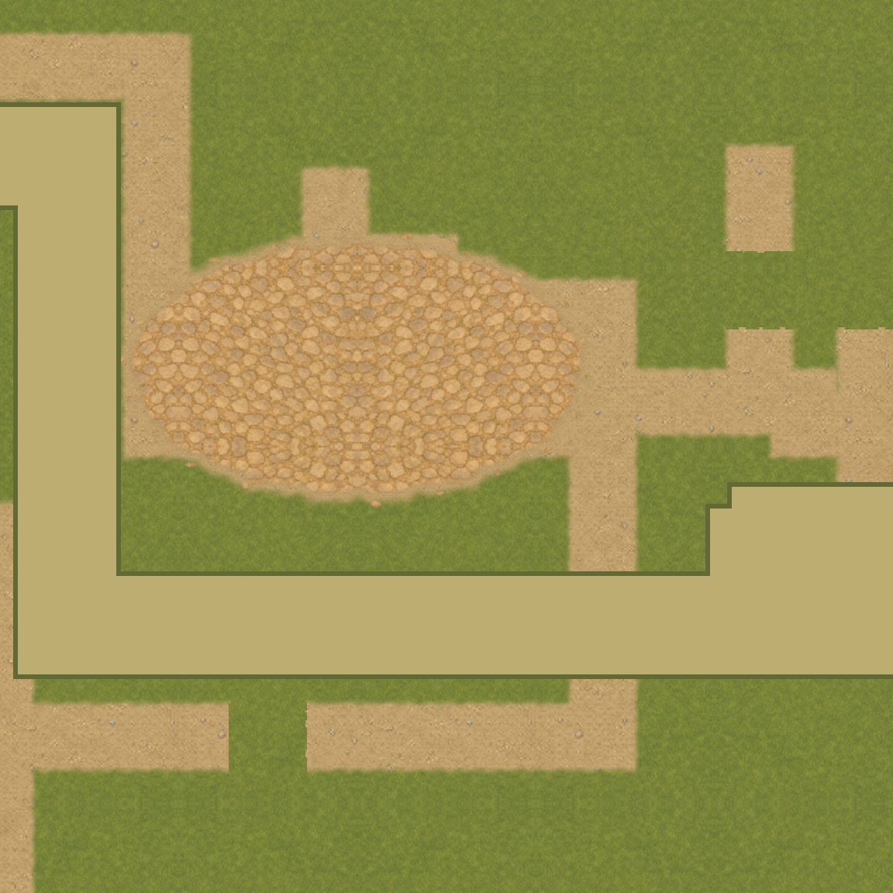

# Площадь и грунт

VGROUND-006 заменила контрастную старую брусчатку первой `overworld` мягким живописным известняком. Земляная кромка, лёгкий контакт и 22 мелких обломка связывают её с дорогой. Герой, колодец и лут остаются прежними. [Карточка](#/development/tasks/visual--VGROUND-006) · [Курс первой локации](visual-pilot.md).

## До и после

Игровые границы площади, движение и вспашка не менялись. На кадре находятся настоящий герой и три предмета — яблоко, камень и мёд. Они сохраняют свои иконки, позиции и масштаб в обеих половинах сравнения.

## Материал и контакт

Новый рисунок — отдельный модуль 512×512, созданный встроенным image_gen по мягкому эталону A. Мастер и точный промпт хранятся отдельно от игровых ресурсов. На полноразмерном повторе разброс яркости p05…p95 уменьшился с 74 до 44, стандартное отклонение — с 22,46 до 13,73. Герой и лут проверены также визуально; эти числа сами по себе не принимают читаемость.

Цвет и покрытие разделены. При смене материала весь альфа-канал совпал побайтно; в сечении края 11 уровней, максимальный шаг 51/255. Контакт мягкий, без тяжёлой обводки. Первый вариант с тёмной почвой отклонён; принята финальная серия C со светлой дорожной землёй. Модуль повторяется через зеркальные UV без цветового скачка в шве.

## Проверка и ограничения

74 нативных PNG / 242 наблюдения draw: два окна, 120%, четыре сезонных тона, дождь, обе стороны площади, дорожные стыки, оба моста и вход/выход дома. Холодный кадр точно равен direct эталону; непрозрачный HUD/интерьер, полные saves/геометрия/очередь сохранены. Кеш неизменен за 120 callbacks.

26 профильных утверждений проверяют 1 200 правил земли, восемь движений у мостов, UV/mipmaps, сколы/контакт и источники. 10 Python-тестов отклоняют неправильные кадры/окно/камеру/HP, потерю альфы, контрастный/пустой материал и ложный FPS. Готовая геометрия — 16 377 вершин; новых узлов, targets и пересчётов поля на кадр нет. Прежняя площадь возвращается флагом без миграции слотов, другие карты не изменены.

Это не FPS-замер. В статичной серии уже открытый обычный Godot сохранён; сосуществование записано явно, любые дополнительные процессы отклоняются. Существующий VPERF-контракт требует отдельного измерительного запуска. GPU timer — `null`; Image-данные и размеры файлов не равны RSS/VRAM. Снег, берег, живая стоимость и итог всей локации VMAP-003 остаются открытыми.

[Итоги](../../docs/reports/visual-overhaul/vground-006/summary.json) · [Происхождение и точный промпт](../../docs/reports/visual-overhaul/vground-006/art-source.json) · [Точные источники](../../docs/reports/visual-overhaul/vground-006/native/source.json).
