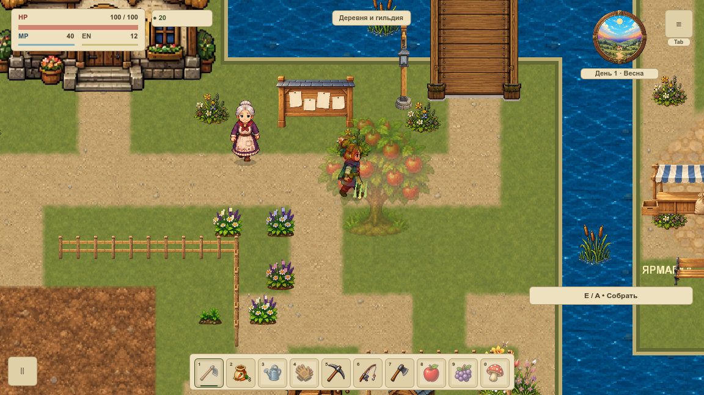
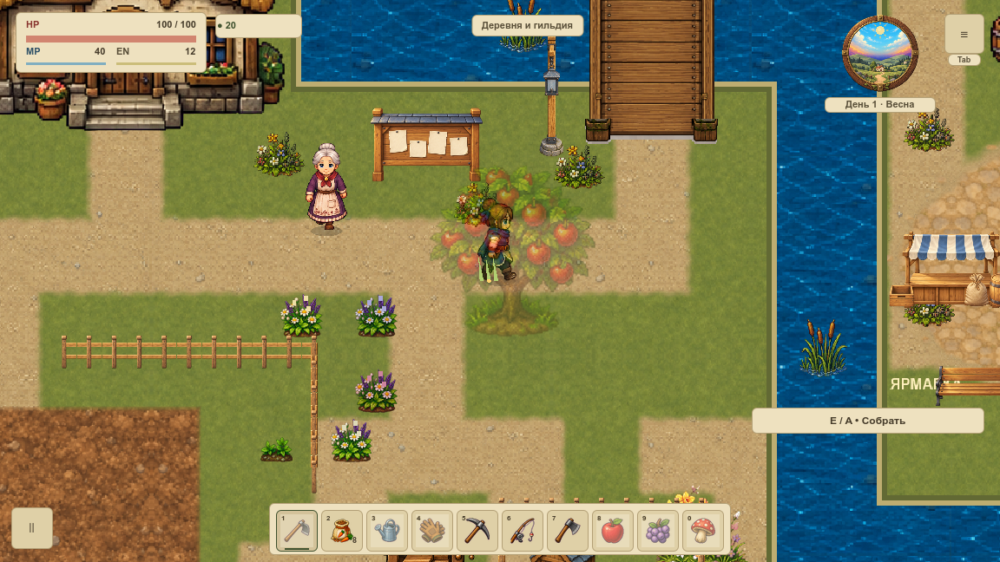
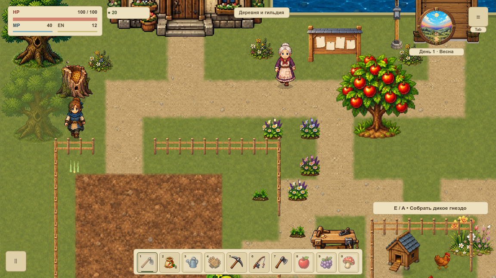
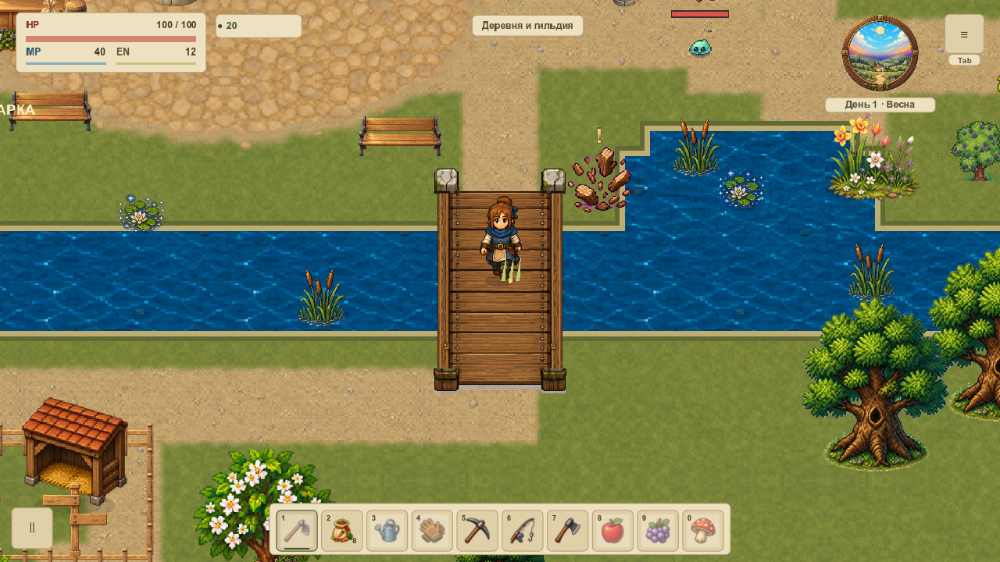

# Время и контакт после движения

VRENDER-008 публикует визуальный кадр **после коллизий, переходов и действий героя**. Декоративные часы первой карты перенесены из начала обновления мира в конец разрешённого такта. [Карточка и статус](#/development/tasks/visual--VRENDER-008) · [Главный курс](visual-pilot.md).

## Что получает растение

Read-only пакет: мир, фактическая мировая опора, время и доступность эффектов. Он не содержит Node, Material, callback или желаемой позиции от кнопки. Контакт использует ту же отображаемую стопу, что герой; камера120% не превращает её в экранные координаты. Зелёный пучок с золотой точкой ниже — отдельный QA-примитив с vertex shader, проверяющий uniform контакта. Новая художественная трава и time-uniform ветра остаются у последующих карточек.

## Упор в ограду

Восемь настоящих тактов с удерживаемым направлением вниз: герой остаётся у сплошной существующей ограды. Пакет получает эту конечную точку; пучок за оградой не сгибается от желаемого движения.

## Нативные маршруты до и после

В каждом ролике40 кадров: ходьба, ограда, дерево/куст, оба моста, Escape, инвентарь, F12, настоящая дверь и соседний рынок/возврат. **Физика30Гц, запись10кадров/с: диагностическое замедление, не FPS.** Во время draw QA-observer фиксирует декоративные эффекты прежним режимом эталона; между draw выполняется настоящий игровой такт. Эти ролики не принимают живую художественную воду или ветер.

## Пауза и перенос

Пауза/инвентарь/потеря фокуса не копят долг и сохраняют замороженный контакт. F12, reduced motion и режим эталона не разрешают влияние на растения. После двери пакет содержит конечную карту и spawn; вне overworld он неактивен. Изменившаяся опора/карта или повреждённый пакет отвергаются до следующего разрешённого такта. Календарь, коллизии, сохранения и другие механики не расширены.

## Подтверждение

**160 PNG / 320 production draw callbacks.80 пар полных сохранений и80 полных RGBA-пар совпали.** Два настоящих размера окна,48 профильных условий,20 отрицательных Python-сценариев. Все четыре MP4 независимо декодированы и сопоставлены с исходным первым PNG. Время проверяется по реальным часам и пакету, а shader uniform — по контакту. Новая сортировка, ветер/вода, FPS, VRELEASE-003 и вся VMAP-003 остаются открытыми.

Исходные попытки с разным seed и ленивым интерьерным состоянием отклонены. Финальные серии целиком пересняты с одинаковым seed; пустое существующее pottery-состояние подготовлено в обоих QA-профилях до измерений. Его прежняя ленивая инициализация в обычном интерьере здесь не объявляется исправленной. Пользовательские слоты не использовались.

[Нативная сводка](../../docs/reports/visual-overhaul/vrender-008/summary.json) · [Исходный callback и конфигурация](../../docs/reports/visual-overhaul/vrender-008/native/before/source.json) · [Новый publisher и конфигурация](../../docs/reports/visual-overhaul/vrender-008/native/after/source.json)
