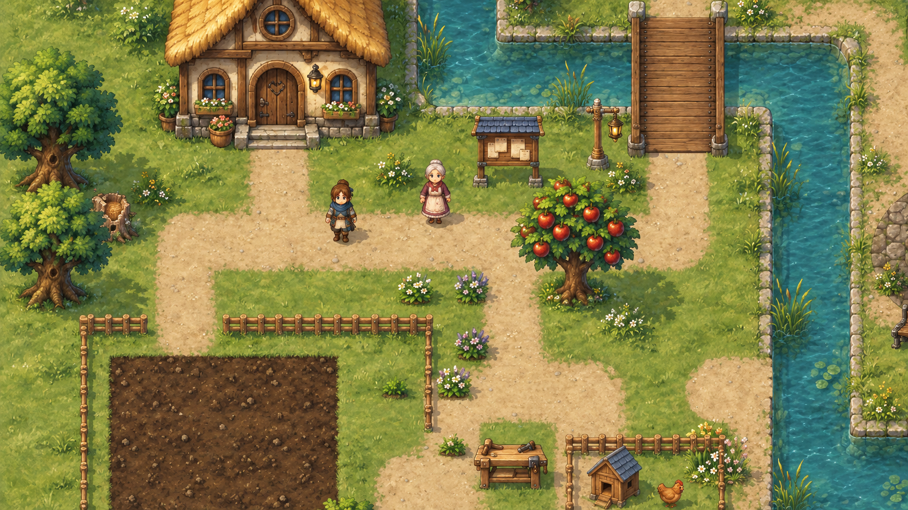

# От живописной деревни до выпуска игры

Решение Expert Agent от **16 ноября 2026**, принятое по прямому поручению владельца. [Карточки и живые статусы](#/development/first-location) · [Выпускные задачи](#/development/epics/release--DEMO).

Цель — уютная современная RPG: приятно идти по миру, понятно взаимодействовать с ним, интересно закончить приключение и вернуться на свою ферму. Принятый рисунок A, естественная вода, мягкий свет и устойчивый кадр важнее количества новых систем. Наличие механик в коде ещё не означает готовую демоверсию.

## Три больших шага

| Шаг | Что получает игрок | Условие перехода |
| --- | --- | --- |
| 1. Качество первой локации | Вся деревня `overworld` в стиле A, движение и взаимодействия без визуальных разрывов | Живой пилот VRELEASE-003, измеренная стоимость VRELEASE-004, вся карта VMAP-001…003 |
| 2. Законченное приключение | Ферма, жители, ремонт моста, лесной Страж, редкое семя и выбор награды; 10 полностью оформленных карт | Ведомость DEMO-002, итог графики DEMO-007, все VMAP демо, сквозная глава DEMO-003 и подача DEMO-004 |
| 3. Выпуск демо | Клиент, который можно установить, пройти и продолжить без среды разработчика | Устройства/плавность, внешний QA-04, исправления DEMO-005, QA-05 и выпускная DEMO-006 |

Это последовательность результатов, а не три больших коммита. Внутри — одна игровая задача за раз, отдельные ветки/PR и независимое ревью каждого точного head. Число карточек не является оценкой часов: сроки уточняются по фактическому темпу первой карты и плейтесту.

## Границы демо: все доступные места дорисованы

В демо входят **10 существующих карт**, включая всю деревню и нужные места жителей. Так мы не разрезаем домашнюю часть мира случайными закрытыми проходами.

| Карта | Роль | Каноническая графическая приёмка |
| --- | --- | --- |
| Деревня и ферма · overworld | Домашний цикл, оба моста, огород, животные | VMAP-001…003 |
| Обычный лес · forest | Исследование, Страж чащи, механизм и семя | VMAP-004…006 |
| Торговая слобода · village_market | Деревенские услуги и жители | VMAP-028…030 |
| Сад травницы · village_garden | Агафья и сюжетное поручение | VMAP-031…033 |
| Речная переправа · village_river | Рыбалка и спокойное исследование | VMAP-034…036 |
| Ремесленный двор · village_workyard | Существующие службы и ремесло | VMAP-037…039 |
| Яблоневый сад · village_orchard | Домашняя прогулка и сбор | VMAP-040…042 |
| Дом бабушки · cottage_interior | Отдых, хранение и возвращение | VMAP-061…063 |
| Сельская лавка · shop_interior | Семена, камень и доступная экономика | VMAP-064…066 |
| Зал гильдии · guild_interior | Жители и уже существующие службы | VMAP-067…069 |

**DEMO-001** проверяет весь граф входов/выходов, расписания, доступность услуг, ресурсов и наград. Вне этого набора находятся каменистая область, руины, пещеры, поздние регионы и прочие интерьеры. Их переходы в профиле демо должны быть понятны и безопасны, а исходный полный режим сохраняется. Нельзя просто скрыть кнопку и оставить активный портал, телепорт или расписание с недоступным обязательным NPC.

В коде первая глава уже содержит 12 событий и три награды. Обнаруженная граница: `early_return_location` сейчас действует только до завершения главы. При реализации DEMO-001 нужно сохранить возвращение из леса и после награды, иначе демо рискует отправить игрока в позднюю область. Это конкретная проверка, не утверждение, что дефект уже исправлен.

**DEMO-002** — обязательный список всей видимой графики: герой и его действия, жители, враги, посевы/урожай, предметы/иконки, дома/интерьеры, HUD, день/ночь/погода. DEMO-002 назначает каждому ресурсу настоящую карточку VACTOR/VPLANT/VBUILD/VICON и добавляет её в зависимости отдельной приёмки DEMO-007. После принятия постановки команда выполняет эти задачи по одной; DEMO-007 сверяет готовые ресурсы и все 10 карт в игре. Финальная графика всех десяти карт обязательна к выпуску; существующий PNG или концепт сам по себе не принимает игровую реализацию. Неиспользуемый в демо каталог переносится позднее.

## Приключение и ощущение качества

Существующий маршрут WORLD-01: бабушка → первые посадки и 10 морковок → Агафья → 8 древесины и 4 камня для моста → лес → Страж чащи → механизм → редкое семя → одна из трёх наград. Все ресурсы получаются обычной игрой. Старые «5–7 дней» — модель игрового времени; цель первого прохождения **45–90 минут** — новая гипотеза, которую проверяет внешний плейтест, а не таймер-ограничение.

В начале должна быть понятна ближайшая цель; во время ожидания роста — доступны небольшие добровольные занятия. Бой требует читаемой подготовки атаки и честного спасения. После финала остаются ферма, сохранение и возвращение домой. Новые рецепты, большие ветки талантов, станции и побочные миры не становятся обязательными ради наполнения демо.

Плавность принимается на заявленном оборудовании по VPERF/OPT: реальные интервалы кадра, холодный/тёплый вход, длинная сессия и память. Цель 60 FPS не считается достигнутой из-за красивого видео. UI проверяется в шести языках, на реальных устройствах ввода, с читаемым текстом, фокусом и отменой. Если нужен новый звук, Developer Agent даёт Music Agent предметный бриф и проверяет результат в игре.

Внешний плейтест — минимум пять участников с разным опытом. Предложенный порог: 4/5 проходят без подсказок разработчика, 3/5 хотят продолжить; это гипотеза допуска, а не доказанный спрос. Потеря прогресса, тупик или неработающий обязательный ввод блокируют выпуск независимо от среднего результата.

## После демо: полная игра 1.0

Полная версия включает **все 30 уже существующих карт**, а не весь список когда-либо предложенных идей. Остальные двадцать карт имеют собственные карточки на странице прогресса. Порядок детализации: каменистая область → руины/тюрьма → кристальные пещеры и подземные комнаты → поздние наружные области → интерьеры и замок. До производства проверяются реальные зависимости и роль области в кампании.

RELEASE-001 принимает состав и ведомость, RELEASE-002 — целостную существующую кампанию/экономику, VRELEASE-008/010 — всю графическую миграцию, RELEASE-003 — полный маршрут и переход сохранений демо в 1.0, RELEASE-004 — распространяемые сборки и решение о выпуске. Число выполненных VMAP не заменяет сюжетную и техническую приёмку.

**Одобрена IDEA-192 «Следы сапог на сырой земле»** — только ограниченная визуальная полировка после DEMO-006: один мокрый огород, конечный пул, без грязи на одежде или новой системы выслеживания. Её три задачи и прежние отдельные оценки сохранены; нативная стоимость и заметность для игрока ещё предстоит проверить. Остальные идеи сохраняют свои текущие решения и не включаются автоматически.

## Поддержка и DLC

Ниже отметки полной игры находятся LIVE-001 — патчи и небольшие улучшения, LIVE-002 — предпроект одного самостоятельного дополнения по реальным отзывам. Каждый обнаруженный баг получает свою карточку; каждый DLC — свой тематический эпик, первый законченный выпуск и собственные зависимости. Сейчас DLC не выбран и не обещан. Двадцать отложенных карт базовой игры не становятся платным дополнением по умолчанию.

## С чего начинает команда

Дополнение владельца 17 ноября: до демо обязательны **два взрослых выбираемых героя** — привлекательный мускулистый мужчина и привлекательная женщина с выраженной естественной грудью и женственным силуэтом. Оба получают полный комплект рисунков, живую походку, переходы и позы с предметами в руках. В шаге 2 есть карточка «Два героя: выбор и живое движение». VACTOR-001…004 сохраняют владение рисунками; HERO-01 отвечает за выбор/сохранения, HERO-02 — за фактическую приёмку обоих наборов и блокирует DEMO-007. [Паспорт, матрица и критерии HERO](demo-heroes.md).

Для плавности сначала VANIM-002 сравнивает 3D-модель/rig с предварительным рендером 2D-кадров и качественную 2D-анимацию на одном живом образце. Предпочтителен 3D → 2D при сохранении живописного стиля и бюджета. Принимаются перенос веса, контакт стоп, темп по скорости, переходы и хват, а не короткий цикл из пары кадров или красивый статичный концепт. Количество поз и частота выбираются по нативному видео; FPS анимации не подменяет производительность игры.

1. **VSHORE-005**, **VSHORE-006** и **REFACTOR-09** приняты. VSHORE-005 учтена через PR №54/56, VSHORE-006 — через PR №59/60. Постановка переноса проверок лавок оформлена в PR №57, реализация принята в PR №61. Первый технический выпуск REFACTOR-03/07/06 завершён.
2. Команда возвращается к каноническому маршруту первой `overworld`. Сначала живой пилот **VRELEASE-003**, затем его бюджет **VRELEASE-004** и приёмка всей локации **VMAP-001…003**. Актуальные статусы и полный порядок зависимостей указаны в карточках.
3. После VMAP-003 первым идёт **DEMO-001**, затем внутренний пилот VRELEASE-006, адресная ведомость DEMO-002 и карты демо. WORLD/UX/QA/OPT берутся по полным зависимостям и конкретным проблемам, а не по номеру процента.
4. Tech Lead проверяет точный head, Team Lead решает о приёмке и следующей задаче. Expert Agent отвечает за границы продукта и проработку выпусков; не заменяет независимое ревью автора.

[Прогресс по локациям](#/development/first-location) · [Демо](#/development/epics/release--DEMO) · [Полный выпуск](#/development/epics/release--RELEASE) · [Поддержка](#/development/epics/release--LIVE).
