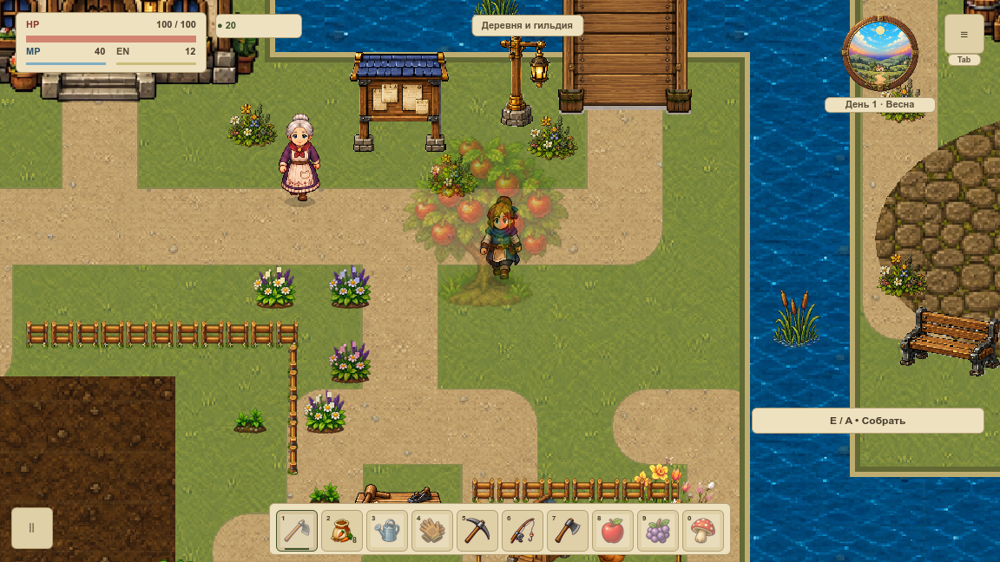
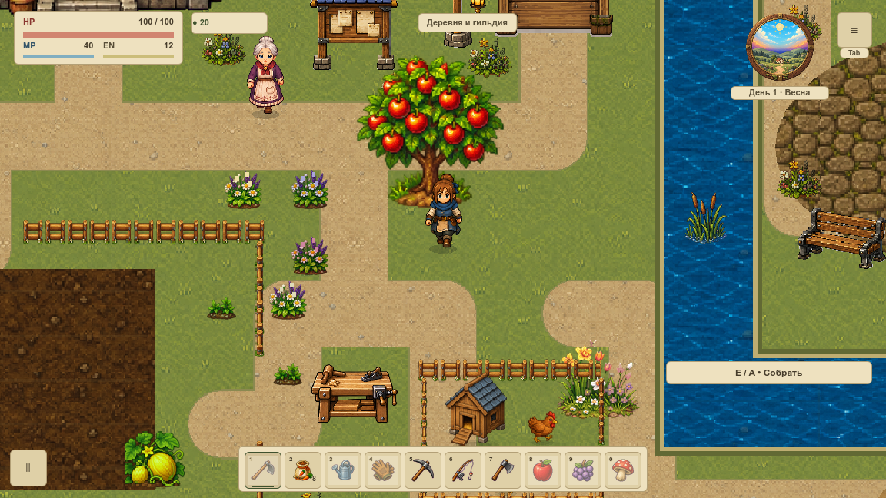
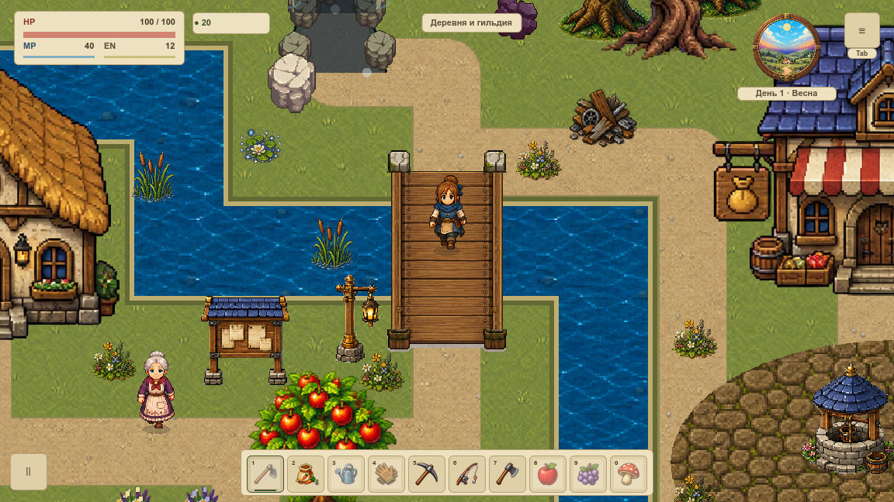

# Как собирается кадр первой локации

**VRENDER-001:** порядок существующих команд закреплён по исходникам и нативным кадрам. Это подготовка безопасного переноса живописной графики на [всю первую локацию](visual-pilot.md). [Статус и критерии карточки](#/development/tasks/visual--VRENDER-001?queue=village-pilot) остаются единственным источником готовности.

## От земли до интерфейса

| Проход | Что происходит |
|---|---|
| Фоновый узел | WorldBackground компонуется позади Game. Первая карта берёт готовый terrain-кеш или прямую отрисовку земли |
| Ранние экраны | Язык/title завершают маршрут отдельно. Непрозрачное хранилище пропускает мир и оставляет экранные проходы |
| Начало мира | Очистка очереди перекрытий, общая матрица камеры; затем фоновые предметы, ферма и RPG world |
| Слои земли | VillageRegion, fishing, biome trees, cave/boss ground; published/editor background и ground |
| Предметы и актёры | Buildings/events/NPC, hazards/enemies, деревья/ресурсы/еда, loot/wildlife/drops, traps/companions, ферма/сюжет/ограды, published/editor objects |
| Герой | draw_player разделяет задние и передние команды |
| Передний план | Livestock/boss/cave/spell/interior, VillageForeground с очередью деревьев и высокими предметами, adventure и published/editor foreground, debug, apiary и placement overlays |
| Экран | Identity transform → atmosphere → HUD и UI с photo/editor/clean gates |
| Верхние окна | Editor/basement UI → pause/settings/defeat → MenuHub → QA teleport → feedback → recovery notice |

В [полном паспорте команд](../../docs/reports/visual-overhaul/vrender-001/contract.json) сохранены **94 методных упоминания**, строки исходников и точные guards. Это условная структура исходного кода, не 94 выполненных GPU-команды одного кадра. Ниже доступен весь список; внутренние переходы `draw_screen` и условие `opaque_storage` показаны в схеме отдельно.

## Где мир, а где экран

Мир использует `zoom × (world − camera)`: первая overworld 120%, поле 960×540. Фоновый Node2D получает ту же позицию/масштаб и `show_behind_parent=true`. Грунт собирается в offscreen SubViewport 2400×1368 при инвалидировании; это кеш мира, не дополнительная камера. После сброса draw-transform HUD работает в логическом canvas 1152×648 при 100%, а оконный stretch выполняется один раз.

В обоих нативных окнах — **1152×648 и 1280×720** — настоящий readback соответствует физическому размеру, логический canvas остаётся 1152×648. Материалы game/background/terrain фактически `null`: используются обычные CanvasItem, текстуры, шрифты и цвет команд. Новый шейдер или normal map этой задачей не внедрялись. Для времени и памяти применяется отдельный [измерительный контракт](performance-contract.md).

## Перекрытия на настоящих объектах

Координаты яблони берутся из текущих игровых данных `(744,744)`. Когда герой за ней, передний проход кроны имеет альфу **0,34**; когда южнее — альфа **1,0**, дерево непрозрачно, герой поверх. Временный fade/cache не входит в сохранение. Очередь TreeOcclusion после каждого draw опустошается.

**У прежнего моста перила запечены в грунт.** Отдельного переднего прохода у них пока нет. Кадр ниже сохраняет существующий результат; он не принимает новое перекрытие перилами. Новые детали берега/моста остаются [отдельным комплектом](shore-kit.md), их подключение и разделение слоёв выполняются следующими владельцами.

## Что проверено

**18 пар PNG, 72 реальных draw callbacks, ноль отличающихся пикселей и игровых snapshot.** Для каждой композиции baseline и observed имеют одну камеру. В двух окнах проверены деревня, настоящее дерево с двух сторон, ягодный куст, мост, пауза, непрозрачное хранилище, вход в существующий дом и выход обратно. Escape подан через production input router; это автоматизированная проверка, не физическая запись клавиатуры.

Наблюдатель вызывает настоящий `super._draw()`. До/после каждого draw сравнивается полный SaveSystem.snapshot, а также камера/позиция/локация/меню. Прогревочные кеши разрешены; сравнение не охватывает произвольную память всех узлов. Симуляция остановлена, PNG/readback и сериализация исключают FPS-приёмку. Для подмены HP/камеры, пикселя, очереди и устаревшего дерева есть отрицательные проверки на временных копиях.

[Нативный результат JSON](../../docs/reports/visual-overhaul/vrender-001/summary.json) · [Исходники и подписи серии](../../docs/reports/visual-overhaul/vrender-001/native/source.json).

VRENDER-002/003 сохраняют следующие технические решения. Новые shader effects, batching, стоимость и VMAP-003 не объявляются выполненными из-за принятой схемы команд. Порядок разработки остаётся в [маршруте первой локации](visual-pilot.md).

## Полный список методных упоминаний

Порядок — как в RenderSystem, с отдельной функцией и строкой. Внутри одной исходной строки могут находиться несколько последовательных вызовов. Точные условия и вся строка доступны в паспорте JSON выше.

| # | Function / line | Method |
|---:|---|---|
| 1 | `draw:13` | `game.draw_language_screen` |
| 2 | `draw:13` | `game.UiFeedbackRenderer.draw` |
| 3 | `draw:15` | `game.draw_title_screen` |
| 4 | `draw:15` | `game.UiFeedbackRenderer.draw` |
| 5 | `draw:17` | `game.draw_set_transform` |
| 6 | `draw:18` | `TreeOcclusion.begin_frame` |
| 7 | `draw:19` | `WorldProjection.apply` |
| 8 | `draw:20` | `game.BuildingSystem.is_interior` |
| 9 | `draw:21` | `game.draw_interior_objects` |
| 10 | `draw:21` | `game.draw_quest_npcs` |
| 11 | `draw:23` | `game.VillageAmbientRenderer.draw_ground` |
| 12 | `draw:23` | `game.draw_farm` |
| 13 | `draw:23` | `VillagePropRenderer.draw` |
| 14 | `draw:23` | `game.draw_rpg_world` |
| 15 | `draw:25` | `game.draw_farm` |
| 16 | `draw:26` | `preload("res://scripts/presentation/village_region_renderer.gd").draw_ground` |
| 17 | `draw:27` | `preload("res://scripts/presentation/village_region_renderer.gd").draw_objects` |
| 18 | `draw:28` | `game.draw_fishing_animations` |
| 19 | `draw:29` | `game.EnvironmentVisualSystem.draw_biome_trees` |
| 20 | `draw:30` | `CaveRenderer.draw_lights` |
| 21 | `draw:30` | `BossRenderer.draw_ground` |
| 22 | `draw:31` | `game.PublishedLevelRenderer.draw_layer` |
| 23 | `draw:31` | `game.PublishedLevelRenderer.draw_layer` |
| 24 | `draw:31` | `game.LevelEditorRenderer.draw_layer` |
| 25 | `draw:31` | `game.LevelEditorRenderer.draw_layer` |
| 26 | `draw:32` | `game.BuildingSystem.is_interior` |
| 27 | `draw:33` | `game.draw_buildings` |
| 28 | `draw:33` | `game.draw_world_events` |
| 29 | `draw:33` | `game.VillageEventRenderer.draw` |
| 30 | `draw:33` | `game.draw_quest_npcs` |
| 31 | `draw:34` | `game.CastleCampaignRenderer.draw` |
| 32 | `draw:34` | `game.draw_hazards` |
| 33 | `draw:34` | `game.draw_enemy_nodes_and_gate` |
| 34 | `draw:34` | `BossRenderer.draw_actors` |
| 35 | `draw:34` | `game.draw_tree_nodes` |
| 36 | `draw:34` | `game.draw_resource_nodes` |
| 37 | `draw:34` | `game.draw_food_nodes` |
| 38 | `draw:34` | `game.draw_world_loot` |
| 39 | `draw:34` | `game.draw_wildlife` |
| 40 | `draw:34` | `game.draw_dropped_items` |
| 41 | `draw:34` | `FishingRenderer.draw_traps` |
| 42 | `draw:34` | `game.draw_companions` |
| 43 | `draw:34` | `game.FarmLifeRenderer.draw_world` |
| 44 | `draw:34` | `game.FirstChapterRenderer.draw_world` |
| 45 | `draw:34` | `game.FenceRenderer.draw_world` |
| 46 | `draw:34` | `game.PublishedLevelRenderer.draw_layer` |
| 47 | `draw:34` | `game.LevelEditorRenderer.draw_layer` |
| 48 | `draw:34` | `game.draw_player` |
| 49 | `draw:34` | `preload("res://scripts/systems/livestock_renderer.gd").draw` |
| 50 | `draw:34` | `BossRenderer.draw_front` |
| 51 | `draw:34` | `CaveRenderer.draw_foreground` |
| 52 | `draw:34` | `game.SpellRenderer.draw_world` |
| 53 | `draw:34` | `game.InteriorRenderer.draw_foreground` |
| 54 | `draw:34` | `game.VillageForegroundRenderer.draw` |
| 55 | `draw:34` | `game.AdventurePolishRenderer.draw_world` |
| 56 | `draw:34` | `game.PublishedLevelRenderer.draw_layer` |
| 57 | `draw:34` | `game.LevelEditorRenderer.draw_layer` |
| 58 | `draw:34` | `game.DebugPlaygroundRenderer.draw_world_overlay` |
| 59 | `draw:34` | `game.DebugOverlayRenderer.draw_world` |
| 60 | `draw:35` | `preload("res://scripts/presentation/apiary_visual_system.gd").draw_world` |
| 61 | `draw:36` | `preload("res://scripts/presentation/house_furniture_placement_renderer.gd").draw` |
| 62 | `draw:37` | `preload("res://scripts/presentation/basement_renderer.gd").placement` |
| 63 | `draw:38` | `preload("res://scripts/presentation/basement_renderer.gd").work_overlay` |
| 64 | `draw:39` | `game.draw_set_transform` |
| 65 | `draw:39` | `game.AtmosphereRenderer.draw` |
| 66 | `draw:40` | `game.has_meta` |
| 67 | `opaque_storage:45` | `game.has_meta` |
| 68 | `opaque_storage:45` | `game.FarmLifeSystem.state` |
| 69 | `opaque_storage:45` | `game.LevelEditorSystem.active` |
| 70 | `opaque_storage:45` | `preload("res://scripts/systems/dev_cabinet_system.gd").active` |
| 71 | `draw_screen:49` | `preload("res://scripts/presentation/visual_reference_mode.gd").hud_visible` |
| 72 | `draw_screen:50` | `game.FarmLifeSystem.state` |
| 73 | `draw_screen:50` | `game.LevelEditorSystem.active` |
| 74 | `draw_screen:50` | `game.draw_ui` |
| 75 | `draw_screen:50` | `BossRenderer.draw_ui` |
| 76 | `draw_screen:50` | `FishingRenderer.draw` |
| 77 | `draw_screen:50` | `game.WorldMapRenderer.draw` |
| 78 | `draw_screen:50` | `game.AdventurePolishRenderer.draw_ui` |
| 79 | `draw_screen:50` | `game.FenceRenderer.draw_ui` |
| 80 | `draw_screen:50` | `game.SpellRenderer.draw_ui` |
| 81 | `draw_screen:51` | `game.LevelEditorSystem.active` |
| 82 | `draw_screen:52` | `game.FarmLifeRenderer.draw_ui` |
| 83 | `draw_screen:53` | `game.has_meta` |
| 84 | `draw_screen:53` | `game.FirstChapterRenderer.draw_ui` |
| 85 | `draw_screen:54` | `game.StoryUiRenderer.draw_notification` |
| 86 | `draw_screen:55` | `game.DebugPlaygroundRenderer.draw_overlay` |
| 87 | `draw_screen:55` | `game.DebugOverlayRenderer.draw_panel` |
| 88 | `draw_screen:56` | `game.LevelEditorRenderer.draw_panel` |
| 89 | `draw_screen:57` | `preload("res://scripts/presentation/basement_renderer.gd").ui` |
| 90 | `draw_screen:58` | `game.MenuRenderer.draw_pause_layer` |
| 91 | `draw_screen:59` | `preload("res://scripts/systems/menu_hub_system.gd").draw_chrome` |
| 92 | `draw_screen:60` | `preload("res://scripts/presentation/qa_teleport_renderer.gd").draw` |
| 93 | `draw_screen:61` | `game.UiFeedbackRenderer.draw` |
| 94 | `draw_screen:62` | `preload("res://scripts/presentation/recovery_notice_renderer.gd").draw` |
