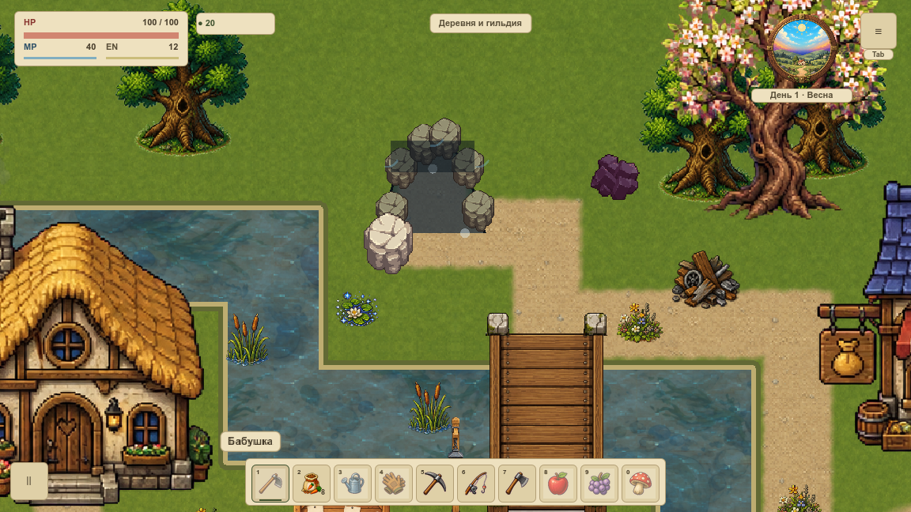
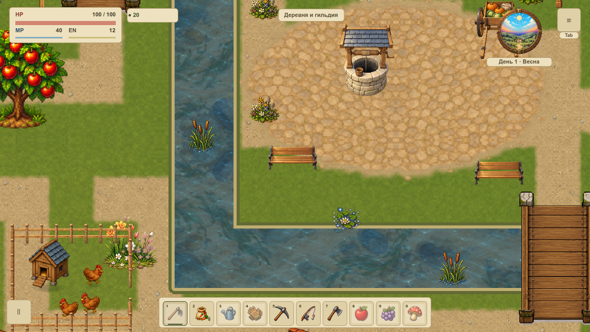

# Течение вдоль русла

На прямых река течёт вдоль берега. На изгибе рябь поворачивает вместе с руслом. В пруду остаётся спокойная рябь, а при уменьшенном движении вода статична.

| До · у западного моста | После · у западного моста |
| --- | --- |
|  |  |

| До · у деревенской площади | После · у деревенской площади |
| --- | --- |
|  |  |

По кадрам проверены направления на прямых и четырёх изгибах. Рыбалка и проход по обоим мостам проверены игровыми тестами. [Карточка VSHORE-006](#/development/tasks/visual--VSHORE-006) · [Нативный захват](../../docs/reports/visual-overhaul/vshore-006/native/capture.json) · [Измерения](../../docs/reports/visual-overhaul/vshore-006/native/metrics.json).
