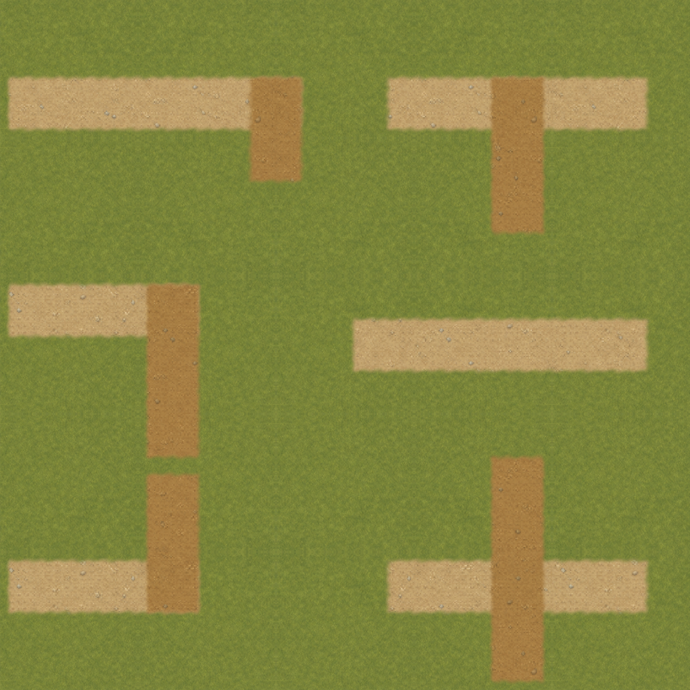

# Соединения дорожной сети

В VGROUND-005 основные дороги и выходные ветви первой `overworld` получили общий материал и непрерывную фактуру. Прежние осевые пути и [плоские торцы](axial-roads.md) сохранены. [Карточка](#/development/tasks/visual--VGROUND-005) · [Курс первой локации](visual-pilot.md).

## До и после

Основные и выходные дорожки раньше рисовались друг поверх друга с разным оттенком. Теперь у них общее покрытие; каждая часть принадлежит только одному слою. Поэтому Т-стыки, кресты и повороты не получают вторую тёмную линию. Ширина — 72 мира, UV общие. Порядок относительно площади, огорода, берегов и мостов сохранён; две маски позволяют вернуть прежний вариант без миграции слотов.

## Проверка стыков

Листы сняты на GPU при 120%. Независимый контроль рисует все ветви единым проходом: альфа совпала побайтно, разница цвета не выше 1/255. На пяти рукавах ширина 85–88 px при номинальных 86,4 px с мягким неровным краем. Два слоя покрывают ровно те же 166 010 клеток полной карты, не пересекаясь. Изменение материала также не меняет альфу.

## Безопасность и границы

Серия A: 68 PNG / 210 наблюдений draw, два окна, четыре сезонных тона, дождь, три настоящих соединения, оба моста и вход/выход дома. 23 профильных утверждения и 9 Python-тестов; в 1 200 точках правила земли прежние, восемь движений у мостов и полный save сохранились. Холодный кадр точно равен direct эталону, HUD/интерьер не изменились, кеш неизменен за 120 callbacks. Постоянных узлов и обновлений каждый кадр не добавлено.

Это не FPS-замер. GPU timer — `null`, объём `.res` не равен RSS/VRAM. Новая площадь, берег, снежный набор и вся карта до VMAP-003 остаются открытыми. [Итоги](../../docs/reports/visual-overhaul/vground-005/summary.json) · [Точные источники](../../docs/reports/visual-overhaul/vground-005/native/source.json) · [Кеш](../../docs/reports/visual-overhaul/vground-005/native/1152/retained.json).
