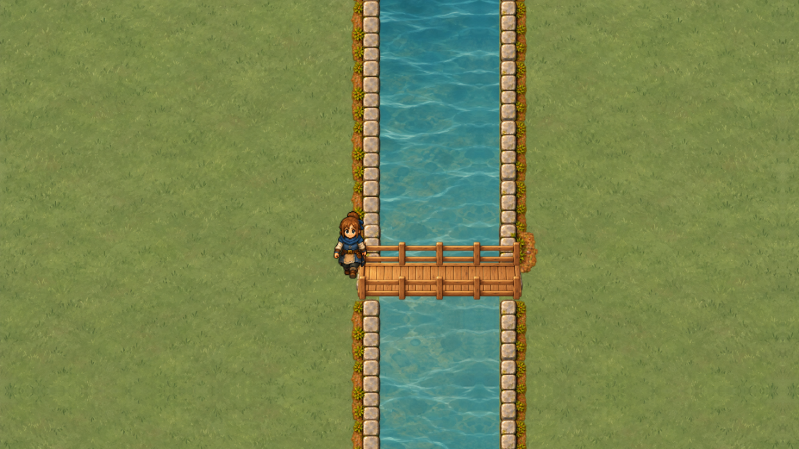
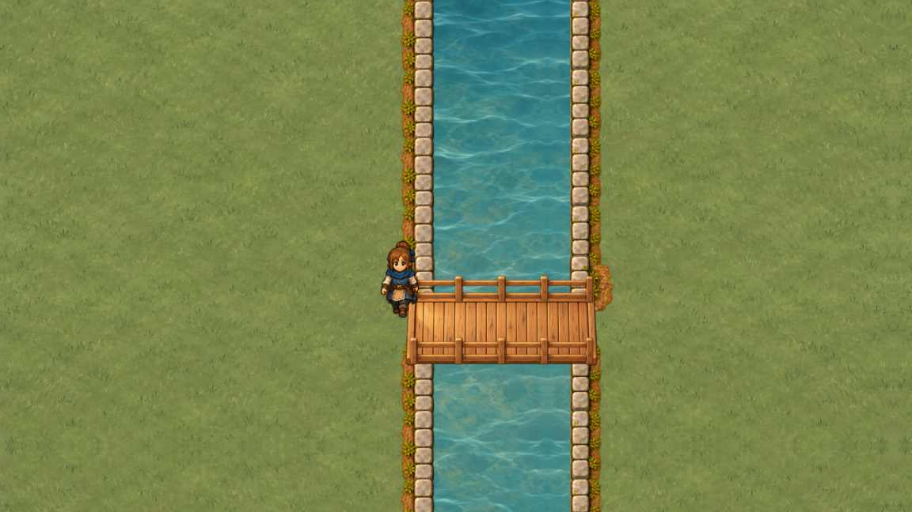
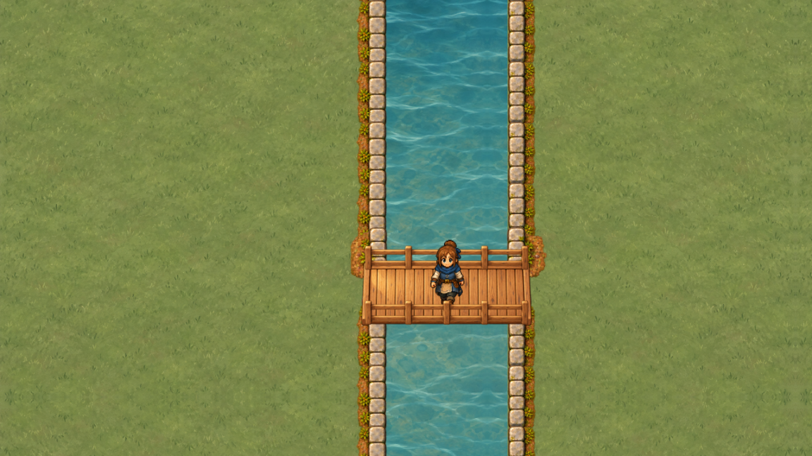
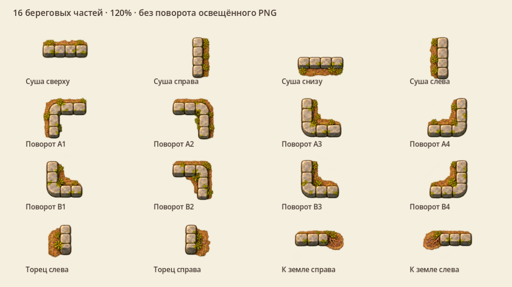
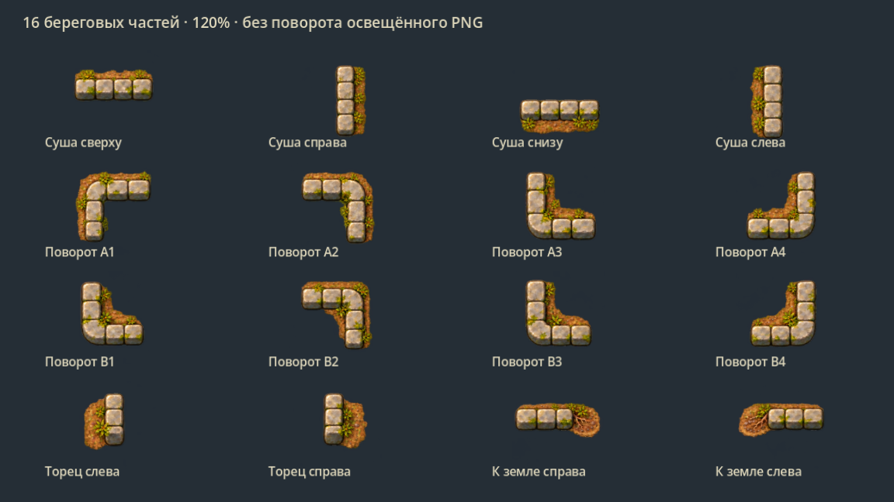
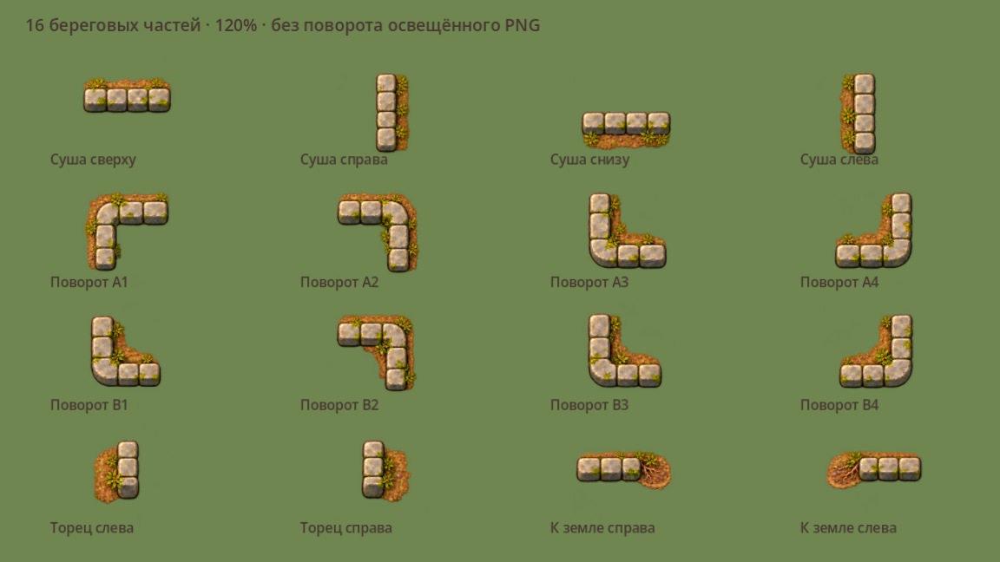
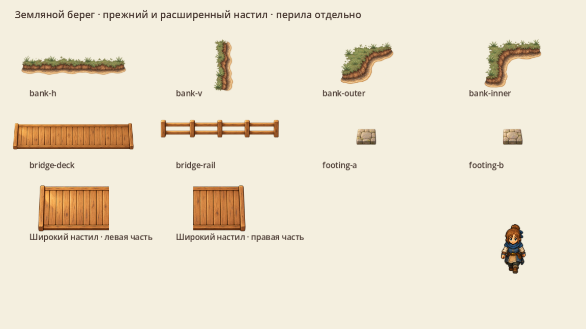
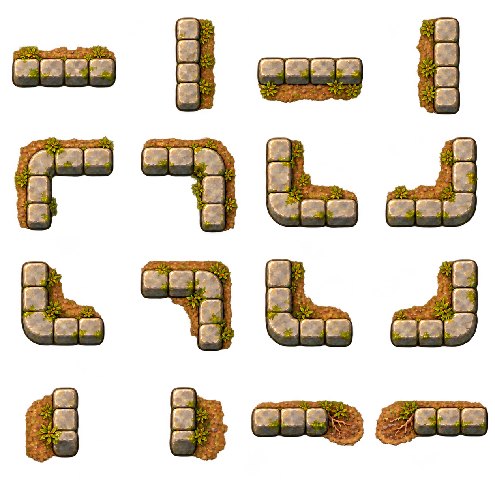
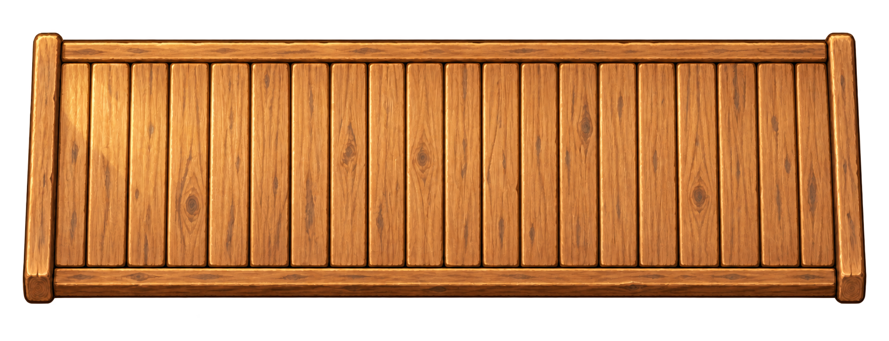

# Низкий берег · камень, земля и мост

VSHORE-001: выбран низкий каменный берег для деревенских проходов, а принятый земляной край VART-008 сохранён для природных участков. Это отдельный художественный комплект и нативная витрина Godot при 120%; подключение к карте выполняется следующими задачами [маршрута первой локации](visual-pilot.md).

## Мост стал шире

По просьбе пользователя проход расширен с **48 до 72 мировых единиц — с двух до трёх клеток**. Пролёт сохранён: основание образца 192×72. Перила раздвинуты, настил перерисован; две его части стыкуются по шву досок с одним коэффициентом масштаба. Рисунок не растянут по вертикали. На обоих кадрах одинаковы камера, герой, освещение и берег.

### Было · две клетки

### Стало · три клетки

## Отдельные части берега

| Части | Для чего подготовлены |
|---|---|
| 4 прямые кромки | Суша сверху, справа, снизу и слева; каждая нарисована отдельно, свет сохраняется сверху-слева |
| 8 угловых этюдов | Повороты кладки с разным заполнением грунта; A1…A4 и B1…B4 — художественные обозначения, не коды WaterTopology |
| 2 торца | Низкое каменное завершение около открытого прохода на мост |
| 2 перехода | Каменная кладка заканчивается и переходит в землю с корнями |
| 2 части широкого настила | Левая и правая половины, общий масштаб, отдельные перила и опоры |

Дополнительно повторно использованы 11 ресурсов VART-008: четыре земляных края, прежние настил/перила/две опоры и три материала. Всего 29 точных вырезок; 18 новых частей и 11 прежних. Камень не превращён в высокую крепостную стену, зелень приглушена, белой общей обводки нет.

## Мастера и нарезка

В [паспорте комплекта JSON](../../docs/reports/visual-overhaul/vshore-001/profile.json) указаны источник, целочисленный регион, опора и масштаб каждой части. Коэффициент всех каменных частей одинаков: 0,32 мира на исходный px. Прозрачные поля не растягиваются в квадрат. У широкого настила плотность другая из-за отдельного мастера; обе половины имеют один масштаб, а их суммарная визуальная длина 204 мира включает небольшой выступ за основание 192.

Три средние доски исходного мастера пропущены при модульной сборке, чтобы сохранить прежнюю длину пролёта. Это выбор настоящих регионов по швам, не неравномерное сжатие PNG. Геометрия прохода — `[432,312,192,72]`, все границы на сетке 24; его центр находится на полуклетке по Y, что допустимо.

[Происхождение и промпты](../../docs/reports/visual-overhaul/vshore-001/source.json) сохраняют также отклонённые варианты. Сначала у камня повторились стороны, затем исправлены южная/западная и восточная кромки. Для широкого настила применён встроенный imagegen; механическая нарезка выполнена Godot без перекраски и очистки альфы.

## Движение камеры

120 настоящих GPU-кадров, 1152×648, поле 960×540, zoom 1,2; камера сдвигается дробно на 0,5 / 0,125 мира за кадр. Кодирование — 30 кадров/с, длительность 4 с. Это фиксированная диагностическая съёмка, **не замер FPS** и не запись игрового управления. Вода неподвижная, её анимация ещё не принимается.

При одном масштабе светлый, тёмный и травяной фоны выявляют кайму и обрезку. Перила, вода и герой сохраняют общий сдвиг камеры. [Нативные параметры, подписи и траектория](../../docs/reports/visual-overhaul/vshore-001/native/capture.json).

## Границы приёмки

Утверждены художественные мастера и показанные стыки. Это ещё не полный бесшовный autotile: таблица соседств, все внутренние/внешние случаи, смена ширины русла и соответствие маске принимаются в VSHORE-003 / WATER-04. Угловой этюд нельзя автоматически назвать готовым вариантом любой диагональной маски. Временная сборка фактуры и повторение отдельных кромок не заменяют эту проверку.

Показанный мост горизонтальный, как в VART-008. Первый физический мост `overworld` имеет основание 96×192 и другое направление; его новый настил и подходы нужно подготовить отдельно при внедрении, сохранив расширение прохода и геометрию маршрута. Освещённый PNG нельзя просто повернуть. Физические мосты, вода, рыбалка, декор и сохранения этой витриной не изменены.

Положительные и отрицательные сценарии существующей WATER-системы прошли **845 / 0**: осевые пути, мост/вода, круг героя, чанки, декоративная вода, видимый поплавок и отрицательный заброс. Это проверка сохранности прежней механики; новая графика не участвовала в физическом тесте. [Протокол WATER](../../docs/reports/visual-overhaul/vshore-001/water-review.json).

Загрузка текстур и mipmaps выполняется до рисования. Декодированные изображения комплекта с mipmaps занимают около **33,44 МиБ**; это не RSS/VRAM процесса и не бюджет всей локации. CPU-мастера, framebuffer, движок и драйвер считаются отдельно. В `assets/game` ничего не перенесено; стоимость живого включения остаётся у VPERF и VRELEASE-004. Общие правила — в [пакете художника](artist-packet.md).
