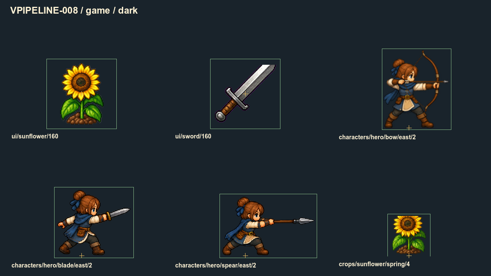
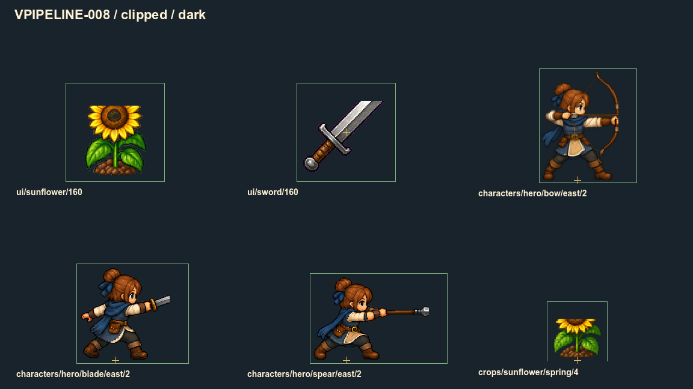
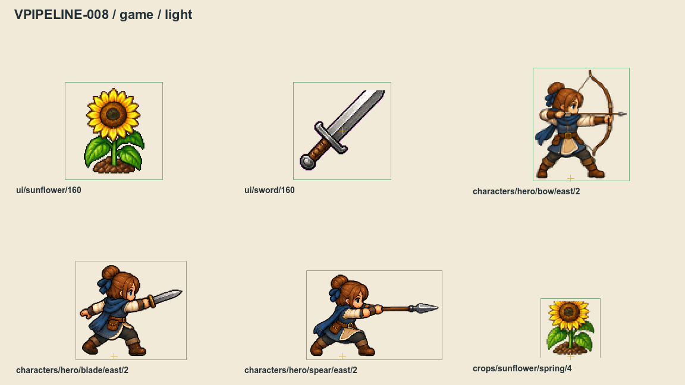
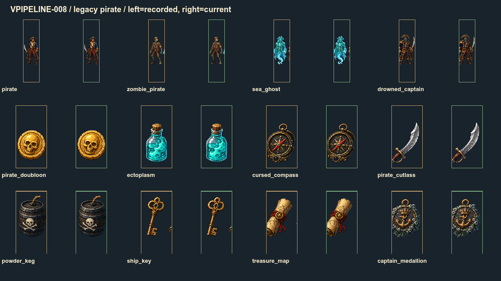
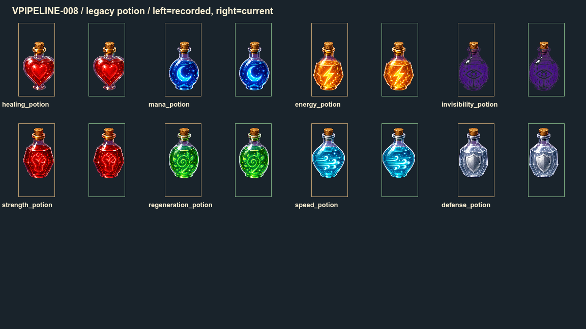

# Нарезка: целые кадры и точки опоры

**VPIPELINE-008** проверяет, что область кадра помещается в изображение, координаты целочисленны, опора допустима, а нарезка не прячет выступающий край. Проверены **5570 зарегистрированных кадров и 321 AtlasTexture**.

## Исправленная ошибка

В старых атласах пиратов и зелий ширина 1254 делилась на четыре. Получались границы на половине пикселя. Найдены и исправлены **20 регионов**: четыре семейства врагов, восемь предметов, восемь зелий.

Новый общий `grid_source()` разделяет исходник так: `0 → 313 → 627 → 940 → 1254`. Ширины 313 и 314 чередуются; весь исходник сохраняется без щелей и перекрытия. На делимых сетках прежние границы сохраняются. Неизвестный ID или неверная сетка дают пустую область.

Математическая проверка не заменяет художественный просмотр: кусок соседней фигуры, уже попавший в старый мастер, не исчезнет от округления. Сырые старые fallback-атласы остаются материалом для миграции VPIPELINE-009 и перерисовки VICON/VACTOR. Обычные выбранные иконки используют подготовленный каталог.

## Подсолнух и оружие

Зелёная рамка показывает полный исходный кадр, крестик — его опору. Подсолнух и меч показаны в UI 1.0, боевые позы увеличены вдвое для просмотра края. Культура подсолнуха показана в масштабе 1.5 исходного пикселя. Это диагностическая витрина, не изменение игровой камеры.

Ниже — намеренно испорченные области тех же PNG. Рамки и опоры оставлены прежними, поэтому видно, где теряются головка цветка, клинок или наконечник. Эти копии не подключены к игре.

На двух фонах игровая выборка каждого из шести регионов совпала с независимой полной копией: **0 отличающихся пикселей во всех 12 сравнениях**. Намеренные обрезы изменили 258–1790 пикселей. Полные кадры до/после исправления сетки также совпали.

| Пример | Измеренный запас слева / сверху / справа / снизу |
|---|---|
| Превью подсолнуха 160 | 29 / 8 / 29 / 8 px |
| Взрослый подсолнух на грядке | 5 / 2 / 5 / 2 исходных px |
| Старая боковая поза лука, плотная альфа | 1 / 1 / 1 / 0 исходных px |

Поза лука плотная, но при текущем полном source rect исходные пиксели сохраняются. Для будущей мягкой партии ей нужен отдельный запас; сдвигать стопы или растягивать фигуру ради него нельзя. Детали, потерянные ещё при рисовании PNG, проверяются художником отдельно.

## Что входит в аудит

Все 42 персонажа справочника и их доступные позы; 386 исходных иконок и 1930 пакетов UI 64/32/16/8/160; культуры во всех сезонах; звери во всех состояниях; босс и эффекты; станки и строительные кучи; мебель в трёх разрешённых ракурсах; вода, деревья, ограды, декор и вложенные атласы. Дополнительно проверены размеры 236 файлов мирового реестра.

AtlasTexture описывает область и поля, а физическая опора принадлежит её потребителю. Поэтому отсутствие pivot у самого .tres не подменяется выдуманной точкой; реальные позы выгружают свою опору отдельно. Частичные тайлы, UI-обрезы и произвольный пользовательский уровень имеют дополнительные существующие проверки.

## Плотный crop и старый долг

У **1786 семантических кадров / 823 различных пакетов** отмечены малое поле, продолжение альфы через границу либо отсутствие плотной альфы. Многие позы повторно используются несколькими жителями или состояниями. Это список для просмотра, а не 1786 подтверждённых обрезаний. [Полный список и повторные использования](slice-risks.md).

Уровни 32/16/8 защищены полями и extrusion [VPIPELINE-004](padded-atlases.md); отсутствие прозрачного края внутри такой маленькой ячейки не означает потерю силуэта. Их страницы и области сверяются с настоящим каталогом. Большое превью 160 сохраняет минимум 8 прозрачных пикселей.

Ниже показаны старые fallback-области: слева сохранённые дробные, справа нынешние целочисленные. Это воспроизведение исходной геометрии, не запуск прежнего бинарника. На старом листе местами остаются кусочки соседних объектов — например, у ключа. Этот сырой лист не принят как новая графика.

## Как проверять новую графику

Запустить `python3 tools/run.py assets.slicing.slice_audit`. Он создаёт свежую выгрузку в отдельном профиле и получает реальные импортированные пиксели. Код поставщиков и данные проверяются до/после; старый экспорт не подменяет текущий результат. Картинки полного экспорта временные и не дублируются в репозитории.

Геометрическая ошибка блокируется всегда. Новый или изменённый риск требует просмотра и адресного review с точной подписью кадра, причиной и хешами доказательств. Одноразовый исходный снимок нельзя использовать для принятия новых ошибок. 16 review после правки относятся только к прежним тесным fallback-PNG и конкретным новым координатам; это не художественное одобрение.

Для отдельного отчёта — `python3 tools/run.py assets.slicing.slice_audit --report /private/tmp/slices-new`, путь должен быть новым и вне assets. Входы нативного пакета должны находиться в Git. Полные данные и методика: `docs/reports/visual-overhaul/vpipeline-008/`.

Автопроверки: **14 сценариев аудитора, 5 сценариев порчи доказательств, 440 профильных игровых утверждений**. Нативные кадры сняты настоящим GPU в фиксированном SubViewport 1152×648, Godot 4.7.1 Compatibility/opengl3. Размер окна не выдаётся за framebuffer. Это статичная проверка нарезки, не оценка FPS, качества всех рисунков или полного цикла анимации.

Связанные основы: [паспорт рисунка](visual-resources.md), [альфа-края](alpha-edges.md), [два размера иконок](item-icon-sizes.md). Следующая задача — VPIPELINE-009, безопасная миграция файлов с сохранением владельцев и возможности отката.
