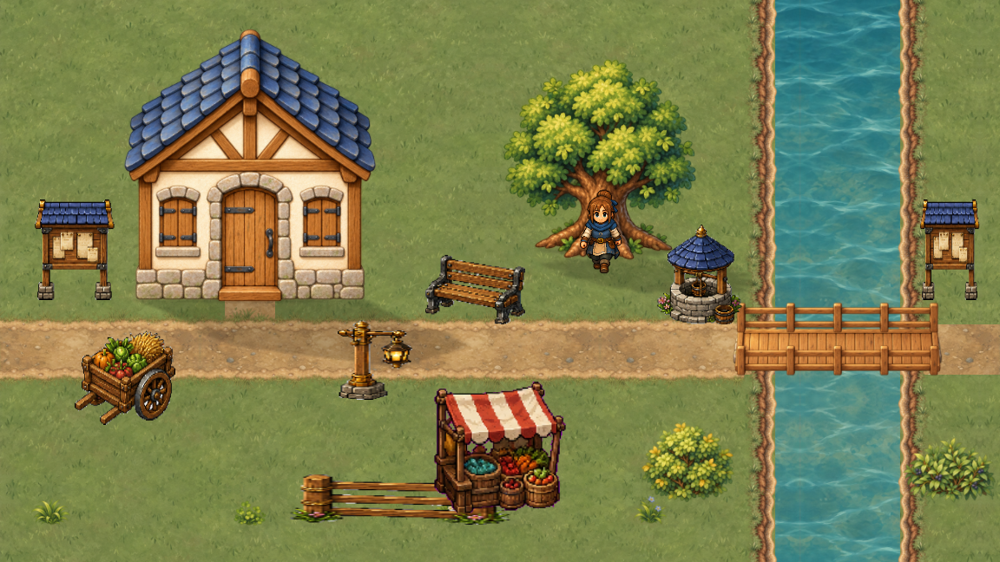
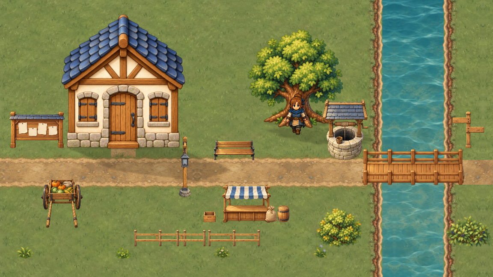
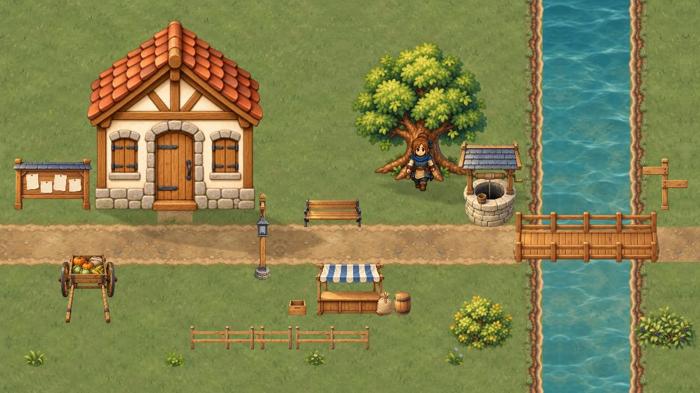
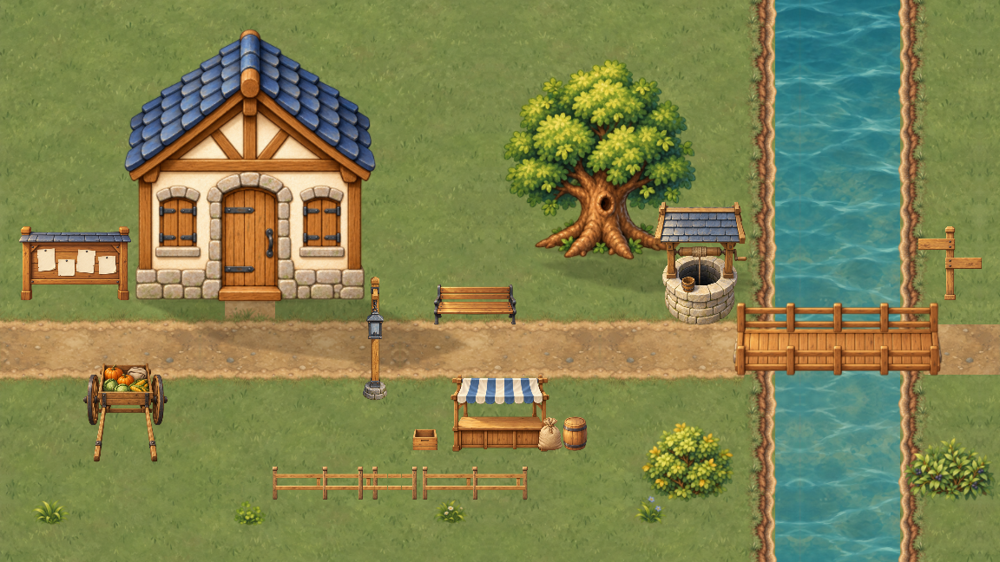
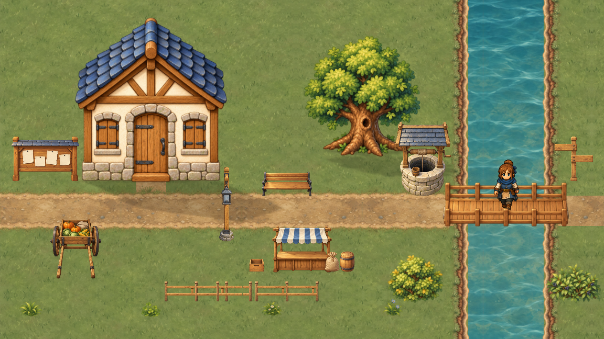
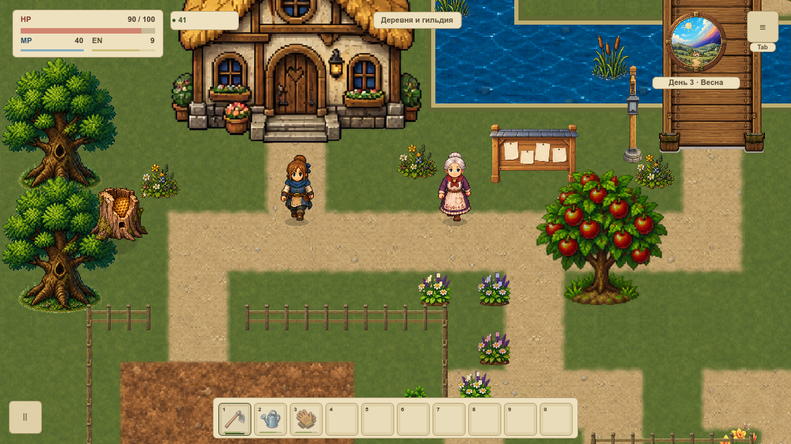

# Статичный модульный пилот

VRELEASE-002 принимает отдельный композиционный стенд первой локации: принятые модули VART-008 и все наружные семейства VPROP-002…007. Это промежуточный показ. **Вся карта overworld ещё не переведена на новую графику**, живое включение и VMAP-003 остаются впереди. [Карточка и статус](#/development/tasks/visual--VRELEASE-002) · [Главный курс](visual-pilot.md).

## Одинаковая композиция: прежний и новый декор

Фасад, дерево, грунт, берег, вода, мост и герой в паре одинаковы. Меняются только предметы окружения; это сравнение набора декора в отдельном стенде, а не «до/после всей игры».

Сцена собрана из самостоятельных ресурсов, общей сетки 24 и настоящих production-помощников предметов. Рабочее поле 960×540, фактическая проекция 120%, оба проверенных окна 1152×648 и 1280×720. Область планирования 960 клеток ниже лимита 1000. Композиция из VART-008 служит проверкой масштаба и материалов; она не меняет физическую расстановку обычной деревни.

## Оба фасада и перекрытия

Пользователь принял оба дома для будущих поселений. Они остаются двумя вариантами одного стенда; новый каталог всех домов здесь не переносится.

Это статичные положения. Реальный проход, ветер, вода, смена света и стоимость обычной игры принимаются отдельно в VRELEASE-003/004. Весь overworld — после ведомости VMAP-001, адресного переноса и VMAP-002/003.

## Настоящая игра и старый слот проверены отдельно

В нативной серии есть самостоятельные кадры обычной игры, входа/выхода дома и копии старого слота версии 1. Его день 3,41 монета,14 дерева и 2 яблока сохранены. Дождь третьего дня остаётся естественным. Слоты пользователя не использовались.

После удаления отдельного стенда ordinary/rollback PNG совпали побайтно в обоих окнах; полный save, игрок и камера тоже совпали. Это откат режима просмотра. Он не выдаётся за приёмку будущего переноса всей карты.

## Что подтверждено

51 предшествующая карточка проверена по канонической очереди и Git-доказательствам.44PNG/304 реальных callbacks,16 пар «до/после»: вне ограниченных предметных областей пиксели совпали.12Python-сценариев защищают доказательства от порчи и ложного завершения зависимостей.

Фокус macOS записан как фактическое наблюдение; статичная сверка требует видимое окно и реальные кадры, но не принимает физический ввод или FPS. Производительность аппаратной базы остаётся недостаточной и этим результатом не объявляется исправленной.

[Нативная сверка](../../docs/reports/visual-overhaul/vrelease-002/summary.json) · [Предшественники и доказательства](../../docs/reports/visual-overhaul/vrelease-002/dependency-audit.json) · [Исходники и конфигурация](../../docs/reports/visual-overhaul/vrelease-002/native/static/source.json)
