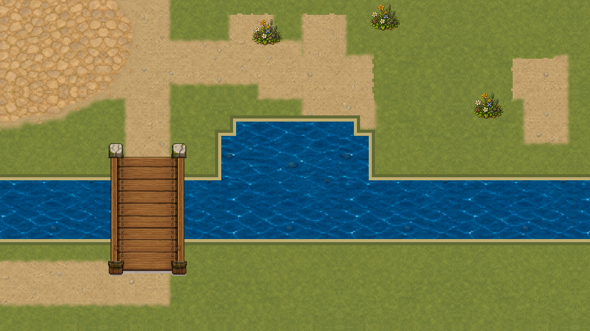
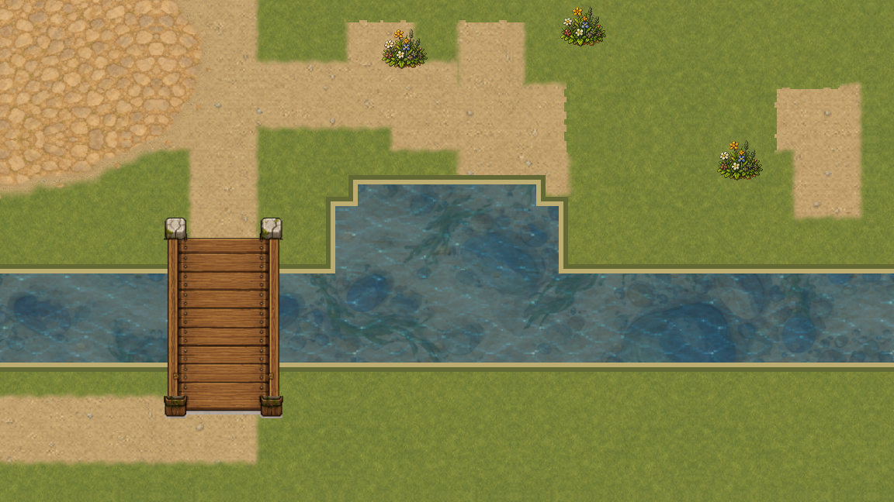
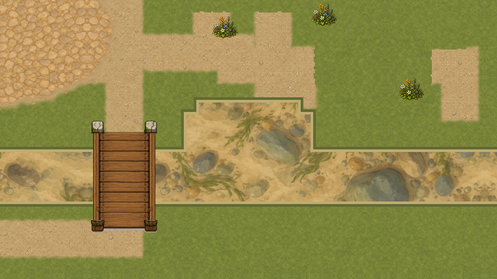
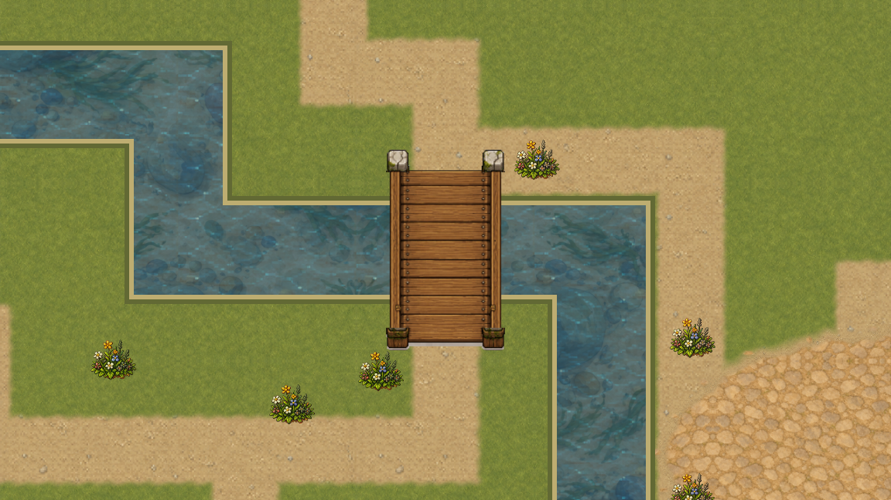
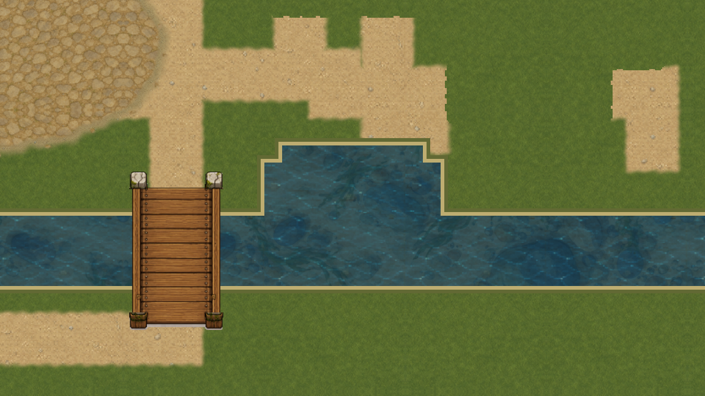
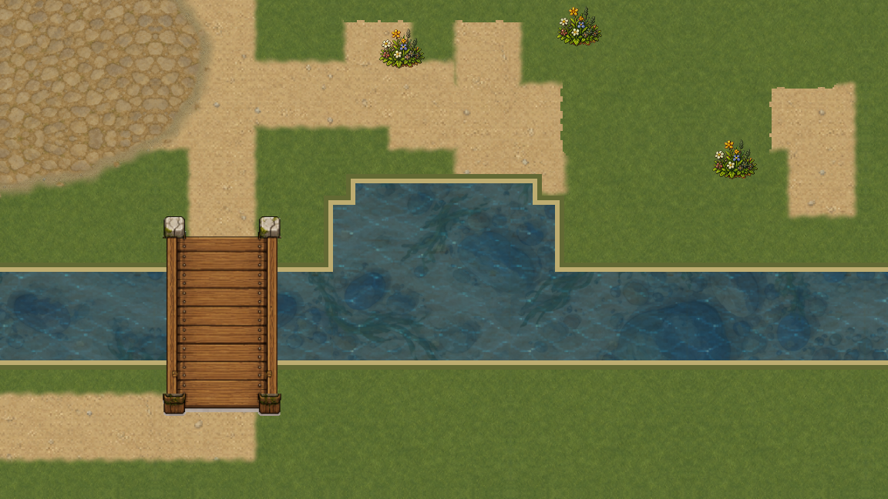

# Подводное дно · песок, камни и водоросли

VSHORE-002 подключает к первой `overworld` отдельный живописный слой мелководья. Под прежней водой читаются тёплый песок, округлые камни и редкие водоросли. Форма реки, пруда, мостов, навигация и рыбалка не изменены.

## До и после при одной камере

Раньше непрозрачный синий материал скрывал всё под поверхностью:

Теперь прежняя поверхность полупрозрачна и лежит над самостоятельным дном:

Оба кадра сняты оконным Godot 4.7.1 в 1152×648, при поле 960×540 и zoom 1,2. Камера совпадает точно. В пересечении реки и пруда больше нет тёмного прямоугольника от двойного альфа-смешивания: два контура объединяются только для визуального прохода.

## Из чего собран слой

Мастер 1254×1254 используется в игре побайтно. Его визуальные ячейки имеют размер 768×768 и зеркалятся по обеим осям. Так противоположные края сгенерированного изображения не соединяются напрямую, а материал не растягивается вдоль русла. Linear-фильтрация и mipmaps принадлежат отдельному sampler дна и не меняют старые пиксельные ресурсы.

Все отсечённые части текущей воды собраны в один кешированный mesh: одна поверхность, 36 вершин и одна команда рисования на геометрию. Текстура загружается до draw. Это ограниченный профиль самого дна, а не замер памяти или FPS всей игры.

Порядок кадра:

1. Земля и неподвижная кромка.
2. Дно.
3. Полупрозрачная поверхность воды.
4. Цветы и мосты.

## Сезоны, погода и движение

Поверхность имеет альфу 0,56, зимой 0,62. Дождь затемняет цвет, но не прячет материал дна. Новая рябь и течение намеренно не добавлены: их отдельно принимают VSHORE-005 и VSHORE-006.

Ролик содержит 90 различных GPU-кадров, 1152×648, 30 fps, 3 секунды. Это fixed-clock проверка повторов и стыков при движении камеры, **не замер FPS** и не запись игрового управления. Обычная игра и пользовательские сохранения при съёмке не запускались.

## Что проверено

Профильный WATER-набор повторяет положительные и отрицательные сценарии суши, моста, навигации, рыбалки, декоративной воды и визуального порядка. Нативный пакет содержит четыре пары до/после, чистое дно, зиму, дождь и три свидетеля движения. Все источники, кадры, видео и код съёмки связаны точными SHA.

Дно имеет `physical_authority: false`: WaterTopology и WaterMapRegistry остаются владельцами игровых правил. VSHORE-003 принимает согласование визуальной маски, VSHORE-004 — береговые стыки чанков, VSHORE-005 — спокойную анимированную поверхность, VSHORE-006 — осевое течение. Полная стоимость и вся первая карта остаются у VPERF/VRELEASE/VMAP.

[Отчёт, паспорт и сырые доказательства](../../docs/reports/visual-overhaul/vshore-002/README.md).
