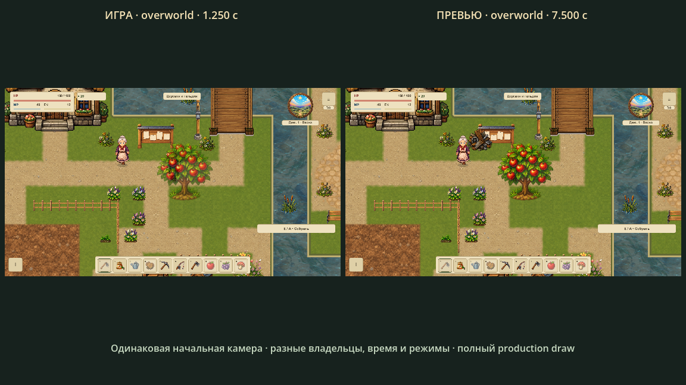
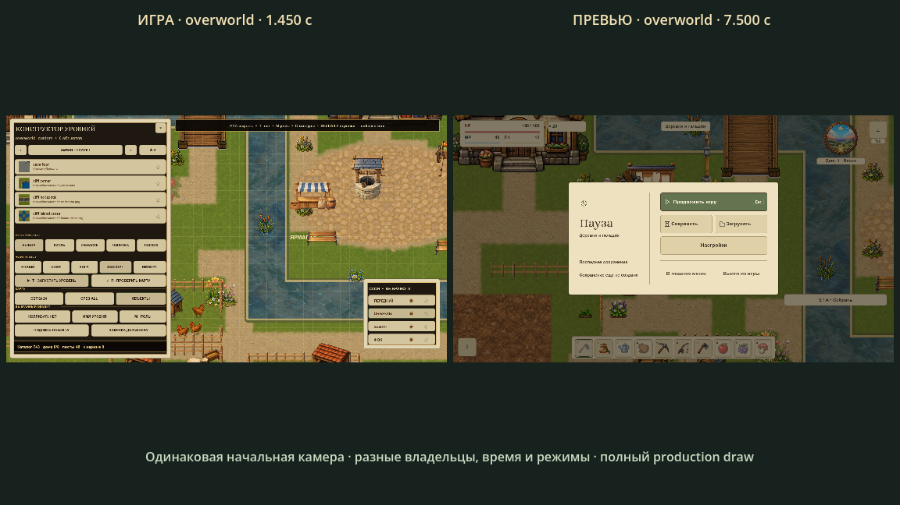
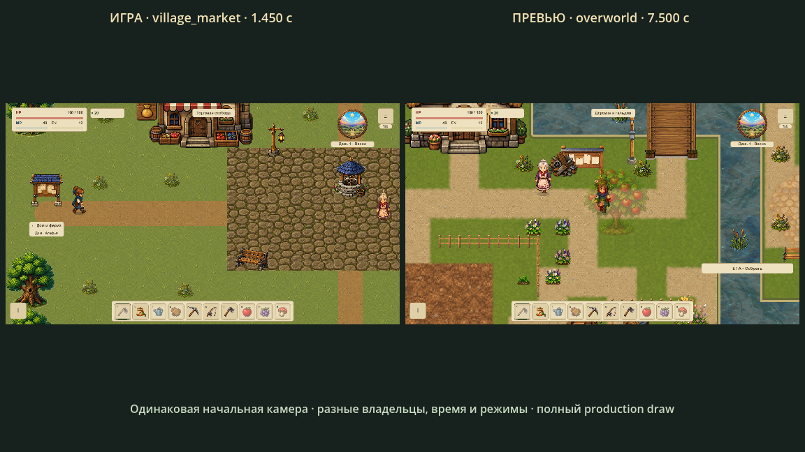

# Изоляция визуальных миров

VRENDER-009 закрепляет одного владельца за каждой связкой **игра → viewport → фон**. Игра, встроенное превью и редактор больше не делят позицию камеры, фазу декоративного времени или последний опубликованный кадр. [Карточка и статус](#/development/tasks/visual--VRENDER-009) · [Предыдущий контракт кадра](post-motion-frame.md) · [Главный курс](visual-pilot.md).

## Что хранит владелец

Контекст состоит только из трёх числовых идентификаторов: игрового узла, его `Viewport` и `WorldBackground`. В нём нет Node, Material, callback и сохраняемых игровых данных. Фон принимает проекцию и окружение только от своей связки; декоративные часы и post-motion пакет сначала проверяют того же владельца. Чужой пакет, фон или viewport дают нейтральный отказ, а не подменяют состояние.

## Редактор и ручная пауза

Слева открыт настоящий F12-редактор и сдвинута только его камера. Справа открыта обычная пауза. Оба собственных таймера заморожены, при этом режим одного мира не появляется во втором. Открытие паузы сохраняет только ожидаемое tutorial-событие своего мира.

## Переход карты

Игровой мир входит в `village_market`, тогда как превью остаётся в `overworld` с прежней позицией, камерой, временем и сохранением. Затем игровой мир возвращается через настоящий порт. Фон каждой карты остаётся привязан к своему viewport.

## Подтверждение

Нативный macOS-стенд использует два настоящих `SubViewport` по **1152×648** и пять последовательных сценариев: одинаковая камера, движение только игры, F12/пауза, вход и возврат. Проверены герой, куст, перила, передний план и HUD. Зафиксированы **20 production draw** и 20 полных пар сохранения до/после; все совпали, включая первый кадр. Ленивая подготовка пустых разделов алхимии, оград и магии перенесена из первого draw в bootstrap.

Это проверка владения и сохранности состояния, а не FPS-допуск и не приёмка всей VMAP-003. Новые механики, художественные ресурсы и другие карты не добавлялись.

[Нативная сводка](../../docs/reports/visual-overhaul/vrender-009/summary.json) · [Сырые состояния и конфигурация](../../docs/reports/visual-overhaul/vrender-009/native/capture.json)
