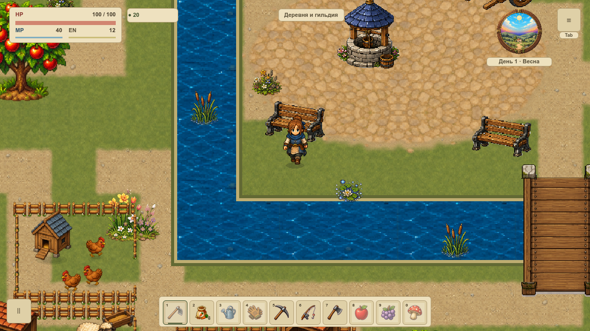
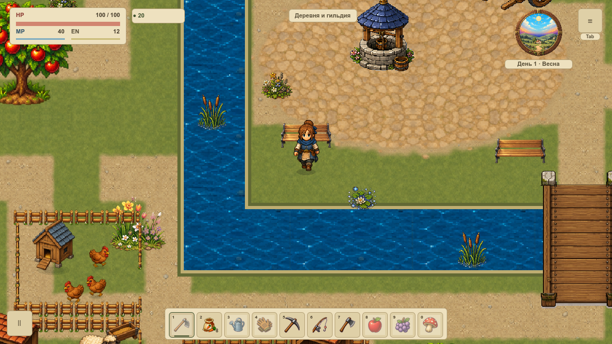
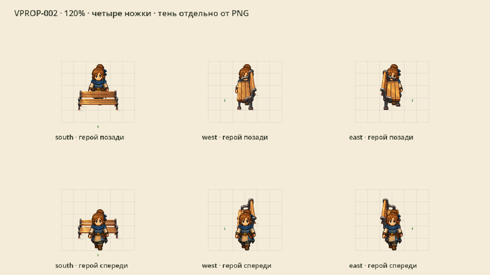
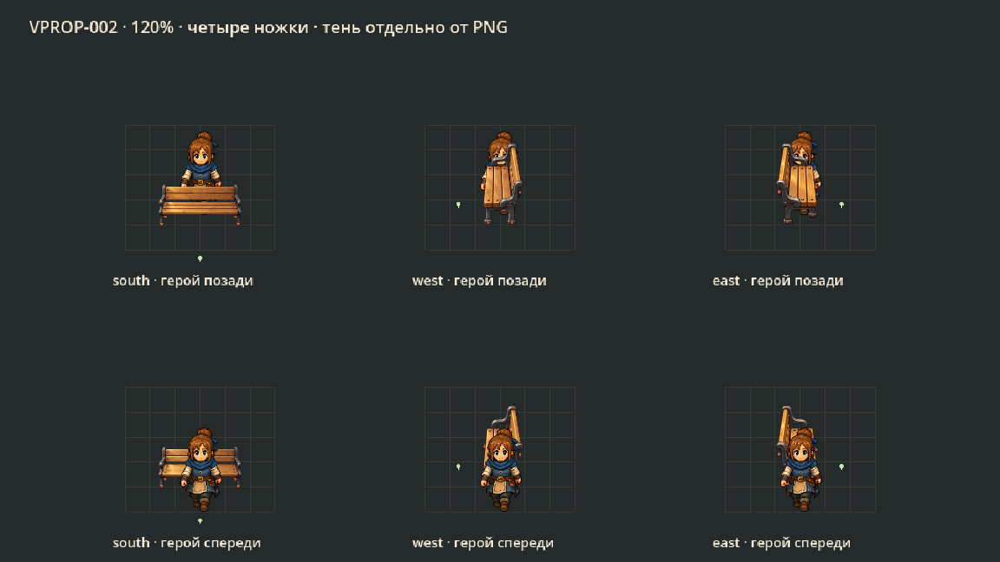

# Живописные деревенские лавочки

VPROP-002 заменяет две лавочки первой локации: тёплое дерево, мягкие края, три самостоятельных ракурса и **четыре ножки в каждом**. Боковые мастера исправлены по замечанию о двух ножках. [Карточка и статус](#/development/tasks/visual--VPROP-002) · [Курс первой локации](visual-pilot.md).

## В игре: до и после

Одинаковая камера 120%, прежние места и коллизии. Перерисованы только лавочки на исходных местах; HUD, земля, вода и герой сохраняют свои параметры.

## Три ракурса и четыре опоры

Красные точки и сетка — только QA-витрина: отмечены четыре настоящих ножки. Зелёная точка — единственный подход со стороны сиденья. В игре этих маркеров нет. Боковые картинки имеют тот же свет сверху-слева; задний и диагональный ракурсы не используются.

Игровые картинки уменьшены из отдельных мастеров и используют линейный фильтр. Единая плотность — 4 исходных пикселя на мировую единицу; растяжения по отдельным осям нет. Все четыре контакта дают одну небольшую общую геометрию тени, повторно используемую в кадрах. Она рисуется до героя и не запечена в PNG.

## Проверка

50 нативных PNG / 224 draw callbacks при двух размерах окна: вне лавочек и теней RGBA совпадают побайтно. Проверены боковые перекрытия, пауза, вход/выход дома и сохранения. 24 профильных утверждения и 9 Python-сценариев прошли; неправильный fullscreen-размер в первой попытке был отклонён, повтор снят заново.

Штатные лавочки сохраняют коллизию 72×24 и сетку 24. Три вида готовы как ресурсы; в первой карте используются две передние лавочки. Сидение, новые механики, другие карты, FPS и приёмка всей локации VMAP-003 остаются отдельными задачами.

[Нативная сверка](../../docs/reports/visual-overhaul/vprop-002/summary.json) · [Мастера, масштаб и четыре контакта](../../docs/reports/visual-overhaul/vprop-002/source.json) · [Промпты](../../docs/reports/visual-overhaul/vprop-002/prompts.json)
