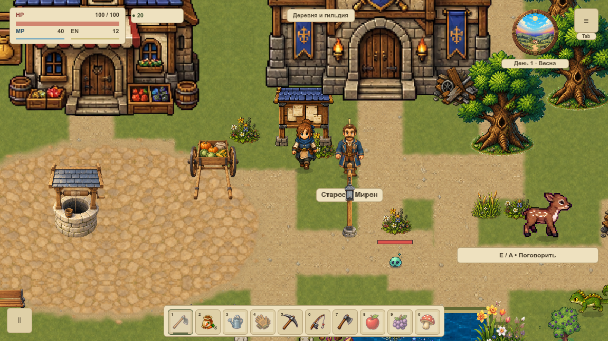
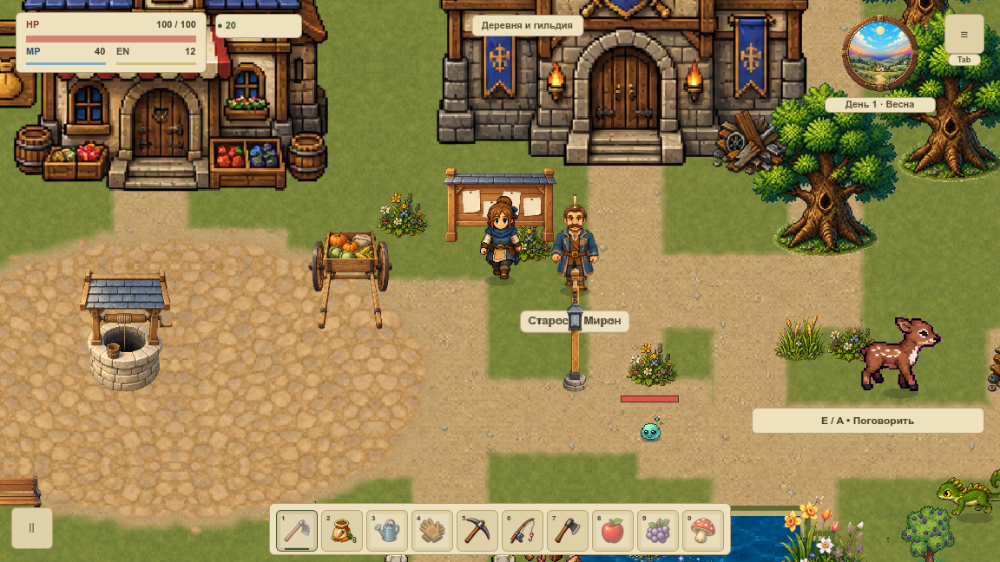
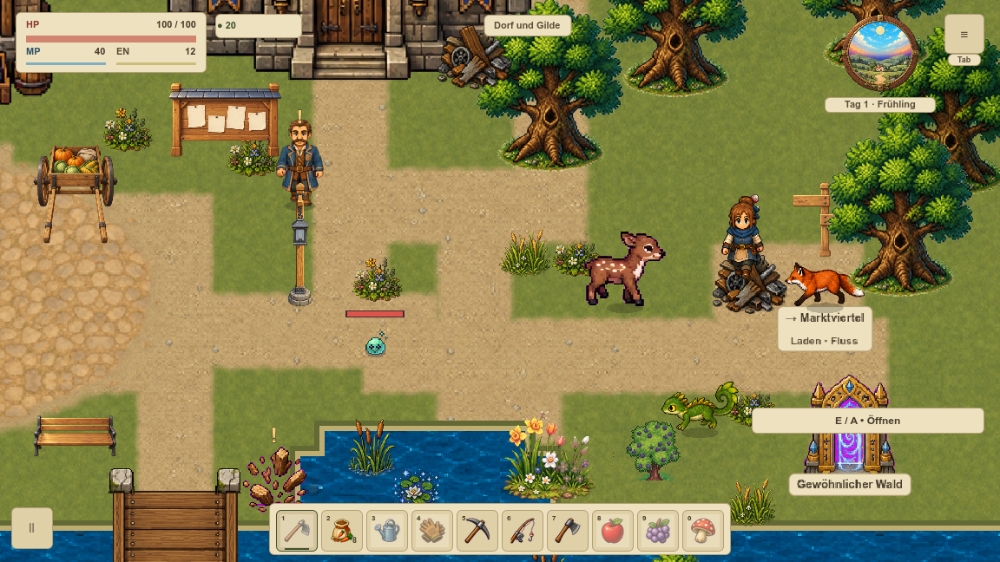
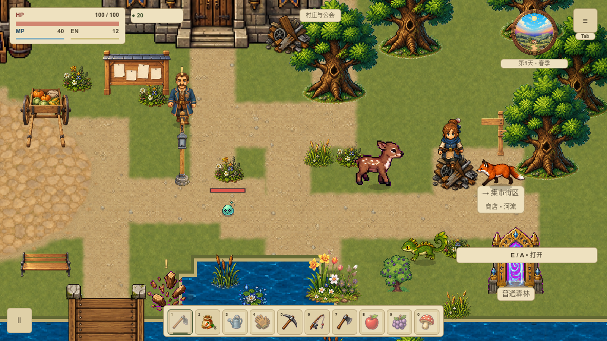
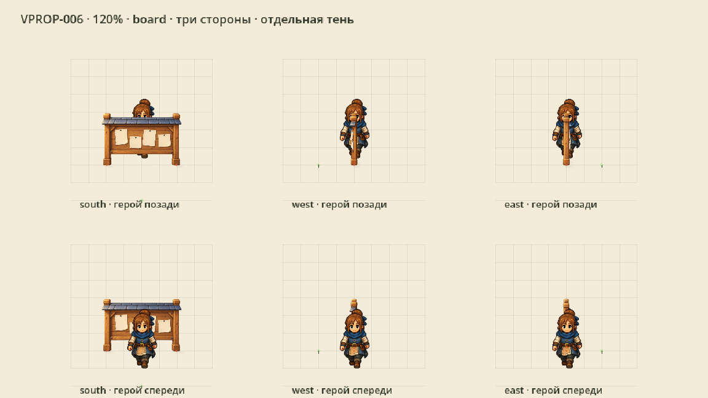
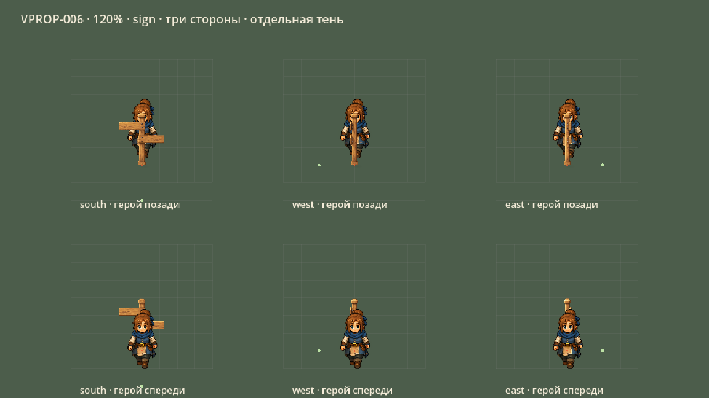

# Доски и указатели без встроенных надписей

**VPROP-006** подключила две доски и три указателя первой локации. Общий мягкий рисунок, тёплый дуб, сланцевая крыша досок и три прямых ракурса. Бумага и планки пустые; названия и стрелки рисуются отдельным текстом во всех **шести языках**.

## Доски: до и после

Обе доски сохраняют свои места и твёрдые основания **72×24**. Большие исходники находятся отдельно от игры; каждый runtime-PNG имеет прозрачное поле и собственную измеренную опору. Части равномерно уменьшены, при отрисовке не растягиваются.

## Один указатель — разные языки

Русский, английский, испанский, немецкий, французский и китайский используют одинаковое тело спрайта. Проверены реальные символы шрифта и ширина обеих строк; 30 побайтовых сравнений подтвердили неизменность тела между локалями. Переводы и осевые стрелки принадлежат прежней системе ориентиров.

Три указателя остаются у прежних переходов. Основание сдвинуто на 4 px к узлу сетки **24 px**; точки переходов и их радиусы сохранены. Переход на рынок и обратно проверен настоящим API игры.

## Три стороны и перекрытие

Верхний ряд — герой позади, нижний — спереди. Боковые виды узкие, опоры стоят одна за другой без диагонального разворота. У дальней стойки доски скрытый контакт отмечен в паспорте как выведенный, а не видимый. Шесть контактных теней и текстуры повторно используют кеш.

Приняты **140 нативных PNG / 624 draw callbacks** в двух окнах, 117 профильных условий и 11 Python-проверок. Интерьер, рынок и отдельный кадр фермы совпали полностью; вне пяти предметов пиксели совпали. Остальные карты, FPS и вся приёмка до VMAP-003 остаются следующими этапами.

[Нативная сводка](../../docs/reports/visual-overhaul/vprop-006/summary.json) · [Паспорт шести PNG](../../docs/reports/visual-overhaul/vprop-006/source.json) · [Промпты built-in image_gen](../../docs/reports/visual-overhaul/vprop-006/prompts.json) · [Карточка и статус](#/development/tasks/visual--VPROP-006) · [Первый живописный участок](visual-pilot.md)
