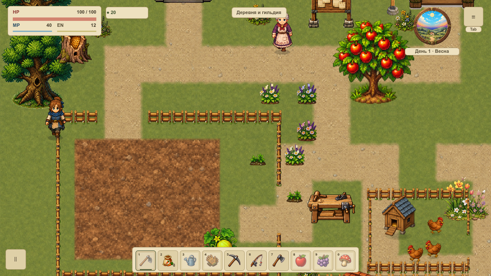
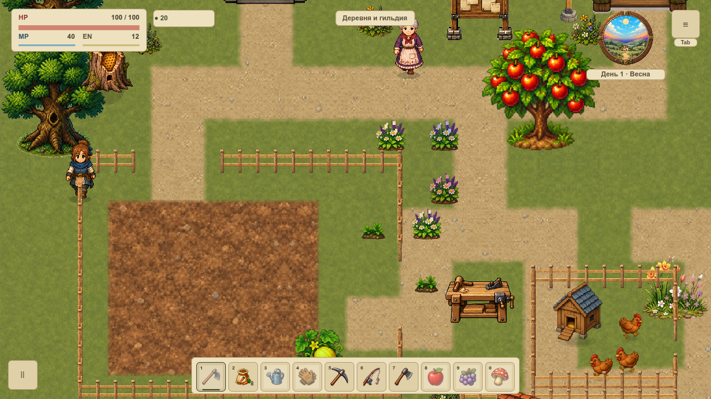
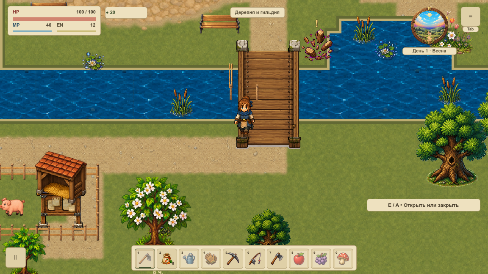
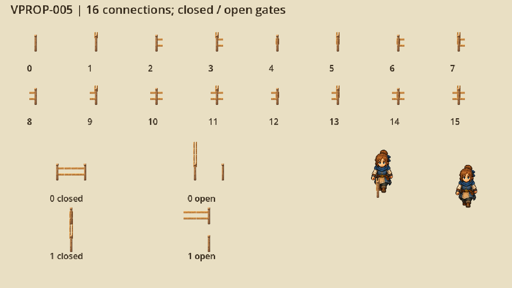
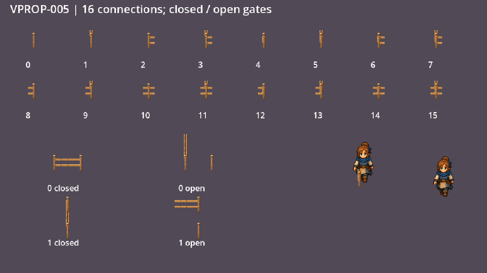

# Ограды и проходы по сетке

VPROP-005 подключила живописные деревянные ограды первой локации. Общие столбы и перекладины соединяются по сетке **24 px**; прямые секции, углы и все **16 масок** используют отдельные осевые детали без вращения готового рисунка по диагонали.

## Периметр фермы

Два старых прохода фермы остаются открытыми. Загон также сохраняет свои физические стенки толщиной 8 px и разрывы для входа. Периметр рисуется по глубине относительно героя, отдельно от кеша земли. HUD и правила движения сохранены.

## Калитки

У построенной игроком калитки остаются прежние два направления и две клетки. В открытом состоянии створка складывается вдоль края, середина прохода свободна. Переключение E, стоимость, стройка и сохранения используют прежнюю механику. Новые калитки в старые открытые входы не добавляются.

## Модульный набор

Справа внизу настоящий герой проходит перед боковой секцией и за ней. В отчёте сохранены также тёмный и травяной фоны. Три самостоятельных PNG имеют прозрачный край и постоянную плотность; в runtime нет растяжения квадратной ячейки или новых узлов. Другие материалы забора и остальные карты пока используют прежний путь.

Настоящие окна 1152×648 и 1280×720, камера 120%; **56 PNG / 256 draw callbacks**, одинаковые снимки мира до/после. Проверено 56 профильных условия и десять Python-сценариев, включая порчу HUD, окна и состояния калитки. Это графическая приёмка VPROP-005; FPS и вся первая карта до VMAP-003 остаются отдельной работой.

[Нативная сводка](../../docs/reports/visual-overhaul/vprop-005/summary.json) · [Паспорт трёх частей](../../docs/reports/visual-overhaul/vprop-005/source.json) · [Промпты built-in image_gen](../../docs/reports/visual-overhaul/vprop-005/prompts.json) · [Карточка и статус](#/development/tasks/visual--VPROP-005) · [Первый живописный участок](visual-pilot.md)
