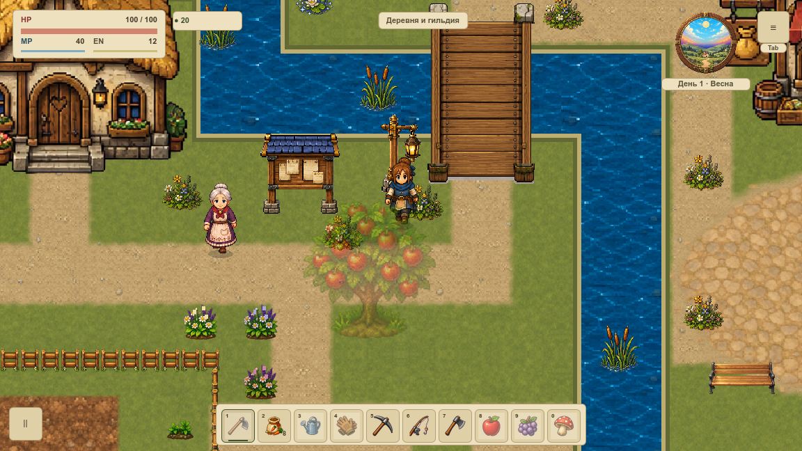
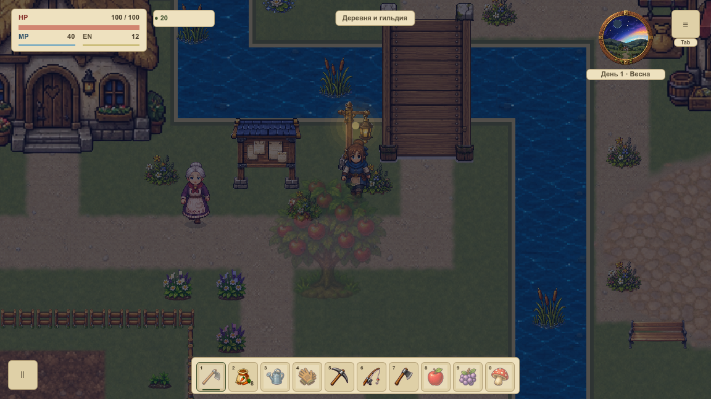
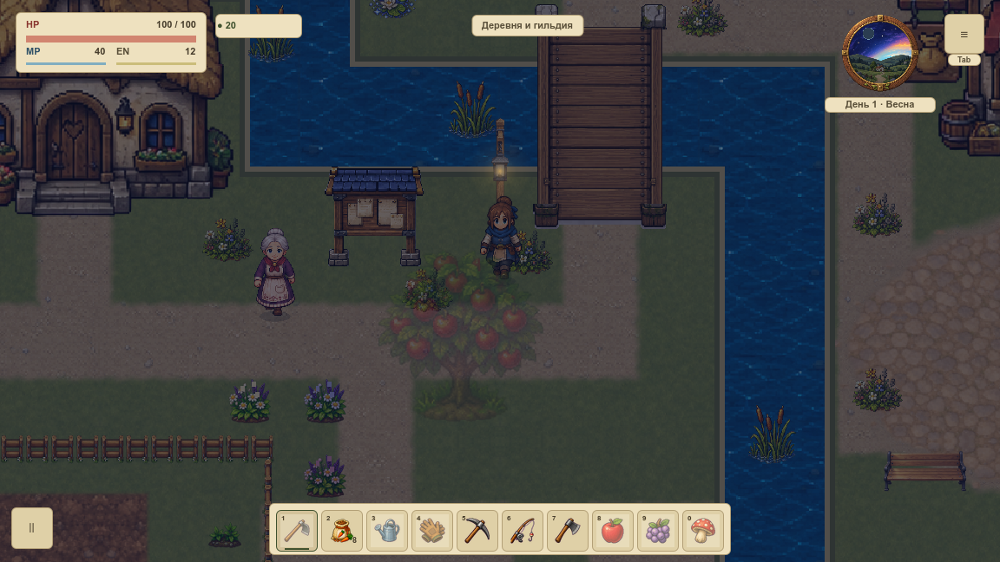
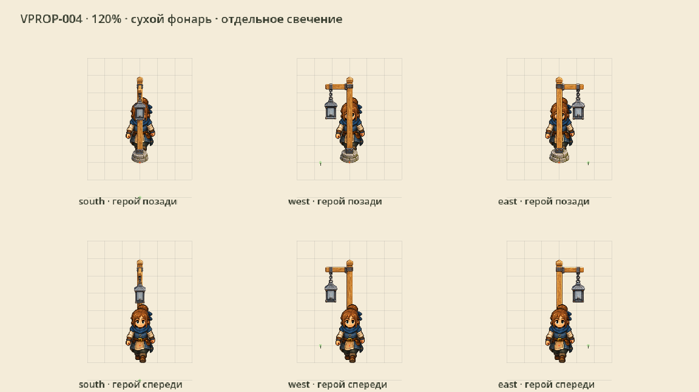
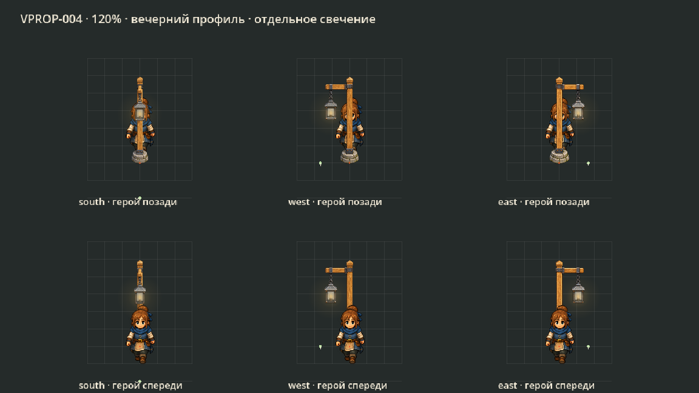

# Фонарь днём и вечером

**VPROP-004:** негорящий рисунок фонаря и отдельное свечение. Днём стекло холодное серое; вечером появляется тёплый свет, точно привязанный к стеклу. [Карточка и статус](#/development/tasks/visual--VPROP-004) · [Курс первой локации](visual-pilot.md).

## День: до и после

Та же камера 120% и прежние места. Свет больше не запечён в дневной PNG.

## Ночь: отдельный профиль

Сохранены прежние часы: сумерки с 18:00 до 20:00, рассвет с 05:00 до 07:00. Пауза останавливает календарь и яркость. Ночной слой находится под свечением, интерфейс — над ним. Это художественный световой ориентир; динамические тени и новая физическая модель освещения относятся к следующим задачам.

## Три прямых ракурса

Верхний ряд — герой за предметом, нижний — перед ним. Сетка, точка опоры и подход показаны только в QA-витрине. В игре подключены две прежние передние стойки с коллизией 24×24; боковые варианты готовы отдельными ресурсами.

## Проверка

84 нативных PNG / 400 draw callbacks в двух окнах; четыре контрастных фона, сухой и светящийся режимы, обычные день/сумерки/ночь, пауза и дом. Вне корпуса/теней/свечения RGBA совпадают; интерьер и отдельный кадр с фонарями вне экрана совпадают полностью. 48 измерений стекла показывают независимый прирост яркости при включении света.

42 профильных утверждения и 13 Python-сценариев прошли. Три PNG используют одинаковую плотность и линейную фильтрацию. Одна геометрия свечения и одна контактная тень разделяются всеми видами и размещениями. Новых игровых узлов, render target и PNG-readback нет. FPS и вся VMAP-003 этой партией не принимаются.

[Нативная сверка](../../docs/reports/visual-overhaul/vprop-004/summary.json) · [Корпуса, опоры и профиль](../../docs/reports/visual-overhaul/vprop-004/source.json) · [Промпты](../../docs/reports/visual-overhaul/vprop-004/prompts.json)
