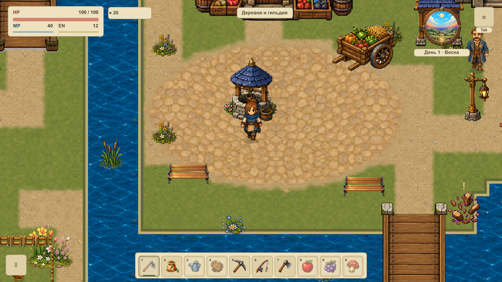
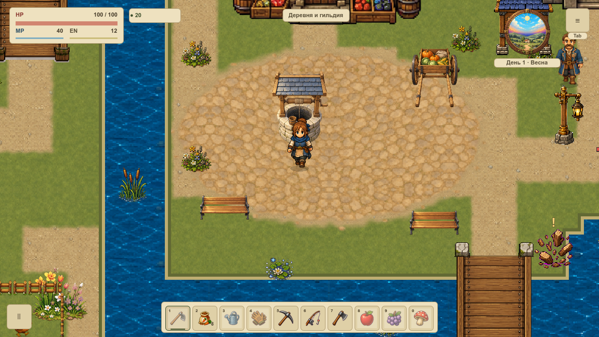
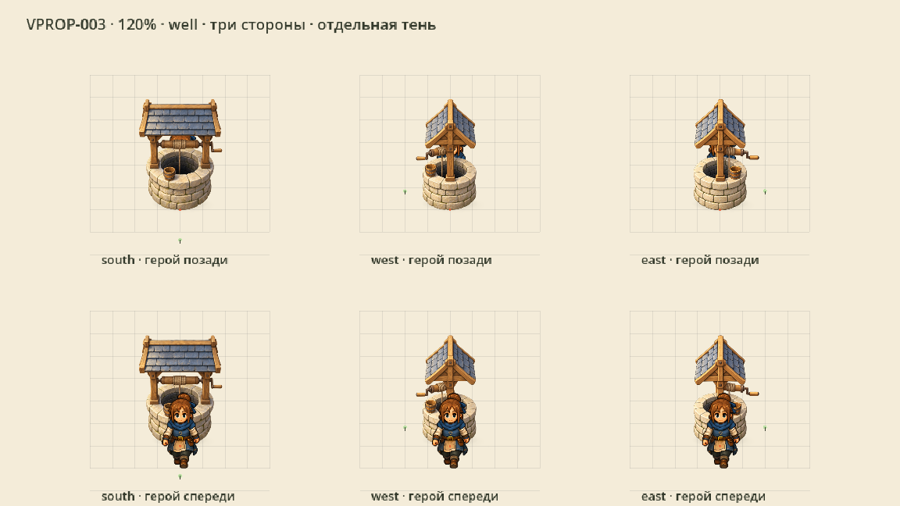
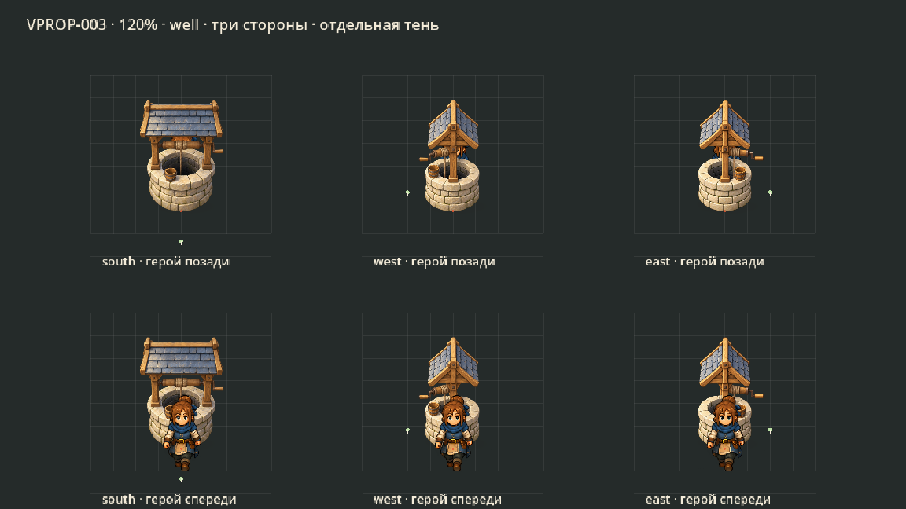
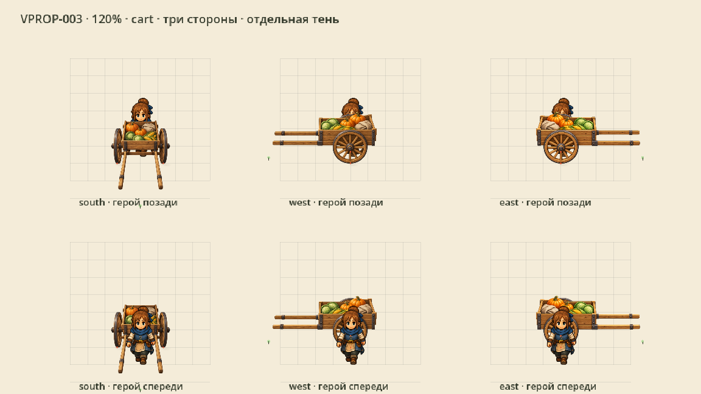
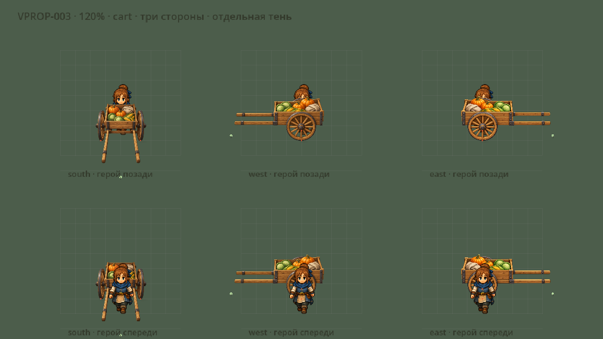

# Живописные колодец и телега

**VPROP-003** заменяет два существующих предмета первой локации. Колодец получил светлый каменный обод, деревянную лебёдку и видимую глубину. Телега стоит прямо: ось горизонтальна, ручки направлены к игроку. Подготовлены отдельные виды влево и вправо с горизонтальными бортами. [Карточка и статус](#/development/tasks/visual--VPROP-003) · [Курс первой локации](visual-pilot.md).

## В игре: до и после

Одинаковая камера 120% и прежние места. Опора колодца находится у нижнего камня, телеги — у колёс; концы ручек сохраняют полную длину. Коллизия колодца 72×48 и реальная торговая область 60×54 сохранены.

## Колодец: три стороны

Верхний ряд показывает героя за предметом; высокий колодец может скрыть его целиком. Нижний — перед предметом. Красная точка и сетка принадлежат только QA-витрине. Зелёная точка отмечает одну рабочую сторону. В штатном кадре этих маркеров нет.

## Телега: прямые направления

Боковые стороны перерисованы с тем же светом сверху-слева. Это отдельные PNG; зеркалирование и плоский поворот картинки при отрисовке не используются. Коричневый RGB за границей предмета имеет нулевую альфу и не создаёт облака в игре. Дальний контакт бокового колеса скрыт корпусом и явно отмечен в паспорте; автоматического распознавания ножек или колёс не заявляется.

## Проверка

**64 нативных PNG / 320 draw callbacks**, два окна 1152×648 и 1280×720. Проверены четыре положения героя у каждого объекта, соседняя лавка, пауза, дом и возврат. Все три стороны показаны на светлом, тёмном, дневном и вечернем травяных фонах. Вне ограниченных областей двух предметов и теней RGBA совпадают побайтно; контроль дома совпадает полностью.

50 профильных утверждений и 11 Python-сценариев прошли. Прежняя торговая точка доступна: продажа одной моркови убирает её из инвентаря и даёт восемь монет. Одна общая плотность — 4 пикселя на мировую единицу. Тени отделены от PNG и повторно используют до шести небольших мешей; новых игровых viewport/readback нет.

В первой карте используются два передних вида, остальные подготовлены как ресурсы. Новая добыча воды, изменение торговли, размещение боковых предметов, другие карты, FPS и приёмка всей VMAP-003 остаются отдельными задачами.

[Нативная сверка](../../docs/reports/visual-overhaul/vprop-003/summary.json) · [Мастера, опоры и нарезка](../../docs/reports/visual-overhaul/vprop-003/source.json) · [Промпты](../../docs/reports/visual-overhaul/vprop-003/prompts.json)
