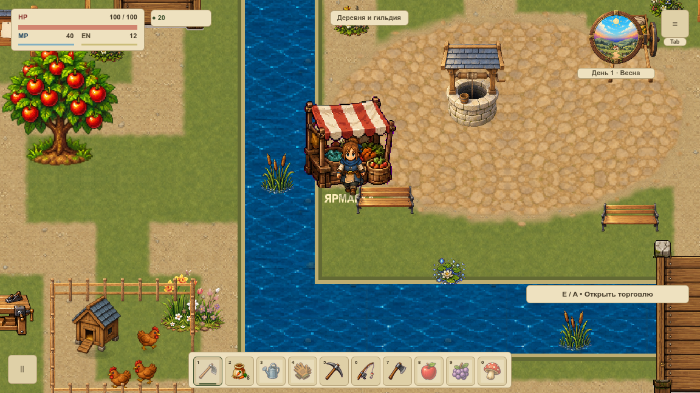
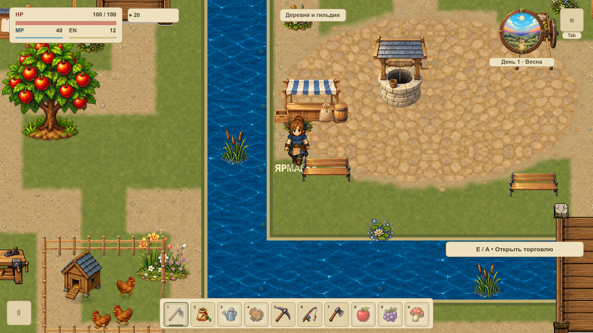
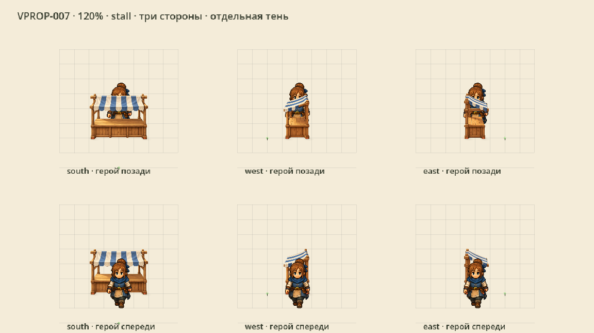
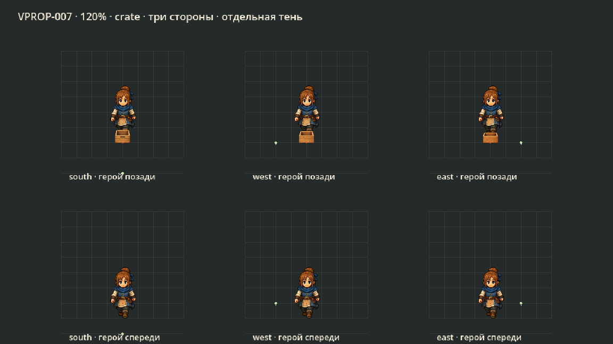
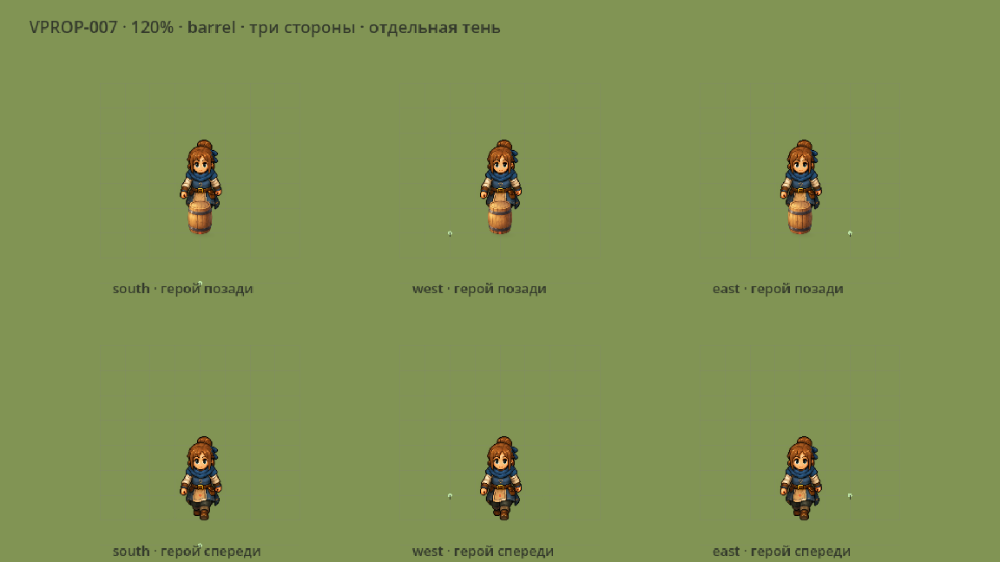
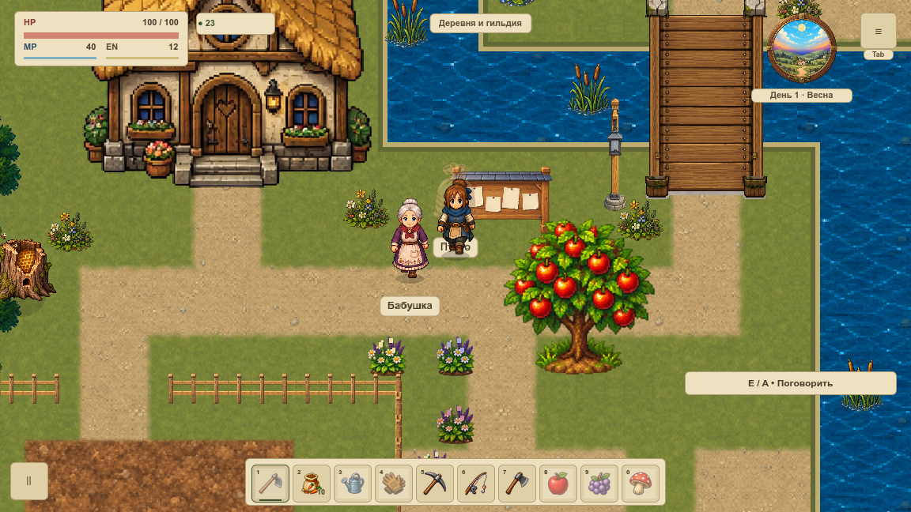

# Ярмарка и торговые припасы

VPROP-007 собирает прежнюю ярмарку `overworld` из четырёх отдельных предметов: прилавок, ящик, бочка и мешок. Новый набор стоит на суше, оставляя прежние услуги и подходы. [Карточка и статус](#/development/tasks/visual--VPROP-007) · [Курс первой локации](visual-pilot.md).

## В игре: до и после

Камера 120%, одинаковый герой, время и состояние мира. Старый составной спрайт заходил к реке; новый прилавок сдвинут вправо на 24px, точка взаимодействия остаётся прежней. Всё вне заменённых областей совпадает побайтно.

## Три стороны и общая плотность

Прилавок и ящик имеют отдельные виды вниз, влево и вправо с прежним светом сверху-слева. Задней стороны нет. Бочка и мешок круглые, без направленных надписей или деталей: три записи намеренно разделяют один рисунок. Восемь runtime-PNG уменьшены из отдельных мастеров; плотность 0.25, без растяжения по отдельным осям. Маленький мешок ярмарки явно имеет масштаб 0.5.

Контактные тени отделены от PNG и используют восемь кешированных meshes. После первого обращения повторные кадры используют готовые текстуры и тени без создания изображений или viewport; холодный старт здесь не измеряется. Тела новых предметов перекрываются героем по положению ног. Красные точки/сетка/зелёный подход присутствуют только в QA-витрине.

## Мешки и услуги сохраняют поведение

Новый мешок используется только в существующем луте первой карты. Коллизия 48×24, содержимое, исходные места, выбор трёх случайных контейнеров, выдача предметов и невозможность повторного получения сохранены. После открытия альфа 0.38 и прежняя подпись «Пусто».

Пять мешков в нативной QA-сцене покрывают все пять возможных мест; штатная генерация остаётся прежней. Услуги лавки и продажи, двери, подходы и взаимодействие ярмарки не переносились. Другие события, типы лута и карты сохраняют старую графику. Ящики/бочки внутри прежнего фасада магазина относятся к будущей ведомости VMAP-001.

## Проверка и ограничения

132PNG/656draw callbacks в двух видимых окнах 1152×648 и 1280×720.149 профильных условий и 11Python-проверок защищают геометрию, полные saves,1200 правил движения, выдачу лута и доказательства. Пауза, дом, соседний район и оба моста входят в серию.

macOS не отдала QA-окнам фокус: в отчёте честно записано 0 кадров с фокусом. Эта статическая сверка подтверждает изображение и сохранность состояния; физический ввод и FPS не принимаются. Весь живой пилот и полная карта до VMAP-003 остаются последующими этапами.

[Нативная сверка](../../docs/reports/visual-overhaul/vprop-007/summary.json) · [Мастера и масштаб](../../docs/reports/visual-overhaul/vprop-007/source.json) · [Промпты](../../docs/reports/visual-overhaul/vprop-007/prompts.json)
