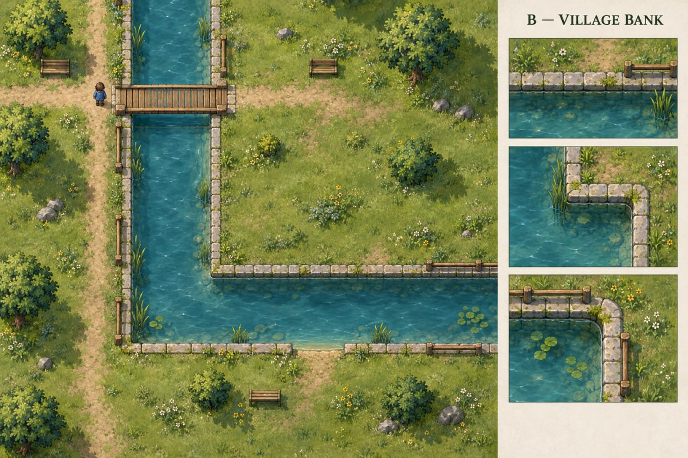
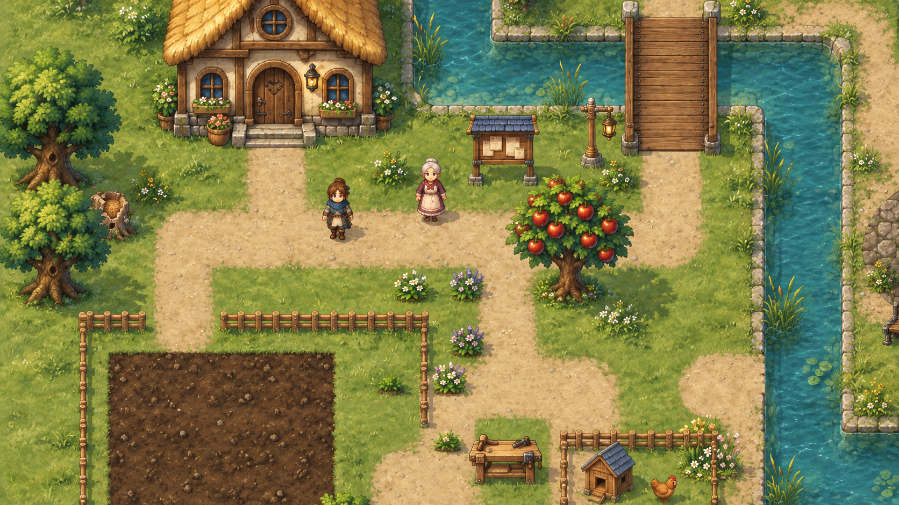
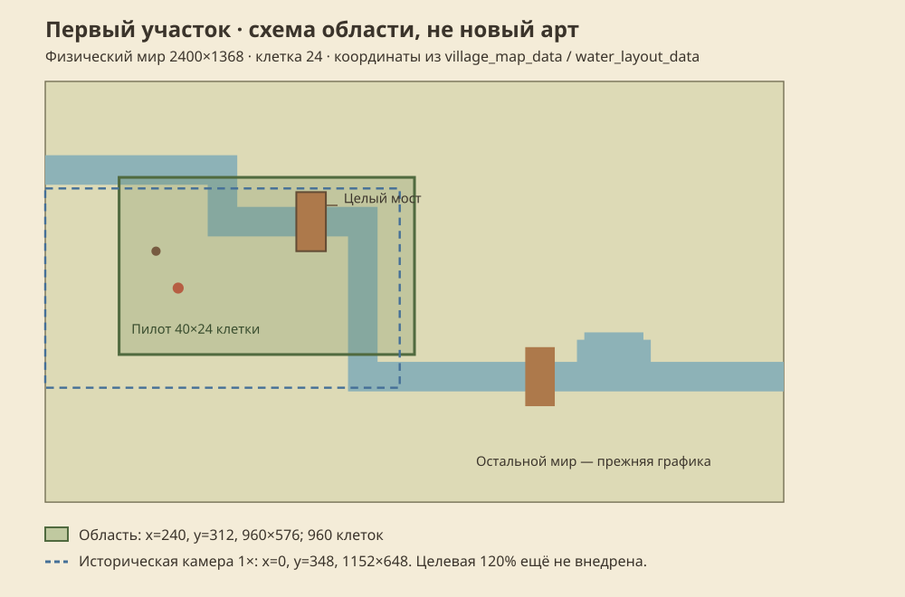

# Первый живописный участок

**Главный курс — первая локация `overworld` целиком, до приёмки VMAP-003.** Маленький пилот проверяет способ сборки; после него оформляем всю набережную, двор, огород, площадь, существующие загоны, фасады, оба моста и края карты. Новые механики, квесты, рецепты, станки и следующие локации ждут; идеи сохраняются в предложениях.

## Художественный ориентир

Все принятые решения, размеры, палитра, экспорт и паспорт сдачи собраны в [пакете художника](artist-packet.md). Он не требует чтения исходников и сохраняет открытыми приёмку нового арта и производительности.

Готов отдельный [комплект низкого берега и широкого моста](shore-kit.md): нарезаемые мастера, три фона, общий масштаб и движение камеры. Перенос на карту и полный набор соседств принимаются следующими карточками.

[Измерительный контракт VPERF-001](performance-contract.md): записана полная новая серия 3×30 с + 600 с, CPU/RSS и настоящие render-интервалы разделены, реальные resize/pause-контроли отклонены. Медиана p95 56,306 мс подтверждает лаги; исправление FPS, GPU timer и длинный маршрут утечек остаются отдельными воротами. Очередь и зависимости берутся из канонических задач.

[VRENDER-001: порядок кадра](render-order.md) фиксирует реальные проходы, координаты и материалы. В двух нативных окнах сохранены 18 пар и 72 snapshot-проверки без изменений; старые перила пока запечены в грунт. Следующие VRENDER выполняются по канонической очереди, а не заменяются новыми механиками.

[VRENDER-002: три способа живой травы](grass-methods.md) сравнила CPU mesh, отдельные CanvasItem и группы по 64. Выбраны группы с общим шейдером: та же картинка и меньше CPU/узлов в стрессовом опыте. 30 коротких запусков, 54 PNG, пауза и snapshots проверены отдельно; это прототип, штатное подключение и FPS ещё не приняты.

[VRENDER-003: земля и вода отдельными проходами](ground-layers.md) подключила разделение существующего покрытия штатной первой карты: один прозрачный статичный кеш, самостоятельная вода позади, игровые часы декора. 64 PNG / 250 draw callbacks, оба моста, холодный fallback и неизменный кеш при движении проверены; новое водное оформление и FPS остаются открытыми.

[VGROUND-001: спокойная бесшовная трава](meadow-base.md) подключила новую подложку первой карты: 48 нативных PNG, повтор 5×5 при 120%, 162 draw-проверки, сохранность навигации/вспашки и неизменный кеш. Дорожные и береговые переходы остаются следующими задачами; FPS этим не принимается.

[VGROUND-003: мягкие края травы и земли](ground-edges.md) отделила покрытие дорожек от цвета: 52 PNG / 162 draw, прямые/выпуклые/вогнутые стыки, два окна, неизменные навигация и вспашка. Кромка воды, новая текстура дороги и стоимость живого мира остаются следующими воротами.

[VGROUND-004: осевые дороги без капсул](axial-roads.md) заменила полукруглые окончания плоскими торцами: 54 PNG / 162 draw, 1 200 точек правил земли и реальные диагональные движения у обоих мостов без изменений. Материалы и стоимость живого мира остаются следующими воротами.

Спокойная вода, видимое дно, низкая оформленная кромка, осевые русло и мост, естественное соседство травы и дороги. Декор оставляет проходы видимыми.

Выбранный рисунок VART-001 **A** остаётся основой. Шейдеры добавляют движение и свет там, где прототип подтверждает качество и допустимую стоимость. Локацию собираем из отдельных ресурсов.

## Эпики в порядке работы

| Шаг | Эпики и карточки | Результат |
|---|---|---|
| 1. Условия и пакет художнику | VBASE-002/005, VCAMERA-002/003/006, VPERF-001, VRELEASE-005; готовые VART/VPIPELINE | Эталон, размеры, оборудование, маршрут и камера, требования к ресурсу |
| 2. Неподвижный пилот | VRENDER-001…004, VGROUND-001/003…010, VSHORE-001, наружные VPROP-002…007 → VRELEASE-002 | Цельные земля, тропы, берег, мост, дерево, фасад и уличные предметы |
| 3. Живой пилот | Нужные VRENDER, VFOLIAGE, VSHORE/WATER, VTREE, VSHADOW, VLIGHT; VCOMPAT/VEDITOR → VRELEASE-003 | Проход героя, ветер, трава, течение, перила, перекрытие, пауза и fallback |
| 4. Стоимость пилота | VPERF-002…010 → VRELEASE-004 | Бюджет, raw замеры, холодный/тёплый вход, длинный цикл, настоящая память |
| 5. План всей первой карты | **VMAP-001** | Зоны, входы/выходы, композиция и ведомость всех видимых ресурсов `overworld` |
| 6. Вся первая карта | VGROUND/VSHORE/VTREE/VPROP и адресные VBUILD/VACTOR/VPLANT из ведомости | Только видимые здесь фасады, персонажи, животные, растения и предметы |
| 7. Свет и атмосфера | **VMAP-002**, нужные VLIGHT/VSHADOW/VWEATHER | День/вечер/ночь, читаемые двери/лут/ресурсы, существующая погода, low-профиль |
| 8. Итог всей локации | **VMAP-003**, VCOMPAT/VPERF и совместимость существующего F12 | Штатный маршрут, оба моста, вход/выход, сохранение, пауза, взаимодействия, три замера и сравнение с эталоном |

Это порядок результатов. Общие системы и безопасность проверяем по мере подключения; перед каждым следующим этапом разворачиваем его зависимости. Полные критерии широкой карточки сохраняются, непроверенная часть остаётся открытой. Проверка старого интерьера как контрольного случая не означает его перерисовку. Массовые 837 карточек всего каталога не становятся условием первой локации: выбираем только её ведомость.

Готовность всей локации означает согласованный рисунок всех зон без растянутых/диагональных крупных объектов, белых краёв, обрезанных силуэтов и прямых цветовых швов; проверенные движение и опоры; сохранность существующих механик; кадры, видео и raw метрики одного commit/preset. До VMAP-003 остальные карты, новый интерьер/пещера и игровые эпики IDEA/FAIR/ECHO/RELIC/CASE/PACK остаются вне реализации. Срочный дефект первой локации исправляется адресно.

## Ближайшая очередь до статичного показа

Переход защищён и зависимостями: стартовые карточки остальных 29 карт и VRELEASE-006/007 теперь ждут VMAP-003. Идеи остаются предложениями; одобрение постановки не отменяет текущий приоритет реализации.

VRELEASE-001 содержит **52 существующие карточки**: при постановке выполнено 24, открыто 28. Это первый участок маршрута до VMAP-003; текущие статусы и следующая доступная карточка показаны в разделе задач.

[Открыть первую очередь](#/development/tasks?queue=village-pilot) · [Только основание](#/development/tasks?queue=village-pilot&stage=foundation) · [Статичный показ](#/development/tasks?queue=village-pilot&stage=static-preview)

## Что покажем сначала

Один участок деревни **40×24 клетки**: трава и земля, осевые тропы со стыками, низкий берег, спокойная неподвижная вода, целый мост с отдельными перилами, одно дерево, лавка и часть фасада с синей крышей A. Тёплая крыша B остаётся принятой для следующих домов. Сетка — 24; область `(240,312,960,576)` помещается в настоящую физическую карту **2400×1368**. Архивный рисунок 2400×1200 не ограничивает физику карты.

Проверяются только наружные предметы VPROP-002…007: герой для масштаба, клетчатая опора и ракурсы влево/вправо/вниз. VPROP-008/009/010 (интерьер, пещерные опоры и общий набор) остаются открытыми вне очереди. Герой, NPC, HUD и механики сохраняют прежний путь в первом показе; адресная новая графика видимых акторов относится к ведомости всей карты после пилота.

Мягкий стиль A, тёплая палитра, естественный край A, ремесленная фактура B и солнце сверху-слева уже выбраны. Штатная первая карта теперь использует 120% по [VCAMERA-006](visual-reference-zoom.md); HUD и остальные карты сохраняют прежний размер. Для старого/нового рисунка потребуется одна и та же явно записанная проекция.

## Как идём по очереди

| Этап | Состав | Результат |
|---|---|---|
| Основание и пакет художнику | 31 карточка, включая уже завершённые VART/VPIPELINE | Оборудование, маршрут, целевая камера 120% и требования к новой партии |
| Первый статичный показ | 21 дополнительная карточки | Модули земли/берега, порядок слоёв, наружные предметы и цельная неподвижная сцена |

[VBASE-002: оборудование](visual-hardware.md) закрепила доступный Mac, framebuffer 1152×648 и отдельный батарейный профиль. Три свежих повтора валидны, но бюджет плавности провален; релизный минимум не подтверждён, масштаб 120% позднее включён и отдельно измерен в VCAMERA-006.

[VBASE-005: маршруты движения](visual-motion.md) сохранила два независимых нативных прохода: 18 точек через жителей, мост, траву и обычную дверь. Все 630 шагов, камера и ввод совпали; четыре настоящих отказа окна, паузы, фокуса и скачка позиции проверены отдельно. В Wiki доступны оба ролика. Съёмка с фиксированными часами исключена из FPS-gate.

[VCAMERA-002: округление камеры](visual-camera-motion.md) выполнена: по шести настоящим роликам при 1152×648, 1920×1080 и Retina 2304×1296 принят вариант B с дробной камерой. [VCAMERA-003: общий кадр](visual-pose.md) тоже выполнена: стопы, тень, камера, перекрытие и корень используют одну отображаемую позицию; шесть новых роликов подтвердили отсутствие межтактовых остановок. Физика и сохранения сохранены, пауза/переносы/F12 проверены. [VCAMERA-006: масштаб 120%](visual-reference-zoom.md) тоже завершена: шесть новых видео и 18 живых запусков, сравнительный предел PASS при сохранённом абсолютном FAIL 60 FPS. VRELEASE-005 и VSHORE-001 впоследствии завершены; текущие статусы и доступный следующий ID берутся из канонического раздела задач. VPERF-001 подготовила воспроизводимый измеритель с полной новой нативной серией; он не принимает FPS новой графики.

Исправлены обходные пути: [VRELEASE-002](#/development/tasks/visual--VRELEASE-002) больше не ждёт общий набор VPROP-010; её зависимости — наружные VPROP-002…007. Эти предметы теперь опираются на принятые VART-004/008, а не на домашние стол/стул/шкаф/сундук VPROP-001. Общая [VPROP-010](#/development/tasks/visual--VPROP-010) получила полный список VPROP-001…009 и сохраняется для дальнейшего каталога. Камера VCAMERA-006 добавлена к основанию. Частичная проверка не закрывает полные критерии широкой карточки.

## Что остаётся следующим

Стыки дорог VGROUND-005 дополнительно ждут осевую форму тропы VGROUND-004. Это исключает показ новых красивых стыков поверх старых капсульных концов. Крупные биомные цветовые пятна VGROUND-002 остаются вне первого показа.

Все 25 графических эпиков учтены. Основание и статика входят в очередь; ветер/контакт растений, деревья, тени, свет, редактор и совместимость готовят последующее живое включение. Новая погода, боевые эффекты, общий rig и полный редизайн UI сейчас не требуются. 837 производственных карточек предметов, акторов, культур, зданий и карт ждут принятого пилота.

WATER сохраняет единственную физическую геометрию русла. OPT/QA/UX сохраняют собственные критерии; живой мир, истории, ECHO/FAIR/RELIC/CASE и PACK не расширяются ради картинки. Место им предусмотрено в будущей проверке перекрытия, паузы, сохранения и игровых инвариантов.

| Ворота | Что ещё нужно принять |
|---|---|
| Движение · VRELEASE-003 | Отдельно развёрнутая очередь зависимостей, видео, вода, ветер, корни, перекрытие, обычный вход и пауза |
| Стоимость · VRELEASE-004 | Устройство/preset, raw интервалы, p95/p99/max, холодный/тёплый вход, настоящая память и fallback |
| Вся первая локация · VMAP-001…003 | Ведомость, сборка всей карты, атмосфера, штатный маршрут и бюджет |
| Интерьер/пещера · VRELEASE-006/007 | Откладываются до приёмки VMAP-003 |
| Массовый перенос/выпуск · VRELEASE-010 | Каталог, происхождение ресурсов, реальные export/F12 и функциональная приёмка |

Старый слот нового пилота (**VCOMPAT-002**), штатный вход (**VRELEASE-003**) и откат (**VCOMPAT-010**) пока **открыты**. Настоящий код игры и production-ресурсы этой задачей не изменены. Схема выше — план области; она не является новым игровым дизайном или замером FPS.

## Проверяемая исходная точка

Сохранённая нативная пара VPIPELINE-010 — прежняя деревня из source и export-pack при одном состоянии, пиксель в пиксель. Камера `(0,348)`, герой `(432,672)`, framebuffer 1152×648, день 1, 12:00, clear/spring, seed 20261015, симуляция заморожена. Пакет закреплён commit `12e6e2c7…`; эти кадры не принимают ни новый 120%-масштаб, ни живую память.

Агенту: [область и решения JSON](../../docs/reports/visual-overhaul/vrelease-001/plan.json), [полный порядок без дублирования статусов](../../docs/reports/visual-overhaul/vrelease-001/queue.json), [подписи исходной нативной пары](../../docs/reports/visual-overhaul/vrelease-001/reference.json). `python3 tools/pilot_rollout.py --next` показывает те же блокеры. Изменение графа требует обновить очередь и Wiki; смена обычных статусов обновляет прогресс без второго реестра.

[VGROUND-005: соединения дорожной сети](road-junctions.md) объединяет ширину/UV и покрытие основных и выходных ветвей без двойной альфы. 68 PNG / 210 draw, прежние правила земли; новая площадь и живой бюджет остаются открытыми.

[VGROUND-006: площадь и грунт](plaza-ground.md): спокойный известняк, светлая земляная кромка, контакт и 22 обломка. 74 PNG / 242 draw, герой/лут и прежние правила земли проверены; стоимость и VMAP-003 остаются открытыми.

[VGROUND-007: огород и влажная почва](garden-soil.md): новая земля, горизонтальные борозды, влажность без красных капель и светлой сетки. 70 PNG / 242 draw, прежние клетки и полный цикл выращивания сохранены; VPERF и VMAP-003 открыты.

[VGROUND-008: декор и свободные проходы](decoration-exclusions.md): ограничитель запасного посева и ручной приоритет; штатная первая сцена не получает новой травы.
