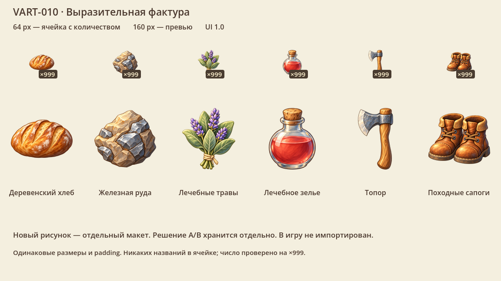

# Новая графика: от исходника до игры

Мы переходим к мягкой живописной 2D-графике. Старые изображения продолжают обслуживать игру, пока новое семейство не подготовлено и не проверено в настоящем кадре. Один красивый большой рисунок ещё не является игровым набором.

## Художественное направление

Приняты мягкие формы A, близкий масштаб 120%, тёплая палитра A, естественный край и ремесленная фактура B. Свет приходит сверху-слева; объём, контактная тень и падающая тень рассматриваются отдельно. У мебели и станков три основных ракурса: влево, вправо и вниз к игроку, с привязкой к сетке и сохранением пропорций.

Для иконок принят выразительный материал B. Маленькая иконка 64×64 и большое превью 160×160 подготавливаются отдельно. Этот выбор зафиксирован в VART-010, но сам набор пока остаётся художественным эталоном.

## Где хранятся файлы

| Назначение | Папка | Как используется |
|---|---|---|
| Концепты и сравнения | `docs/concepts/`, `docs/design/`, `docs/reports/` | Отдельные страницы и отчёты; всё дерево `docs/` закрыто от импорта |
| Новые мастер-исходники | `assets/source/` | Полные исходники и промежуточные экспорты; `.gdignore` |
| Исторические входные материалы | `assets/inbox/`, три старые папки `source/` | Остаются на прежних путях для инструментов; `.gdignore` |
| Превью и результаты разработки | `assets/generated/` | Снимки и регрессионные эталоны; `.gdignore` |
| Старые временные захваты | `tmp/` | Временные PNG также закрыты от импорта |
| Рабочие игровые изображения | `assets/game/` | Готовые ресурсы, импортируемые Godot |
| Сайт | `wiki/` | Отдельная сборка; `.gdignore` |

Имя файла само по себе ничего не доказывает: некоторые действующие листы героя называются `walk_master.png`. Они действительно используются игрой и остаются импортируемыми. Не следует автоматически вырезать из проекта все файлы со словом `master`.

## Что выполнено в VPIPELINE-001

Проверка границ следит за обязательными барьерами, повреждёнными игровыми изображениями, статическими ссылками в исходники и отсутствующими runtime-файлами. Исключения для снимков и сырого чтения регрессионных эталонов перечислены явно. Эти исключения не разрешают импортировать концепт через `load` или `preload`.

Каталог редактора F12 учитывает `.gdignore`, включая прямое открытие вложенной папки. Исходники больше не попадают туда через собственный обход каталогов. Инструменты по-прежнему могут читать диагностические JSON, Markdown и PNG напрямую с диска.

В начальном локальном индексе Godot было 1784 текстуры, в итоговом — 1179. Первый проход исключил 484 изображения из неигровых папок и 25 старых корневых превью. Дополнительный аудит выявил ещё 94 временных PNG в `tmp/` и два превью травы среди тайлов: второй проход уменьшил индекс с 1275 до 1179. Все 27 перенесённых превью сохранены с квитанциями, без удаления. Байты 2398 игровых файлов и профилей импорта сохранены. Это аудит импорта, а не измерение FPS или уменьшения готового релиза.

## Порядок подготовки следующего семейства

1. Сохранить мастер отдельно от `assets/game/` и записать происхождение.
2. Подготовить игровые размеры и необходимые ракурсы. Сохранять сетку, опоры и пропорции.
3. Проверить нарезку, прозрачность, края, настройки импорта и ссылки.
4. Сравнить настоящий кадр при одинаковой камере и конфигурации.
5. Перенести готовые файлы, выполнить профильные и общие проверки, обновить документацию и опубликовать отдельный коммит.

VPIPELINE-002 добавила [паспорт ресурса и пилот трёх ракурсов стола](visual-resources.md). VPIPELINE-003 подключила [адресную фильтрацию семейств](visual-sampling.md). VPIPELINE-004 подготовила [поля и независимые уровни миниатюр](padded-atlases.md). Цветовые/data-текстуры и расширенные проверки краёв остаются задачами VPIPELINE-005–008. Лицензии и безопасная миграция также имеют свои карточки. Барьеры папок не заменяют эти проверки.

Следующий возможный шаг процесса описан в [IDEA-001](IDEA-001.md). Это предложение, которое потребуется реализовывать отдельно.

## Проверка разработчиком

`python3 tools/run.py assets.contracts.visual_pipeline` и `python3 tools/run.py assets.contracts.test_visual_pipeline` проверяют границы и отрицательные сценарии. Профиль Godot — `tools/assets/contracts/visual_pipeline_review.gd`. Все проверки входят в общий gate. Перед публикацией выполняются `TESTING.md` и `pnpm check` для Wiki.

Правило исключения папок описано в [официальной документации Godot](https://docs.godotengine.org/en/stable/tutorials/best_practices/project_organization.html). `.gitignore` управляет Git, а `.gdignore` управляет импортом Godot; содержимое `.gdignore` не задаёт шаблоны имён.
